# 物料中心使用手册

**适用版本**：2026-10-30（含标准名称查重、编码自动缩写、来源单据联动）  
**适用读者**：物料查询使用者、物料提报人员、物料维护人员、物料审核人员、仓库基础维护人员  
**示例与截图**：本文示例来自演示环境（测试公司），截图存放在 [`evidence/materials/`](evidence/materials/)。示例数据只用于说明操作，生产环境请以真实资料为准。

> 一句话理解：**标准名称**回答“这是什么”，**属性模板**回答“按什么规格描述”，**SKU** 回答“具体是哪一种”。SKU 审核启用后，采购、销售、领用和仓库共同引用同一个档案。

## 0. 三个最常见的使用路径

| 你现在的情况                | 从哪里开始                         | 完成标志                         |
| --------------------------- | ---------------------------------- | -------------------------------- |
| 规格明确，要建一个新物料    | 属性模板 → 标准名称 → 新建物料 SKU | SKU 审核启用，在物料中心能检索到 |
| 目录里找不到需要的物料      | 物料申请 → 提交审核 → 办理         | 关联一个已启用 SKU 并办结        |
| 采购/领用单据里有一行不认识 | 在明细行“提报物料治理”             | 来源行确认物料，单据重新提交     |

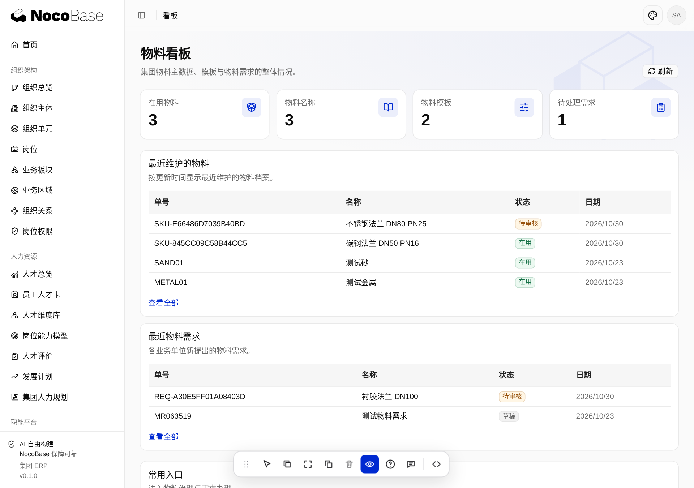

_图 1：物料看板。指标卡显示在用物料、标准名称、属性模板和待处理需求；下方是最近维护的物料和最近物料需求。_

## 1. 这个模块解决什么问题

物料中心统一回答四个问题：**这是什么物品、具体是哪一种规格、用什么单位、原来的叫法对应什么**。同一种物料只建立一份集团身份，后续采购、销售、领用和仓库共同引用，避免各部门各建一套。

目前可以完成两条主数据流程：

- **资料已明确**：建立标准名称及必要的属性模板 → 建立具体 SKU → 独立审核启用 → 在目录中查询、复用。
- **资料不明确**：提报物料申请 → 维护/审核人员核对 → 关联已有 SKU，或建立并审核新 SKU → 办结申请 → 提报人查看结果与历史。

**边界要分清：**

- 物料申请是“建码或识别物料”的治理任务，**没有需求数量**，不会触发采购、领用、入库、出库或库存变化。
- 物料中心维护的是“身份资料”；数量、批次、库位、出入库由仓库执行模块承接。
- 采购/领用单据里的来源行联动，解决的是“这一行到底对应哪个 SKU”，不是替代采购或领用流程本身。

## 2. 入口、菜单与角色

进入方式：**职能平台 → 物料中心**；仓库基础资料在 **仓库管理 → 仓库设置**。菜单和按钮随权限显示，没有权限的页面不会出现。

| 菜单         | 路径                                             | 用来做什么                                      |
| ------------ | ------------------------------------------------ | ----------------------------------------------- |
| 看板         | `/functions/warehouse/materials/overview`        | 指标、最近物料、最近需求、待办入口              |
| 物料中心     | `/functions/warehouse/materials`                 | SKU 列表；新建、查询、维护具体规格              |
| 标准名称     | `/functions/warehouse/materials/names`           | 统一业务名称，关联属性模板                      |
| 属性模板     | `/functions/warehouse/materials/templates`       | 定义规格字段、必填项和身份属性                  |
| 计量单位     | `/functions/warehouse/materials/units`           | 计量类型与数量小数位                            |
| 包装与换算   | `/functions/warehouse/materials/unitRules`       | 按 SKU 维护固定包装比例，需审核                 |
| 别名与旧码   | `/functions/warehouse/materials/references`      | 别名、历史编码与标准名称/SKU 的对应关系，需审核 |
| 标签字典     | `/functions/warehouse/materials/tags`            | 维护标签及适用范围                              |
| 标签关联     | `/functions/warehouse/materials/tagLinks`        | 把标签关联到名称或 SKU                          |
| 物料申请     | `/functions/warehouse/materials/requests`        | 提报缺失物料、办理、关联 SKU 办结               |
| 公司物料设置 | `/functions/warehouse/materials/subjectSettings` | 设置各公司允许采购、允许销售的 SKU              |
| 治理记录     | `/functions/warehouse/materials/history`         | 只读审计：谁在什么时候改了什么                  |
| 仓库设置     | `/functions/warehouse/settings/warehouses`       | 仓库所属主体与责任岗位                          |

**人员分工（按职责理解，不要求角色名称完全一致）：**

| 人员               | 主要工作                                                 | 需要注意                                                 |
| ------------------ | -------------------------------------------------------- | -------------------------------------------------------- |
| 物料查询使用者     | 搜索已启用 SKU，查看规格、单位、包装、全局别名与标签     | 不维护主档，不审核；通常只看到已启用资料                 |
| 物料提报人员       | 查询目录、提报缺失物料、维护自己的申请草稿、撤回申请     | 申请提交和撤回仅限本人；默认只能看到本人申请             |
| 物料维护人员       | 建立模板、名称、SKU、包装、别名和标签，提交审核          | 建档不等于审核启用                                       |
| 物料审核人员       | 审核 SKU、包装、别名，退回资料，办理物料申请             | 不能审核自己创建的记录，也不能审核自己提报申请产生的 SKU |
| 本公司仓库基础维护 | 维护公司仓库及责任岗位                                   | 不代表获得物料主档维护权或库存操作权                     |
| 管理员             | 分配页面权限、操作权限和数据范围（本人/本公司/指定公司） | 页面可访问与资料可操作是两层授权                         |

几个容易踩的权限点：

- **看不到“新建”按钮**：先核对页面访问权限和对应资料类型的操作权限。
- **“物料中心”列表只有已启用资料**：说明你只有目录查询权限，没有 SKU 维护权限；草稿和待审核资料不会出现在目录模式。
- **有账号但没有任职**：可能没有“可选公司”，申请、仓库等按主体归属的功能无法正常选择。
- **审核人看不到“审核启用”**：检查是否拥有对应资料类型的审核权，以及当前记录是否处于待审核状态。

## 3. 先理解几个概念

| 概念         | 示例                             | 用途                                        |
| ------------ | -------------------------------- | ------------------------------------------- |
| 标准名称     | 法兰                             | 一类物品的统一名称，也是 SKU 的归属         |
| 属性模板     | 材质、公称直径、压力等级         | 规定规格填什么、哪些差异区分物料身份        |
| 具体 SKU     | 碳钢法兰 DN50 PN16，基本单位“个” | 业务实际引用的物料档案                      |
| 计量单位     | 个、千克、米、盒                 | SKU 的基本单位，以及包装换算的基准          |
| 包装与换算   | 该 SKU 每盒 12 个                | 描述固定包装比例，需独立审核                |
| 别名与旧码   | “DN50 法兰”、历史物料编号        | 把不同叫法引导到标准名称或具体 SKU          |
| 标签         | 管道配件                         | 多重归属和筛选，不替代规格、权限或数量规则  |
| 公司物料设置 | 测试公司允许采购这个 SKU         | 保存公司级使用开关，不另建一份公司专属 SKU  |
| 物料申请     | 衬胶法兰 DN100                   | 建码/识别物料的治理任务，办结时关联启用 SKU |

对象关系如下：

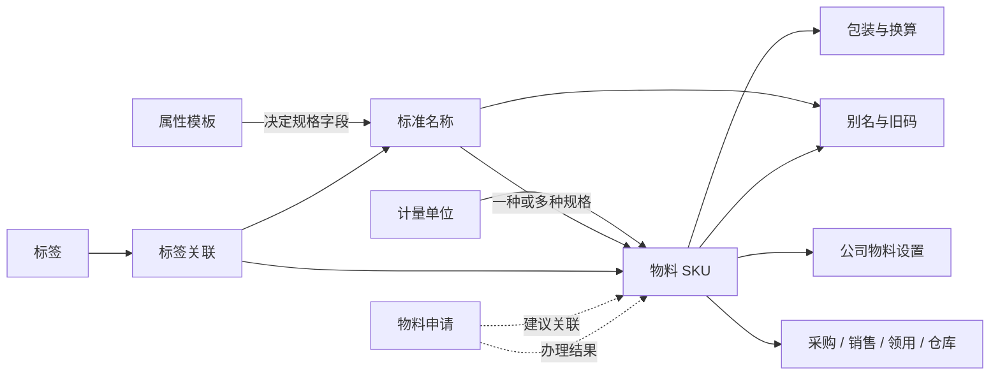

**身份规则（决定“算不算同一种物料”）：**

- 属性模板里的每个字段可以勾选 **身份属性**。同一标准名称下，所有身份属性的组合相同，就视为同一个 SKU，不能重复建立。
- 不勾身份属性的字段（如示例中的壁厚）只作说明，不参与判重；壁厚 4.5 和 5.0 不能靠这个字段区分成两个 SKU。
- 标准名称没有关联模板时，同一名称下只能有一个 SKU，因为没有任何规格可以区分身份。
- 品牌、等级、型号是否要区分，先按验收和实际替代关系决定，再配置为身份属性。**不要只把差异写在备注里。**

## 4. 状态、审核与职责分离

### 4.1 状态

| 资料类型                                                         | 状态流转                                                            | 说明                                   |
| ---------------------------------------------------------------- | ------------------------------------------------------------------- | -------------------------------------- |
| SKU、包装与换算、别名与旧码                                      | 草稿 → 待审核 → 已启用 → 已停用；待审核可退回草稿；已停用可重新启用 | 审核启用后才对业务可见                 |
| 物料申请                                                         | 草稿 → 待审核 → 已办结；待审核可退回草稿；草稿/待审核可撤回（终态） | 必须关联已启用 SKU 才能办结            |
| 标准名称、属性模板、计量单位、标签、标签关联、公司物料设置、仓库 | 创建即启用，可停用/重新启用                                         | 不经过独立审核，但被引用后关键字段冻结 |

### 4.2 动作与权限

| 动作            | 适用资料                         | 通常需要的权限                     | 限制                               |
| --------------- | -------------------------------- | ---------------------------------- | ---------------------------------- |
| 提交审核        | 草稿状态的 SKU、包装、别名、申请 | 修改（update）                     | 物料申请的提交仅限提报人本人       |
| 退回修改        | 待审核资料                       | 审核（review）                     | 退回后回到草稿，修改后重新提交     |
| 审核启用        | 待审核的 SKU、包装、别名         | 审核（review）                     | 不能审核自己创建的记录             |
| 停用 / 重新启用 | 受控资料与基础资料               | 按页面授权（受控资料通常为审核权） | 停用前必须先处理有效引用           |
| 关联 SKU 并办结 | 待审核的物料申请                 | 审核（review）                     | 只能选择已启用的 SKU，必须填写原因 |
| 撤回申请        | 草稿或待审核的申请               | 修改（update）                     | 仅提报人本人；撤回是终态           |
| 编辑说明        | 已启用的 SKU                     | 修改（update）                     | 只能改名称、备注；编码不变         |

**职责分离：**

- 任何资料都**不能由创建人自己审核启用**。
- SKU 审核还会排除：该 SKU 所关联物料申请的提报人、来源处理人（含被转办人）。系统会提示“不能审核自己创建或自己申请产生的 SKU”。
- 申请退回不等于审核通过；退回后由提报人补充内容再提交。
- 每次编辑、提交、退回、审核、停用、办结都会写入治理记录，保留操作人、时间、原因和字段差异。

## 5. 第一次启用：按这个顺序准备

1. **确认真实组织与权限。** 公司和岗位沿用组织模块，人员任职沿用人事，不在物料中心重复建立。
2. **检查计量单位。** 系统初始化了个、件、支、千克、吨、米、平方米、立方米、盒、箱、包共 11 个常用单位。按需调整数量小数位，避免建立同义重复单位。
3. **准备标签（可选）。** 在标签字典统一维护检索和归属标记。
4. **先建立属性模板。** 有多规格的物品，先确定属性、类型、必填项和身份属性，再让标准名称引用模板。
5. **建立标准名称。** 填写统一名称，按需要选择模板。输入名称时系统会提示相似/同名名称，先确认是否已有档案。
6. **建立具体 SKU 并审核。** 选择标准名称、基本单位、管理方式，填写规格属性，创建后提交审核，由另一位人员审核启用。
7. **按需补充包装、别名、标签和公司设置。** 包装和别名需要另外提交、审核；SKU 审核不会自动审核这些关联资料。
8. **维护仓库（按需）。** 仓库选择真实主体及其下责任岗位，责任岗位必须属于同一主体。

**最小可用档案是“标准名称 + 基本单位 + 启用 SKU”。** 需要区分多个规格时，应在创建 SKU 前把模板设计好。标签、别名、包装、公司设置和仓库不是每个 SKU 建档的强制前置步骤。

## 6. 主流程 A：从模板到启用一个 SKU（法兰示例）

下面用“法兰”示例完整走一遍。演示数据包含一个标准名称“法兰”、一个属性模板“法兰规格”，以及 SKU“碳钢法兰 DN50 PN16”。

### 6.1 设计属性模板

在“属性模板”点击“新建属性模板”，填写模板名称，逐行添加属性。示例模板“法兰规格”的字段如下：

| 属性标识  | 显示名称 | 类型     | 单位 | 必填 | 身份属性 | 可选值       |
| --------- | -------- | -------- | ---- | ---- | -------- | ------------ |
| material  | 材质     | 枚举选项 | —    | 是   | 是       | 碳钢、不锈钢 |
| dn        | 公称直径 | 数值     | mm   | 是   | 是       | —            |
| pn        | 压力等级 | 枚举选项 | —    | 是   | 是       | PN16、PN25   |
| thickness | 壁厚     | 数值     | mm   | 否   | 否       | —            |

身份组合是“材质 + 公称直径 + 压力等级”；壁厚不参与判重。因此：

- 碳钢 / DN50 / PN16 / 壁厚 4.5 与 碳钢 / DN50 / PN16 / 壁厚 5.0 是**同一个物料身份**，不能建成两个 SKU。
- 碳钢 / DN50 / PN16 与 不锈钢 / DN80 / PN25 是**不同的 SKU**。

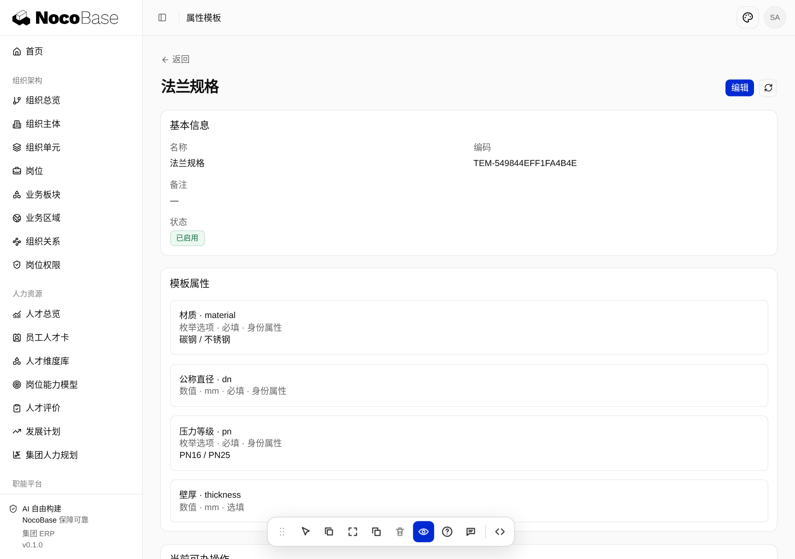

_图 2：模板详情。每项显示“显示名称 · 标识”、类型、单位、必填/选填、是否身份属性，枚举字段还会列出可选值。_

模板保存时会校验：属性标识唯一、枚举类型必须至少有可选项。**模板被标准名称引用后，字段结构不能原位修改**；名称一旦有了 SKU，也不能再更换模板。需要调整时，先评估已有名称和 SKU，必要时新建模板和新档案。

### 6.2 建立标准名称，并利用查重提示

在“标准名称”点击“新建标准名称”，输入统一名称，选择属性模板。输入“法兰”时，表单下方会出现相似名称提示：

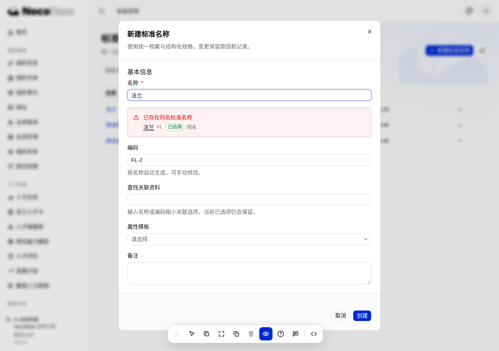

_图 3：输入“法兰”后提示“已存在同名标准名称”，并列出已有记录、编码、状态和原因；编码自动生成 FL-2。_

- **同名 / 名称包含 / 名称相近** 都是提示，不是禁止：系统允许继续创建，但应先确认是否真的需要新名称。
- 查重从输入 2 个字符开始，停止输入约 0.35 秒后触发；只检索标准名称，不检索别名。
- 编码默认按名称自动生成大写缩写：中文取拼音首字母，英文按单词首字母，数字保留；如“法兰”得到 `FL`，编码冲突时自动加 `-2`、`-3`。编码可以手动修改，但创建后保持固定。

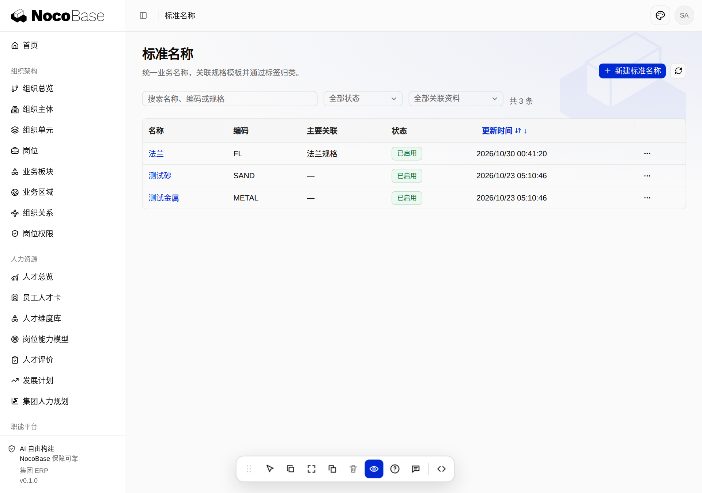

_图 4：标准名称列表。“主要关联”列显示引用的模板，状态通常为已启用。_

### 6.3 建立具体 SKU

回到“物料中心”，点击“新建物料 SKU”。关键填写顺序：

1. **名称**：建议能看出规格，如“碳钢法兰 DN50 PN16”。名称是显示名称，不参与身份判重。
2. **标准名称**：选择“法兰”。选择后，表单会按模板显示“规格属性”。
3. **基本单位**：选择“个”。基本单位创建后不能直接改。
4. **管理方式**：库存物料 / 非库存物料。它目前只是档案管理方式，**不产生数量账**。
5. **规格属性**：按模板填写材质、公称直径、压力等级；壁厚选填。
6. **编码**：可留空，系统按规则自动生成；手工编码只允许大写字母、数字、点、下划线和连字符。

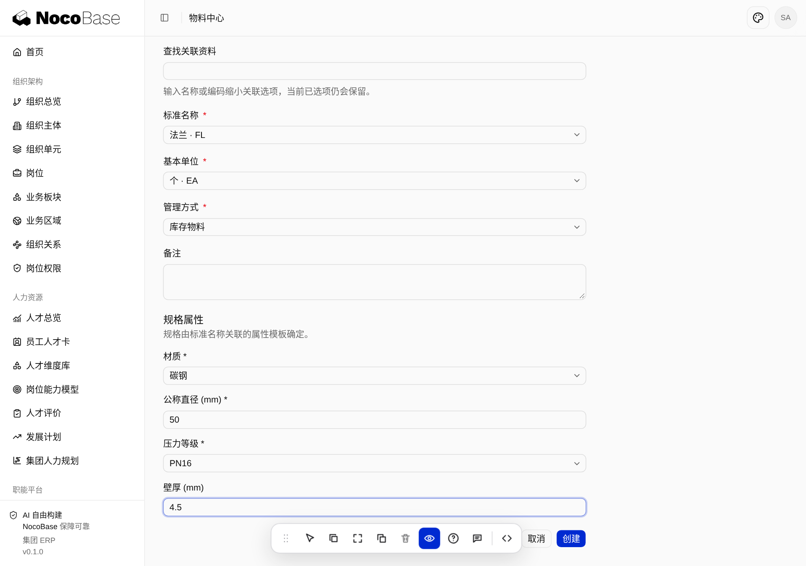

_图 5：新建 SKU。标准名称选择后，规格属性由模板自动生成；必填字段带 `*`，数值字段按小数精度录入。_

创建后先得到**草稿**。草稿可以修改；确认无误后进入详情，点击“提交审核”并填写原因。

### 6.4 提交审核与审核启用

提交后状态变为**待审核**。审核人员打开详情，会在“当前可办操作”看到“退回修改 / 审核启用”：

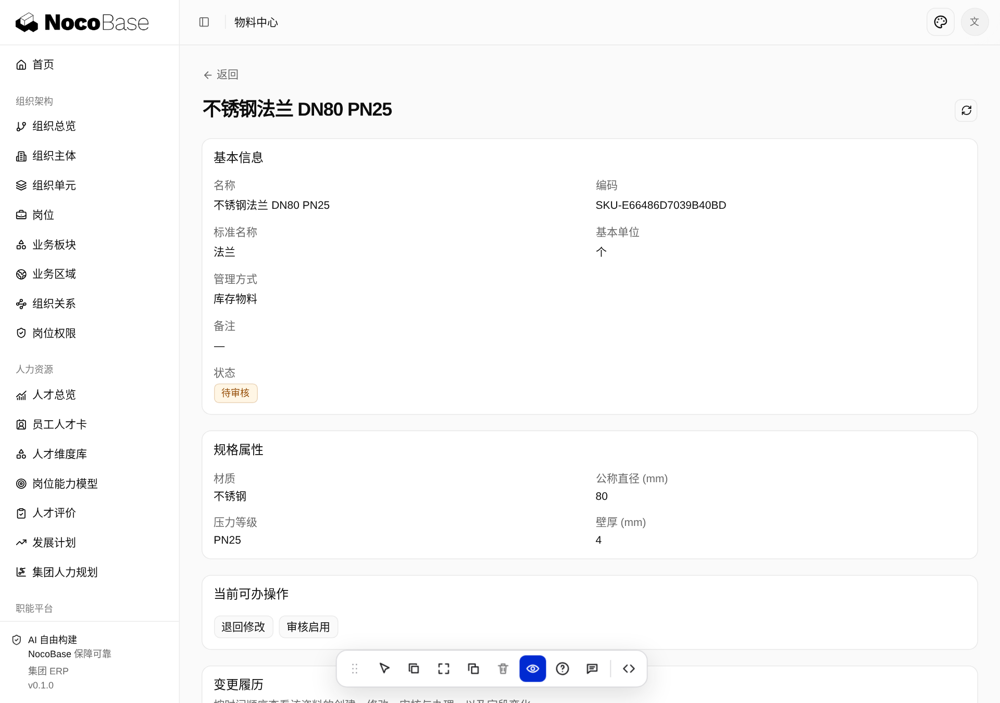

_图 6：审核人视角。待审核 SKU 显示完整规格，底部提供退回和审核启用两个动作。_

点击“审核启用”后，在动作对话框核对信息、填写操作原因：

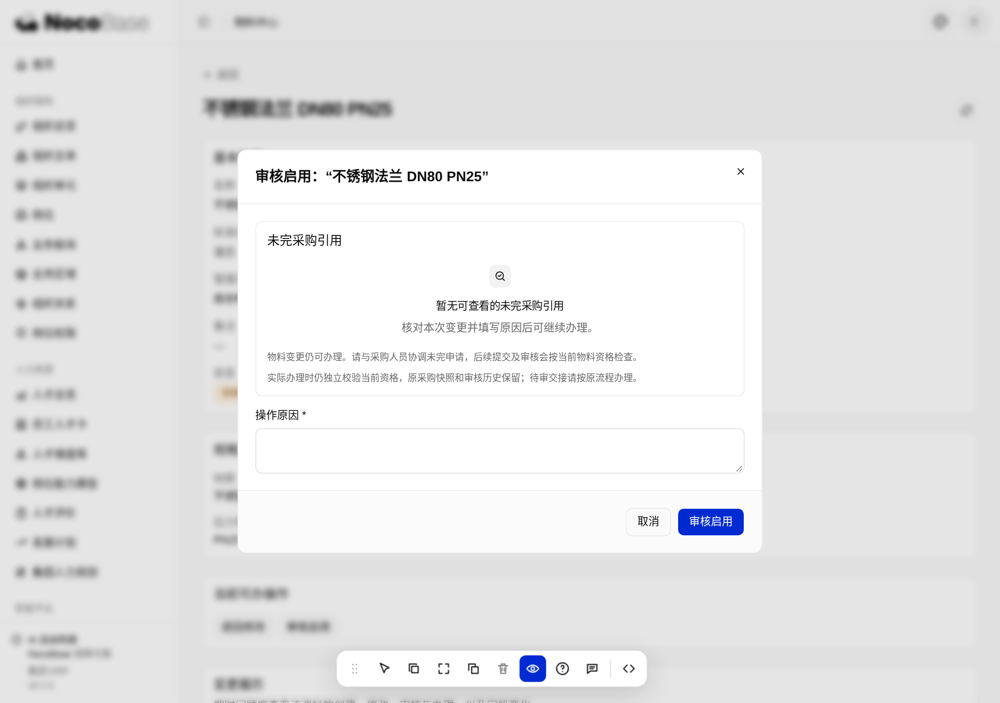

_图 7：审核启用对话框。若有未完成的采购引用，会先提示核对；操作原因必填。_

审核时系统会重新检查：标准名称和基本单位是否仍为启用、模板必填属性是否齐全。信息不足就“退回修改”，由维护人员补充后重新提交。

**不能审核自己创建的记录**；SKU 还不能由关联申请的提报人或来源处理人审核。

### 6.5 启用后补充包装、别名、标签和公司设置

SKU 启用后，在详情页可以看到规格、单位、包装、别名和标签：

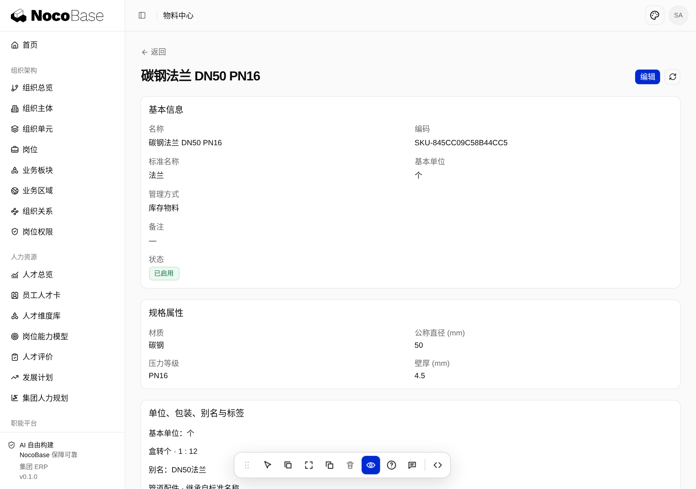

_图 8：已启用 SKU 详情。基本信息、规格属性、单位/包装/别名/标签分区展示；包装显示为“盒转个 · 1 : 12”。_

这些关联资料各自独立：

- **包装与换算**：草稿 → 提交 → 审核启用。示例“盒转个”表示 1 盒 = 12 个。
- **别名与旧码**：草稿 → 提交 → 审核启用。示例“DN50法兰”映射到标准名称“法兰”。
- **标签关联**：创建即生效；名称上的标签会在 SKU 详情继承显示。
- **公司物料设置**：创建即生效；决定该公司在采购/销售选料和入库/出库准入时能否使用该 SKU。

### 6.6 在列表和目录中确认结果

启用后的 SKU 会出现在“物料中心”列表：

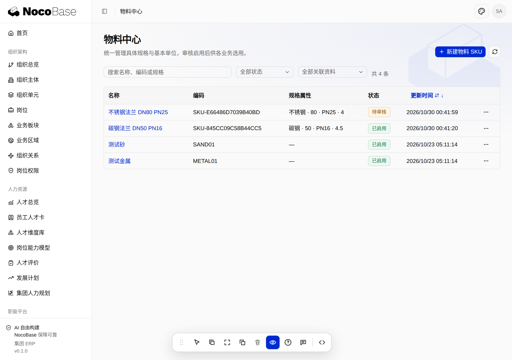

_图 9：物料中心列表。可按名称、编码、规格搜索，按状态和关联资料筛选；列表默认每页 20 条。_

只有目录查询权限的人看到的是**目录模式**：只显示已启用 SKU，不显示草稿和待审核资料，也不能新建。维护人员则能看到全部状态。

## 7. 主流程 B：提报并办结物料申请（衬胶法兰 DN100）

### 7.1 提报

在“物料申请”新建，或在目录空结果时点击“提报缺失物料”。填写：

- 名称（必填）
- 所属主体（必填）
- 规格需求（写清尺寸、型号、材质、等级等判别信息）
- 建议单位、用途、备注（按需）

保存后是**草稿**；检查无误后“提交审核”，填写原因。**提交和撤回只有提报人本人可以操作**；撤回后为终态，再需要应新建申请。

物料申请不填写“采购 100 件”“本次领用 5 盒”等数量。数量属于采购/领用单据，不属于建码申请。

### 7.2 办理：退回或办结

审核人员打开待审核申请，会看到“当前可办操作”和“办理物料申请”卡片：

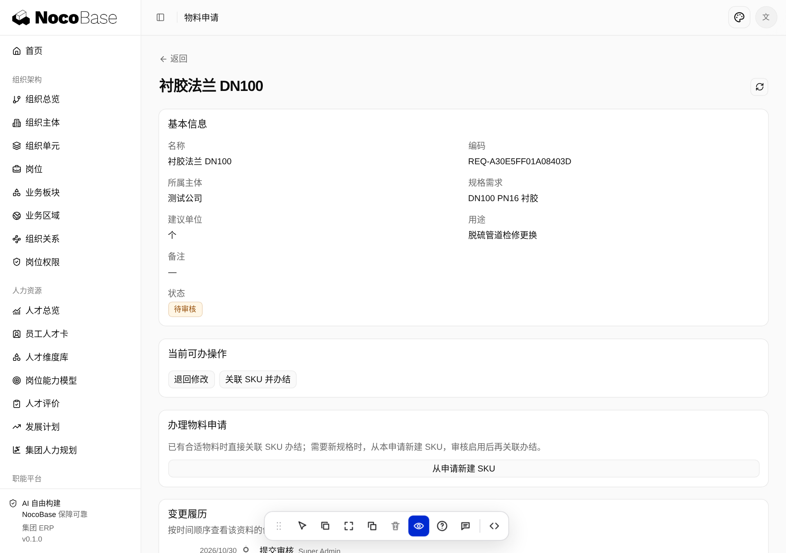

_图 10：待审核申请。上方是提报内容；中部是退回/关联办结；具备 SKU 维护权限时，下方可直接“从申请新建 SKU”。_

- **信息不足**：点击“退回修改”，说明缺什么；申请回到草稿，提报人补充后重新提交。
- **已有合适 SKU**：点击“关联 SKU 并办结”，选择一个**已审核启用**且实际符合需求的 SKU，填写原因后提交。

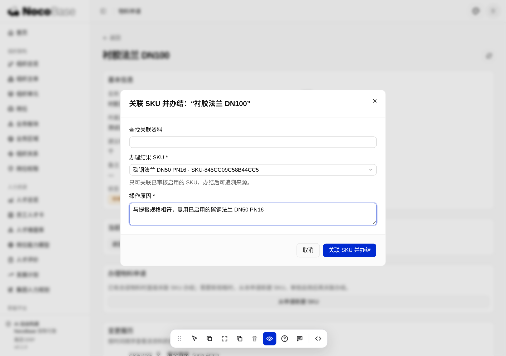

_图 11：关联 SKU 并办结。只能选择已启用 SKU；选择后显示名称、编码和状态；原因必填。_

办结后申请变为**已办结**，详情保留办理结果和治理历史：

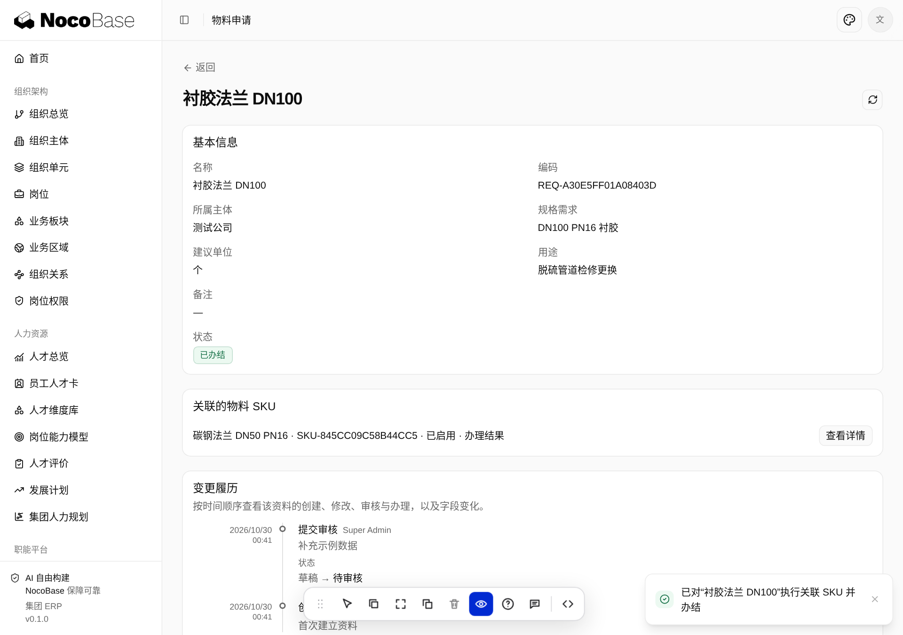

_图 12：已办结申请。状态为已办结，关联物料显示“已启用 · 办理结果”，可继续查看 SKU 详情。_

一个申请最终只关联一个 SKU。多种独立物料应分别提报，不能用一条申请代替多行采购明细。

### 7.3 需要新规格：从申请新建 SKU

如果现有 SKU 都不符合需求：

1. 在申请详情点击“从申请新建 SKU”（需要 SKU 维护权限）。
2. 按申请中的名称、规格和单位建立 SKU；系统保留“建议关联”，但不会自动办结申请。
3. 提交并审核启用 SKU。审核人不能是该 SKU 的创建人、申请提报人或来源处理人。
4. **再回到原申请执行“关联 SKU 并办结”。** 建 SKU、审核启用都不会自动办结申请。

## 8. 来源单据联动：采购/领用明细治理

当采购申请或领用申请里有一行“不知道对应哪个物料”时，可以在来源单据中发起治理，不必重新录入一遍需求。流程如下：

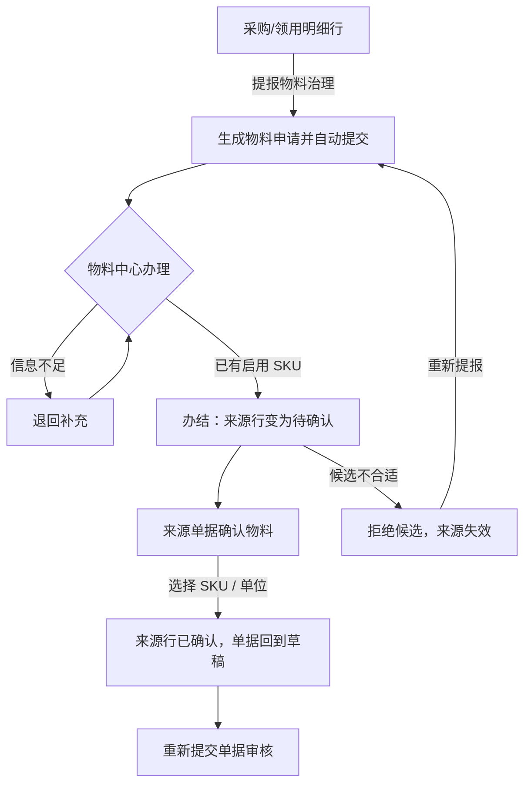

**来源状态：**

| 状态   | 含义                   | 下一步                       |
| ------ | ---------------------- | ---------------------------- |
| 治理中 | 物料中心正在办理       | 等待办结或退回               |
| 待补充 | 物料中心退回了来源     | 回来源单据补充内容后重新提报 |
| 待确认 | 已给出候选 SKU         | 来源单据确认物料或拒绝候选   |
| 已确认 | 来源行已采用具体物料   | 单据回到草稿，重新提交审核   |
| 已失效 | 候选被拒绝或来源被撤销 | 需要时重新提报               |

**两个方向的操作：**

- **物料中心侧**：可以“接手办理”（变更当前办理人）、退回补充、选择启用 SKU 办结。来源申请的内容不能直接改写，必须回原单据修改后重新提报。
- **来源单据侧**：对“待确认”的候选执行“确认物料”，选择 SKU 以及单位/包装；也可“拒绝候选”。确认后来源行固定物料，单据回到草稿并结束未完成的审核，**必须重新提交审核**。
- **附件**：来源明细只把“明确分享给物料治理”的附件提供给物料中心查看，未分享的附件不可见。

独立创建的物料申请（没有来源单据）不受“回原单据修改”的限制，按第 7 节正常办理。

## 9. 包装、别名、标签、公司设置和仓库

| 页面              | 操作要点                                                               | 生效与限制                                                                                                                       |
| ----------------- | ---------------------------------------------------------------------- | -------------------------------------------------------------------------------------------------------------------------------- |
| 包装与换算        | 选具体 SKU 和换算单位；每盒 12 个，填基本单位数量 12、换算单位数量 1   | 草稿 → 提交 → 独立审核启用；比例必须为正数；换算单位须与基本单位同一计量维度，包装单位（盒/箱/包）可按固定数量换算到任意基本单位 |
| 别名与旧码        | 填原始叫法或旧编号，选对应类型，再选标准名称或具体 SKU；主体留空为全局 | 草稿 → 提交 → 独立审核启用；已启用的别名不能再改名称；目录检索只使用全局别名                                                     |
| 标签字典/标签关联 | 先建标签并确定适用层次，再关联名称或 SKU                               | 创建即生效；名称标签在 SKU 详情继承显示；标签不承担库存管制或采购许可                                                            |
| 公司物料设置      | 选主体和启用 SKU，维护允许采购、允许销售                               | 创建即生效；采购选料要求“允许采购”，销售选料要求“允许销售”且 SKU 为库存物料；入库/出库准入也会校验                               |
| 仓库设置          | 填仓库名称/编码、所属主体，可选责任岗位                                | 责任岗位必须属于同一主体；仓库不维护库存余额，建立仓库不会自动入库                                                               |

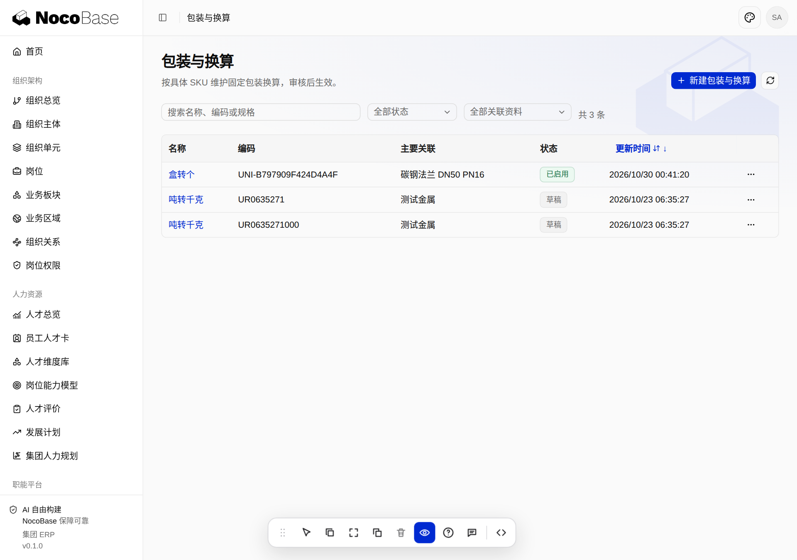

_图 13：包装与换算。示例“盒转个”已启用，另有两条“吨转千克”草稿；规则必须审核后才生效。_

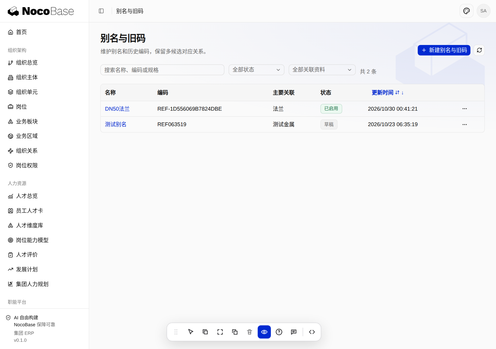

_图 14：别名与旧码。示例“DN50法兰”已启用并映射到标准名称“法兰”。_

## 10. 查询和选择物料

1. 在物料中心或业务选料框输入名称、编码、规格值，或已审核启用的全局别名。
2. 查看候选的具体规格和基本单位；如果命中的是“法兰”这类标准名称，应继续选择具体 SKU。
3. 打开详情，核对结构化属性、单位、启用的包装、别名和标签。
4. 多个候选时人工核对，不要默认选搜索结果的第一条。
5. 没有结果时，先清除不合适的筛选、换关键词，或向维护人员确认是否已有草稿；确实缺失再提报。

几个边界：

- 关联下拉每类最多显示 100 条候选，可用“查找关联资料”缩小范围。
- 搜索匹配范围过大时系统会要求输入更具体的名称，不会一次返回全库。
- 目录只显示**已启用** SKU；草稿和待审核资料不会出现在普通查询里。
- 指定公司的别名可以维护，但目录检索目前使用全局别名；公司级选料是否可见由“公司物料设置”决定。
- 采购选料只列出该公司“允许采购”的启用 SKU；销售选料还要求 SKU 为库存物料。

## 11. 修改、停用和异常处理

- **草稿有误**：直接编辑，填写修改原因后保存。
- **待审核资料有误**：先“退回修改”，不要带着错误审核启用。
- **已启用 SKU**：只能修订名称、备注等说明信息；编码、标准名称、基本单位、管理方式和规格身份字段不能直接改。规格变了应新建 SKU 并处理旧引用。
- **模板被引用**：字段结构不能原位修改；不要企图通过改字段名“绕过”已有 SKU 的身份。
- **单位被引用**：类型和小数位不能直接改；先评估已引用它的 SKU 和包装规则。
- **别名/包装已启用**：关键字段固定；实质变化应新建正确规则并审核。
- **停用失败**：查看是否仍有有效引用（名称下还有 SKU、SKU 还有包装/公司设置、标签还有关联等），先处理引用；不能靠删除规避。
- **有库存或未完成单据时停用**：系统会检查盘点冻结、库存数量/预留、未取消的采购/销售订单行和未完成的调拨/出入库单；这些情况下不能直接停用或改身份字段，需先处理业务。
- **重复编码**：编码按资料类型唯一（仓库编码在同一主体内唯一）；冲突时修改后重交，或留空让系统重新生成。
- **重复规格**：同一标准名称下身份组合重复会提示“已存在相同规格的 SKU”，请引用已有物料。
- **版本冲突**：别人已更新过这条资料时，保存会提示冲突；先加载最新资料再改，重新加载会放弃当前输入。
- **搜索范围过大**：输入更具体的名称或编码。
- **登录过期/无权限**：按页面提示重新登录或联系管理员；不要反复盲点提交。

常见错误提示与处理：

| 提示                                             | 含义                                 | 处理                                 |
| ------------------------------------------------ | ------------------------------------ | ------------------------------------ |
| 此编码已存在                                     | 编码重复                             | 修改编码或留空自动生成               |
| 该标准名称下已存在相同规格的 SKU                 | 身份组合重复                         | 引用已有 SKU，或核对身份属性是否配错 |
| 此身份字段已被引用，不能直接变更                 | 模板字段、名称模板、单位类型等被引用 | 新建档案或走受控变更方案             |
| 资料仍有有效引用，请先处理引用                   | 停用前还有关联资料                   | 先停用/迁移关联资料                  |
| 当前状态不允许修改规格，请新建或退回草稿         | 待审核/已启用资料被直接改关键字段    | 退回草稿，或新建 SKU                 |
| 不能审核自己创建或自己申请产生的 SKU             | 违反职责分离                         | 换一位审核人                         |
| 换算数量必须为正数，基本单位与自身的换算必须相等 | 包装比例填错                         | 按“1 盒 = 12 个”核对分子分母         |
| 不同计量维度不能设置固定换算                     | 质量/长度/体积等互相换算             | 按实际计量，不建固定换算             |
| 匹配范围过大，请输入更具体的名称                 | 搜索命中过多                         | 增加关键词或编码                     |

## 12. 治理记录与审计

“治理记录”只读展示物料维护、审核和办理历史，支持按资料名称、资料类型和记录顺序筛选：

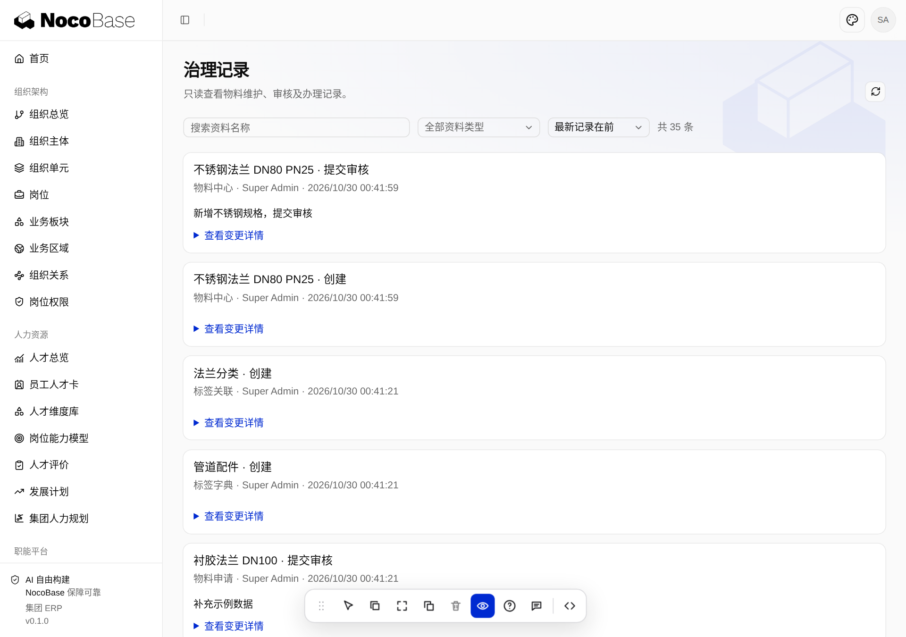

_图 15：治理记录。每条显示资料名称、动作、操作人、时间和原因，可展开查看字段差异。_

- 详情页也会显示该记录的近期变更履历。
- 审计忽略内部技术字段，只展示业务字段的可读差异（如“状态：草稿 → 待审核”）。
- 变更原因应写业务依据，例如“补齐包装比例，经实物核对”，不要只写“修改”。
- 审计记录保留历史，不因停用或后续修改而消失。

## 13. 常见问题

**Q1：输入名称时提示“已存在同名标准名称”，还能创建吗？**  
可以，系统只提示不阻断。但同名通常意味着应复用已有名称；确实需要区分时，先确认是否应通过模板/身份属性解决，而不是复制一个名称。

**Q2：编码可以改吗？**  
创建时可以手动改；创建后保持固定。标准名称留空会按名称首字母自动生成缩写，其他资料使用系统编码。

**Q3：一个标准名称下能有几个 SKU？**  
取决于模板的身份属性组合。有模板时，每个不同的身份组合可以有一个 SKU；没有模板时只能有一个，因为无法区分规格。

**Q4：为什么我看到的物料中心只有已启用资料？**  
你只有目录查询权限。维护人员能看到草稿、待审核、已启用和已停用资料。

**Q5：为什么“停用”失败？**  
还有有效引用，例如名称下仍有 SKU、SKU 还有包装或公司设置、标签还有标签关联。先处理引用再停用。

**Q6：采购选料里为什么找不到这个 SKU？**  
先确认 SKU 已启用，再确认该公司在“公司物料设置”中已允许采购；销售选料还要求 SKU 为库存物料。

**Q7：为什么这条申请不能编辑，也不能重新提交？**  
它由采购/领用来源行生成。来源申请的内容要在原单据修改，再重新提报治理；物料中心侧只能办理、退回或接手。

**Q8：SKU 审核启用后，申请会自动办结吗？**  
不会。必须回到申请执行“关联 SKU 并办结”，申请才会进入已办结。

## 14. 上线检查与当前边界

**首次上线检查清单：**

- [ ] 组织主体、岗位和人员任职已准备好，申请人能选到所属公司。
- [ ] 计量单位已核对，数量小数位符合业务精度。
- [ ] 属性模板已按“是否区分物料身份”设计，必填项和身份属性经过业务确认。
- [ ] 标准名称已建立，并关联了正确的模板。
- [ ] 至少一个 SKU 已审核启用，普通查询账号能在目录中检索到。
- [ ] 包装、别名、标签、公司物料设置按需补充，包装和别名已完成审核。
- [ ] 维护人员与审核人员已分开，审核人知道自己不能自审。
- [ ] 仓库主体和责任岗位已核对，责任岗位属于同一主体。

**当前边界：**

| 能力                 | 物料中心     | 说明                                              |
| -------------------- | ------------ | ------------------------------------------------- |
| 物料身份、规格、单位 | 已实现       | 名称、模板、SKU、单位、包装、别名、标签、公司设置 |
| 建码治理与来源联动   | 已实现       | 申请办理、关联 SKU、采购/领用明细行治理与确认     |
| 数量与库存           | 不在物料中心 | 由仓库执行模块维护出入库、库存、调拨和盘点        |
| 采购/销售业务单据    | 不在物料中心 | 物料中心只提供选料和身份校验                      |
| 条码/扫码            | 当前不要求   | 未来可作为可选的内部标签方式                      |

相关文档：[仓库物料中心首期实施方案](仓库物料中心首期实施方案.md)、[仓库物料中心发布记录](仓库物料中心发布记录.md)、[物料中心分类移除发布记录](物料中心分类移除发布记录.md)。

## 附录 A：主要字段速查

| 资料         | 关键字段                                                                              |
| ------------ | ------------------------------------------------------------------------------------- |
| 标准名称     | 名称、编码、属性模板、备注、状态                                                      |
| 属性模板     | 名称、编码、属性（标识、显示名称、类型、单位、必填、身份属性、可选值）                |
| 物料 SKU     | 名称、编码、标准名称、基本单位、管理方式、规格属性、备注、状态                        |
| 计量单位     | 名称、编码、计量类型（数量/质量/长度/面积/体积/包装）、小数位数                       |
| 包装与换算   | 物料 SKU、换算单位、基本单位数量、换算单位数量、状态                                  |
| 别名与旧码   | 名称、编码、对应类型（别名/历史编码）、对应层次（名称/SKU）、对应物料、所属主体、状态 |
| 标签         | 名称、编码、适用范围（名称/SKU/两者）                                                 |
| 标签关联     | 标签、对应层次、对应物料                                                              |
| 物料申请     | 名称、编码、所属主体、规格需求、建议单位、用途、办理结果 SKU、状态                    |
| 公司物料设置 | 所属主体、物料 SKU、允许采购、允许销售                                                |
| 仓库设置     | 名称、编码、所属主体、责任岗位                                                        |

## 附录 B：编码规则

- 编码格式：`^[A-Z0-9][A-Z0-9_.-]{0,63}$`，即以大写字母或数字开头，可包含大写字母、数字、点、下划线和连字符。
- 标准名称留空时按名称生成大写缩写：中文取拼音首字母（如“法兰”→ `FL`，“碳钢法兰”→ `TGFL`），英文单词按首字母，不超过 3 个字母的代号（如 DN、PN）整词保留，数字原样保留；冲突时依次尝试 `-2`、`-3`，仍冲突则追加随机后缀。
- SKU、包装、别名、申请等由系统生成带前缀的编码（`SKU-`、`UNI-`、`REF-`、`REQ-`）。
- 编码创建后固定，不能通过改名让编码跟随变化。

## 附录 C：截图清单

| 文件                      | 内容                                      |
| ------------------------- | ----------------------------------------- |
| `01-overview.png`         | 物料看板                                  |
| `02-sku-list.png`         | 物料中心（SKU）列表                       |
| `03-standard-names.png`   | 标准名称列表                              |
| `04-name-similarity.png`  | 新建标准名称的同名提示与编码自动生成      |
| `05-template-fields.png`  | 属性模板详情                              |
| `06-sku-form.png`         | 新建 SKU 表单与规格属性                   |
| `07-sku-detail.png`       | 已启用 SKU 详情（规格、包装、别名、标签） |
| `08-pending-sku.png`      | 审核人视角的待审核 SKU                    |
| `09-approve-dialog.png`   | 审核启用对话框                            |
| `10-request-detail.png`   | 待审核物料申请与办理入口                  |
| `11-unit-rules.png`       | 包装与换算列表                            |
| `12-references.png`       | 别名与旧码列表                            |
| `13-audit-history.png`    | 治理记录                                  |
| `14-resolve-dialog.png`   | 关联 SKU 并办结对话框                     |
| `15-request-resolved.png` | 已办结申请与办理结果                      |

## 附录 D：文档修订

- 2026-10-30：按当前界面重写，补充标准名称相似/同名提示、编码自动缩写、来源单据联动、治理记录与 15 张界面截图；示例统一为“法兰”。
- 2026-10-17：首版（A1）。
