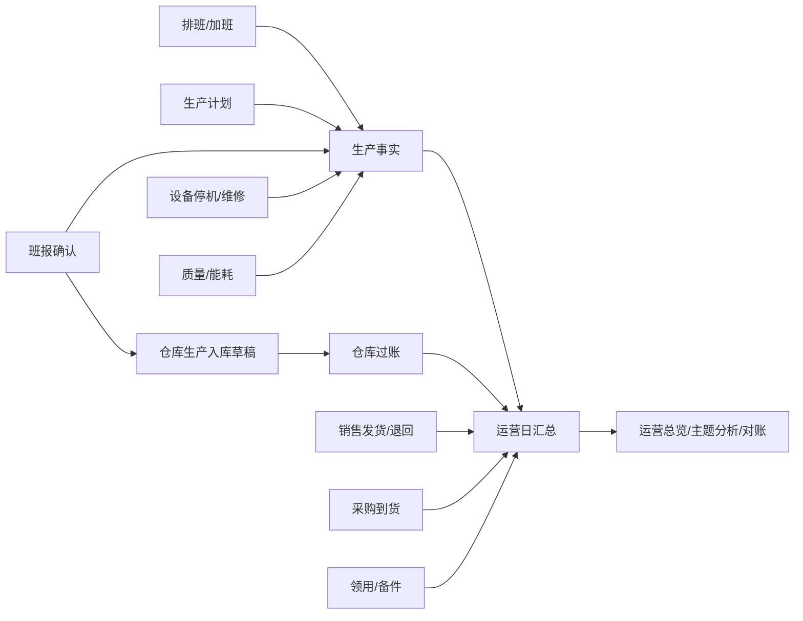

# 生产模块实施方案

> 状态：方案 v2.0；到勤、排班、设备台账/维修工单、设备保养计划、单元档案/产出映射、班报、生产入库草稿与过账状态回显已落盘并上线；加班申请/审批、停机事件已落盘并上线（停机数据迁移 `operations-20261021-2100`，文案补丁 `operations-20261021-2110`；加班 `operations-20261021-2000`/`2010`）。文中标“默认建议”的条目，在未否决前按此设计。
>
> 日期：2026-10-21
>
> 范围：集团 ERP → 职能平台 → 生产
>
> 定位：与采购、仓库、销售、领用、人事并列的生产执行模块；生产数据通过只读服务进入运营，运营不重复录入生产单据。
>
> 关联资料：[运营模块实施方案](运营模块实施方案.md)、[PLC 数据采集与总部监控阶段总结](../../PLC数据采集与总部监控阶段总结.md)、[采购销售仓库与物料治理架构方案](采购销售仓库与物料治理架构方案.md)、[数量业务 B 阶段交接](数量业务B阶段交接-2026-10-19.md)、[工程规范](../AGENTS.md)

> **执行收敛（2026-10-21）**：P1 先做单元/班组、排班、到勤看板、班报、设备台账与维修工单，设备保养计划、加班申请/审批、停机事件已提前落盘；质量、能耗紧接 P2，不取消、不一次铺开。排班先做按日勾选，不做复杂轮班规则。
>
> **实施进展**：到勤看板（岗位标记 `productionRole`、当班到勤/缺勤/请假/休息、加班时间与内容）已完成；生产单元档案与产出映射（`prdUnitProfiles`、`prdOutputMappings`，金属/砂料映射到物料 SKU 和默认仓库）已完成，保存时校验 SKU 基本单位精度 ≥ 6、金属/砂料不得同 SKU、同公司跨产线不得把同一 SKU 映射为不同产出；班报录入、列表、确认与产出快照（`prdShiftReports`、`prdShiftReportOutputs`）已完成；班报确认后可生成仓库生产入库草稿并回写 `stockDocumentId`，班报列表可直接跳转已生成的入库单，并回显草稿/已过账状态。生产排班（`prdSchedules`/`prdScheduleAssignments`）已完成：按单元/日期/班次勾选人员、保存草稿并发布；到勤看板优先读取已发布排班名单，未发布时回退到全部生产岗位主职。设备台账与维修工单（`prdEquipment`/`prdMaintenanceOrders`）已完成：设备新增、报修、开始维修、完工（必须填处理结果）和停机分钟记录。设备保养计划（`prdMaintenancePlans`）已完成：按周期新建、暂停/启用、到期生成维修工单、完工后自动顺延下次到期日。加班申请/审批（`prdOvertimeRequests`）已完成：按生产岗位与日期选人、提交、审批通过/驳回、驳回原因、补偿偏好；不自动算薪、不做月度阈值升级。停机事件（`prdDowntimeEvents`）已完成：登记开始时间与类别、关闭填恢复时间/处理结果、自动计算停机分钟，并在运营总览显示停机中数量与当日分钟；质量、能耗尚未落盘。仓库过账仍走现有入库单生命周期。生产单元主档不再新建 `prdUnits`，统一使用现有 `orgUnits`。
>
> **发布（2026-10-21，保养计划）**：设备保养计划已上线，数据迁移版 `operations-20261021-1900`，空态补丁 `operations-20261021-1910`；数据库批次 9。详见[发布记录](生产设备保养计划发布记录-2026-10-21.md)。
>
> **发布（2026-10-21，加班）**：生产加班申请/审批已上线，数据迁移版 `operations-20261021-2000`，空态补丁 `operations-20261021-2010`；数据库批次 10。详见[发布记录](生产加班发布记录-2026-10-21.md)。
>
> **发布（2026-10-21，单元档案校验）**：生产单元档案保存校验与页面提示已上线，镜像 `operations-20261021-2130`，无数据库变更。详见[发布记录](生产单元档案校验补丁发布记录-2026-10-21.md)。
>
> **全链路测试（2026-10-21，隔离测试库）**：已用测试数据跑通“公司/单元/仓库/金属与砂料 SKU → 生产单元档案与产出映射 → 排班 → 到勤 → 班报 → 确认 → 入库草稿 → 提交/审核 → 过账 → 库存 → 运营总览”。结论与约束见[生产全链路测试报告](生产全链路测试报告-2026-10-21.md)：金属/砂料必须分 SKU、基本单位用吨；生产入库是受控单据，不能从草稿直接过账。
>
> **发布（2026-10-21，停机）**：生产停机事件已上线，数据迁移版 `operations-20261021-2100`，文案补丁 `operations-20261021-2110`；数据库批次 11。详见[发布记录](生产停机事件发布记录-2026-10-21.md)。
>
> **发布（2026-10-21，排班/设备）**：排班与设备维修已上线，主发布 `operations-20261021-1830`，补丁 `operations-20261021-1840`；数据库批次 8 执行 2 迁移 + 2 seed。详见[发布记录](生产排班与设备维修发布记录-2026-10-21.md)。

## 0. 结论摘要

生产独立成模块，管“排班、加班、计划、班报、停机、设备点检保养维修、质量取样、能耗读数”这些执行事实。它不并进运营，也不做成第二套人事、仓库或采购。

三条边界先定死：

1. **生产管执行事实**：谁在哪个班、哪条线、做了什么、产出多少、停了多久、修了什么，生产模块是唯一入口。
2. **运营管经营分析**：只读生产结果，叠加仓库、采购、销售、领用、人事数据，做跨项目总览、主题分析、目标、对账和督办；不在运营里再录一遍班报或排班。
3. **人事、仓库、采购各自管自己的事实**：生产引用人员与任职，不建员工档案；备件走仓库/领用，不建第二套备件库；外委维修和缺件采购走采购，不建采购单。

首期建议先做“生产单元/班组 + 排班 + 班报 + 停机 + 生产计划”，同时把设备台账、点检保养、维修工单的骨架立起来；加班、质量、能耗、PLC 监控分阶段补齐。这样生产模块先能让厂长和值班长用起来，运营总览也有真实生产数据可读。

## 1. 模块边界

| 事项                     | 归属             | 生产模块的角色                                                | 不做什么                              |
| ------------------------ | ---------------- | ------------------------------------------------------------- | ------------------------------------- |
| 生产单元/产线/班组       | 生产             | 单元、班次、班组、排班、生产计划                              | 不重写组织主体和项目立项              |
| 员工、任职、合同         | 人事             | 引用 `personId`/任职，读取可用性                              | 不建员工档案、不办入转调离            |
| 假勤制度、请假审批、薪酬 | 人事             | 引用岗位/任职；生产记当班到勤/缺勤/请假/休息及加班时间/内容   | 不复制员工/岗位，不算工资、不扣款     |
| 班报、产量、停机         | 生产             | 唯一录入与确认入口                                            | 运营不重复录入                        |
| 设备台账、点检、保养     | 生产（近期）     | 生产设备主档、点检/保养计划、执行记录                         | 不做资产折旧、大修技改、设备选型      |
| 维修工单、外委维修       | 生产（近期）     | 报修、派工、维修、验收、停机关联                              | 不建采购订单、不做供应商结算          |
| 备件库存                 | 仓库             | 维修工单引用备件，走领用/仓库出库                             | 不另建备件库、不记库存余额            |
| 备件采购                 | 采购             | 缺件时提采购申请，引用采购订单                                | 不建采购申请/订单/到货                |
| 产品质量化验             | 生产（近期）     | 取样、化验、留样、结果判定                                    | 不建实验室 LIMS、不做对外检测         |
| 能耗读数                 | 生产（近期）     | 抄表/采集、读数校验                                           | 不做能源管理平台、不做碳核算          |
| 安全作业票、环保         | 安环             | 高风险维修开工前校验有效作业票；异常/隐患上报                 | 不建作业票、不审批、不建排放/危废台账 |
| 成本、收入、利润         | 财务（规划）     | 提供工时、产量、维修、能耗等成本动因                          | 不做金额核算、不做利润表              |
| 项目拓展、投资、建设     | 公司发展（规划） | 后续以 `orgUnits` 或 `prdUnitProfiles.projectId` 关联项目档案 | 不重写项目立项、投资、移交            |

**边界原则**：生产是“生产执行事实”的唯一入口；人事、仓库、采购、财务各自保留事实入口；生产只引用、触发和汇总，不复制。

## 2. 关键流程

### 2.1 排班

- 排班对象：生产单元/产线 + 班组 + 班次；职能人员不排生产班，走人事假勤。
- 当前 P1：按“单元 + 日期 + 班次”勾选人员，保存草稿后发布；周模板、复制上周、Excel 导入和批量调整后置。
- 班次配置：班次编码、名称、开始/结束时间、是否跨零点；跨零点夜班归**班次开始日**，与运营业务日期一致。
- 排班内容：日期、班次、人员名单；当前只排生产岗位的有效主职任职人员，不复制员工档案。班组、计划工时、岗位角色后置。
- 校验：只能排本单元生产岗位人员；同一人同一单元同一天同一班次只保留一条；请假/停用冲突提示、连续工作/月工时超限提示后置。
- 发布：草稿 → 发布；发布后到勤看板只显示已排人员。再次修改会回到草稿，需重新发布；发布后改班原因留痕后置。
- 可见性：厂长/排班员看本公司；值班长看本单元；员工看自己的班（后置）。

### 2.2 加班（已落盘）

- 类型：计划加班（排班延长）、临时加班（故障/抢修/来料集中）、节假日加班。
- 申请：按生产单元 + 业务日期选择生产岗位在岗主职人员，填小时数（0.5–24）、类型、原因、补偿偏好（暂不选择/调休/加班费）；首期单人单条，不做批量。
- 审批：提交后状态 `submitted`，生产负责人用 `approve` 动作通过或驳回；驳回必须填原因；审批通过才计入加班统计。
- 结果：按人/单元/日期/状态查询，显示申请编号、岗位、小时数、原因、补偿偏好；通过只读接口供人事薪酬使用（后置）。
- 不做：不替代考勤打卡、不计算加班工资、不处理调休余额；不做月度阈值升级、实际时长回填、批量导入（后续）。
- 页面：`/functions/production/overtime`，页面 ID `production-overtime`；项目用户按公司授权。

### 2.3 到勤看板（P1）

- 目的：厂长/值班长在一个屏幕上看到“今天这条线应到谁、谁到了、谁没到、为什么、加班多久、做了什么”，不做成第二套考勤系统。
- 生产岗位：由人事在岗位档案标记 `productionRole=production`；生产模块只读该标记，不在生产里另建岗位。综合/职能岗位默认 `support`，不进生产到勤名单。
- 名单来源：当日有效主职任职（`personnelAssignments` 的 `primary`，按 `startDate/endDate` 判断），按岗位所属单元归到产线；一人多岗只取主职，避免重复。
- 记录：按“单元 + 业务日期 + 班次”一条记录/人，状态为到勤/缺勤/请假/休息；缺勤填原因；加班填分钟数和内容。未登记显示“未登记”，不默认到勤。
- 写入：值班长/厂长可改当班记录；同一人同一天同一班次唯一，重复保存更新，不新增；只有“到勤/休息”才允许填加班，加班分钟数大于 0 时内容必填。
- 边界：这是“当班结果”，不是打卡明细；不替代人事假勤制度、请假审批、加班工资和调休余额。P1 到勤只记录加班分钟数与内容；加班申请/审批在加班页完成，结果供人事薪酬只读。
- 页面：`/functions/production/report`，页面 ID `production-report`；到勤、班报、停机、加班在同一页按“单元 + 日期 + 班次”一次提交。公司、岗位与填报人由账号任职识别，公司只读，不在表单选择；只有本公司的生产岗位人员能提交。

### 2.4 生产计划

- 周期：月/周/日；按单元、产品（金属/砂料/处理量）设定目标。
- 版本：计划发布有版本；变更留原因；历史版本可查。
- 执行：班报确认后计算实际、差异、完成率；运营只读计划与完成率。
- 口径：计划量默认湿基吨；金属/砂料分别设目标，不用“综合产品率”反推。

### 2.5 班报

- 填报：值班长按班次填报；PLC 已接入时预填处理量、运行小时、电耗等建议值，人工确认后才成为事实。
- 字段：收储量、处理量、金属产量、砂料产量、尾渣量、水分、运行小时、停机小时、电耗、水耗、异常说明、附件。
- 校验：物料平衡差 ≤3% 正常，3%–5% 黄色提示可提交需说明，>5% 红色必须填原因；阈值按单元可配，不直接阻断交班。
- 状态：草稿 → 提交 → 确认 → 作废；确认带版本和幂等键；作废后重报新建记录，不复活旧记录。
- 确认后：固化产出快照（金属/砂料 SKU、数量、默认仓库）；可由有仓库权限的用户生成**生产入库草稿**，草稿来源关联班报 ID，实际过账仍由仓库完成。当前确认本身**不直接改库存**。
- 交接班：记录当班 summary、待处理问题、安全提示，下一班确认；可与班报同页。

### 2.6 设备点检、保养、维修

- 设备台账：生产设备为主（破碎、筛分、磁选、输送、除尘、电气等），字段含单元、编码、名称、类别、关键度、状态、位置、投用日期。
- 当前已落盘：设备台账 + 维修工单；工单状态 `reported → in_progress → completed/cancelled`，完工必须填处理结果，停机分钟记在工单上。保养计划、维修工单已落盘；备件明细、外委采购单、作业票强校验后置；独立停机事件见 2.10。
- 点检/保养计划：按设备设周期（日/周/月/季/年）、检查项、责任人/角色、下次到期日；到期生成待办或工单。
- 维修工单：来源（故障报修/点检异常/保养发现/计划检修）、优先级、报修人、派工对象、开始/完成时间、停机时长、原因、处理措施、验收人。
- 备件：工单可挂备件明细，引用物料中心 SKU 和仓库；实际出库走领用/仓库，生产不扣库存；缺件转采购申请。
- 外委维修：生产记录外委单位、采购订单号、进出厂时间；采购负责订单与结算。
- 停机事件：设备故障、计划检修、缺料、缺人、质量、外部原因等分类；可关联工单和班报，统计影响产量。
- 指标：MTTR、MTBF、故障停机率、保养按期完成率、备件消耗；首期只做基础统计，不做复杂可靠性模型。

### 2.7 质量、能耗、交接（P2/P3）

- 质量：入料、金属、砂料取样；记录样品编号、取样时间、化验项目、结果、判定、留样/附件；不合格触发异常，不直接改班报产量。
- 能耗：电/水/气/耗材读数，支持累计值和区间值；来源为人工抄表或采集服务；生产只记录，运营做单耗分析。
- 交接班：班次总结、待办、安全提示、上级指令；下一班确认后关闭；与班报解耦，避免把交接内容塞进班报备注。

### 2.8 生产单元档案与物料清单

- 单元主档沿用组织架构 `orgUnits`，不另建 `prdUnits`；生产属性放 `prdUnitProfiles`（与 `orgUnits` 一对一）：产线编码、工艺类型、设计产能、投产日期、区域、网关/组态页键、状态。
- 物料清单放 `prdUnitMaterials`：一个单元可配多行物料，每行来自物料中心启用 SKU，并指定用途 `feedstock`（原料）/`product`（产品）/`byproduct`（副产品）/`auxiliary`（辅料），可指定默认入库仓库、排序；`(unitId, skuId)` 唯一，同一 SKU 不能重复。
- 页面 `/functions/production/setup`（`production-setup`）：先选生产单元，再维护生产属性和物料清单；SKU 取物料中心启用 SKU，仓库取本公司启用仓库。配置页只做配置，不产生库存。
- 生产报表按这份清单渲染填写行：原料行即处理量，产品/副产品行即产出，辅料行即消耗；每行再填期末实盘库存，提交时服务端把该 SKU 在默认仓的账面库存快照到 `bookQuantity`，页面显示“实盘 − 账面”差异。
- 班报确认后，产品/副产品中数量大于 0 的行生成仓库生产入库草稿，仓库取该行默认仓；一张班报的入库行必须同仓，不一致拒绝生成。
- 权限：`production` settings 的 `read` 可看，`manage` 可改；项目用户只能配置本公司单元，集团 `readAll` 可跨公司查看。

### 2.9 设备保养计划

- 计划按“单元 + 设备”建，记录周期天数、下次到期日、检查项目、默认执行人和启停状态；`(unitId, equipmentId, name)` 唯一，避免同一设备重复建同名计划。
- 到期或 7 天内到期在列表提示；逾期不自动阻断生产，只提示并允许生成工单。
- “生成工单”复用维修工单，类型取 `inspection`/`preventive`，带入检查项目；同一计划已有 `reported`/`in_progress` 工单时直接返回该工单，不重复创建。
- 工单完工后写回计划 `lastOrderId/lastCompletedOn`，并按 `intervalDays` 顺延 `nextDueOn`；暂停的计划不生成、不顺延。
- 页面 `/functions/production/maintenance-plans`（`production-maintenance-plans`）；`production` settings 的 `read` 可看，`manage` 可建/改/生成。备件、外委、作业票校验仍后置。

### 2.10 停机事件

- 停机事件单独记录，不替代维修工单，也不自动折算产量损失；班报里的 `downtimeMinutes` 是当班汇总，停机事件是明细。
- 字段：单元、设备（可选）、事件号、开始时间、结束时间、停机分钟、类别（设备/生产/水电/来料/质量/其他）、影响（完全停机/降速/其他）、描述、处理结果、状态（`open`/`closed`/`cancelled`）、版本。
- 登记只需开始时间和描述；关闭必须填恢复时间和处理结果，结束时间不得早于开始时间；停机分钟由系统按时间差计算，不允许手填。
- 同一设备不强制唯一进行中事件，避免现场漏报/重复报时无法录入；页面按开始时间倒序展示，重复事件可取消并填原因。
- 页面 `/functions/production/downtime`（`production-downtime`）；运营只读 `downtime.open` 与 `downtime.minutesToday`，明细留在生产。
- 不做：不自动从 PLC 推断停机、不扣减库存/产量、不触发维修工单（后续可人工关联）。

```text
职能平台
├─ 运营
├─ 生产
│  ├─ 生产报表          /functions/production/report
│  ├─ 单元档案          /functions/production/setup
│  ├─ 生产总览          /functions/production/overview
│  ├─ 生产计划          /functions/production/plans
│  ├─ 排班              /functions/production/schedules
│  ├─ 加班              /functions/production/overtime
│  ├─ 班报              /functions/production/shift-reports
│  ├─ 停机              /functions/production/downtime
│  ├─ 设备
│  │  ├─ 设备台账       /functions/production/equipment
│  │  ├─ 点检保养       /functions/production/maintenance/plans
│  │  └─ 维修工单       /functions/production/maintenance/orders
│  ├─ 质量化验          /functions/production/quality
│  ├─ 能耗              /functions/production/energy
│  ├─ 实时监控          /functions/production/monitor
│  ├─ 报警              /functions/production/alarms
│  └─ 生产配置          /functions/production/settings
├─ 物料中心
├─ 仓库
├─ 采购
├─ 销售
├─ 领用
└─ 人事
```

### 3.1 页面清单

| 页面     | 页面 ID                         | 首期      | 说明                                                                                 |
| -------- | ------------------------------- | --------- | ------------------------------------------------------------------------------------ |
| 生产总览 | `production-overview`           | P1        | 本单元/本公司当日计划、产量、运行、停机、待办                                        |
| 生产计划 | `production-plans`              | P1        | 月/周/日计划、版本、完成率                                                           |
| 排班     | `production-schedules`          | P1        | 周排班、复制、冲突校验、发布                                                         |
| 生产报表 | `production-report`             | P1        | 按班次一次提交班报、到勤、停机、加班；公司/岗位/填报人与班次按账号和系统时间自动确定 |
| 单元档案 | `production-setup`              | P1        | 生产属性、金属/砂料 SKU 与默认仓库映射                                               |
| 班报     | `production-shift-reports`      | P1        | 填报、确认；提交/作废/交接后续                                                       |
| 停机     | `production-downtime`           | P1        | 停机事件、原因、影响产量                                                             |
| 生产配置 | `production-settings`           | P1        | 单元、班次、班组、原因字典、审批阈值                                                 |
| 加班     | `production-overtime`           | P2 已落盘 | 申请、审批、按人/单元/日期查询；统计导出后置                                         |
| 设备维修 | `production-equipment`          | P1 已落盘 | 设备主档、报修、维修中、完工                                                         |
| 点检保养 | `production-maintenance-plans`  | P1 已落盘 | 周期、到期提示、生成工单、完工顺延                                                   |
| 维修工单 | `production-maintenance-orders` | P1 已落盘 | 报修、开始维修、完工；派工/验收/备件后置                                             |
| 质量化验 | `production-quality`            | P3        | 取样、化验、判定、留样                                                               |
| 能耗     | `production-energy`             | P3        | 抄表/采集、读数校验                                                                  |
| 实时监控 | `production-monitor`            | P3        | 单项目/单产线 FUXA 组态、实时值、报警                                                |
| 报警     | `production-alarms`             | P3        | PLC 报警同步、确认、关闭                                                             |
| 单元详情 | `production-unit-detail`        | P1        | 不占导航；设备/班报/停机/维修标签页                                                  |

页面 ID 一旦分配不轻易改名；后续拆页面保留旧 ID 兼容授权。

## 4. 数据模型

### 4.1 通用约定

- 主键 `id` 字符串 36 位 UUID；业务编码 `code` 在单元/公司内唯一。
- 公司范围 `subjectId`；单元范围 `unitId`；所有查询必须带范围条件。
- 数量与比率沿用定点字符串（长度 25，最多 18 位整数 + 6 位小数）和 CHECK 约束，避免 SQLite REAL 精度问题；不新造 float。
- 时间 `datetimeTz` 存 UTC，展示 `Asia/Shanghai`；业务日期用 `date`。
- 并发 `version` 乐观锁；提交/确认带 `version` 和 `nonce` 幂等键；冲突明确提示，不自动覆盖。
- 状态记录注册到现有 `recordLifecycleToken`；关键动作写办理历史。
- 业务记录不物理删除；作废保留，报表可追溯。
- 设备、班次、原因等字典可配置，不写死在页面代码里。

### 4.2 表清单

| 表                        | 阶段      | 用途          | 关键字段                                                                                                                                                                                                                                             |
| ------------------------- | --------- | ------------- | ---------------------------------------------------------------------------------------------------------------------------------------------------------------------------------------------------------------------------------------------------- |
| `orgUnits`                | 已有      | 单元/产线主档 | 复用组织架构；`subjectId`、`code`、`name`、`type`、`status`；不再新建 `prdUnits`                                                                                                                                                                     |
| `prdUnitProfiles`         | P1        | 生产属性      | `subjectId`、`unitId`、`lineCode`、`processType`、`designCapacityTpd`、`commissionDate`、`region`、`gatewayKey`、`fuxaPageKey`、`status`；`unitId` 唯一                                                                                              |
| `prdUnitMaterials`        | P1        | 单元物料清单  | `subjectId`、`unitId`、`skuId`、`role`（`feedstock`/`product`/`byproduct`/`auxiliary`）、`defaultWarehouseId`、`sortOrder`、`notes`、`status`；`(unitId, skuId)` 唯一                                                                                |
| `prdShiftReportMaterials` | P1        | 班报物料行    | `reportId`、`subjectId`、`unitId`、`skuId`、`role`、`quantity`、`stockQuantity`（实盘）、`bookQuantity`（提交时账面快照）、`stockDocumentId`、`note`；`(reportId, skuId)` 唯一                                                                       |
| `prdShifts`               | P1        | 班次配置      | `code`、`name`、`startTime`、`endTime`、`crossMidnight`、`enabled`、`sortOrder`                                                                                                                                                                      |
| `prdTeams`                | P1        | 班组          | `unitId`、`code`、`name`、`leaderId`、`status`                                                                                                                                                                                                       |
| `prdTeamMembers`          | P1        | 班组成员      | `teamId`、`personId`、`role`、`effectiveFrom`、`effectiveTo`、`status`                                                                                                                                                                               |
| `prdPlans`                | P1        | 生产计划      | `unitId`、`periodType`、`periodStart`、`metricKey`、`targetValue`、`version`、`status`、`note`                                                                                                                                                       |
| `prdSchedules`            | P1        | 排班主表      | `subjectId`、`unitId`、`scheduleDate`、`shift`、`status`（`draft`/`published`）、`notes`、`version`、审计字段；`(unitId, scheduleDate, shift)` 唯一                                                                                                  |
| `prdScheduleAssignments`  | P1        | 排班人员      | `scheduleId`、`subjectId`、`unitId`、`personId`、`positionId`、审计字段；`(scheduleId, personId)` 唯一                                                                                                                                               |
| `prdAttendanceRecords`    | P1        | 当班到勤      | `unitId`、`personId`、`positionId`、`workDate`、`shift`、`status`、`absenceReason`、`overtimeMinutes`、`overtimeContent`、`recordedBy`、`recordedAt`、`version`                                                                                      |
| `prdOvertimeRequests`     | P2 已落盘 | 加班申请      | `subjectId/unitId/personId/positionId/requestNo/businessDate/hours/type/reason/compensation/status/approverId/approverName/approvedAt/rejectReason/version`；`(subjectId, requestNo)` 唯一                                                           |
| `prdShiftReports`         | P1        | 班报          | `unitId`、`reportDate`、`shift`、`processedQuantity`、`metalQuantity`、`sandQuantity`、`tailingsQuantity`、`runtimeMinutes`、`downtimeMinutes`、`status`、`confirmedBy/At`、`version`、`notes`；`prdShiftReportOutputs` 存确认时的 SKU/仓库/数量快照 |
| `prdDowntimeEvents`       | P1 已落盘 | 停机事件      | `subjectId`、`unitId`、`equipmentId`、`eventNo`、`startedAt`、`endedAt`、`durationMinutes`、`category`、`impact`、`status`、`description`、`resolution`、`reportedBy`、`closedBy`、`version`；`(subjectId, eventNo)` 唯一                            |
| `prdEquipment`            | P2        | 设备台账      | `unitId`、`code`、`name`、`category`、`criticality`、`status`、`location`、`commissionedOn`                                                                                                                                                          |
| `prdMaintenancePlans`     | P1 已落盘 | 设备保养计划  | `unitId/equipmentId/name/type/intervalDays/nextDueOn/checklist/assigneeName/status/lastOrderId/lastCompletedOn/version`                                                                                                                              |
| `prdMaintenanceOrders`    | P2        | 维修/保养工单 | `equipmentId`、`type`、`priority`、`status`、`source`、`reportedBy`、`assigneeId`、`startedAt`、`finishedAt`、`downtimeHours`、`cause`、`solution`、`externalVendor`、`purchaseOrderId`、`permitRequired`、`permitId`、`permitStatus`、`version`     |
| `prdMaintenanceParts`     | P2        | 工单备件      | `orderId`、`skuId`、`warehouseId`、`quantity`、`unit`、`issueId`、`status`                                                                                                                                                                           |
| `prdQualityTests`         | P3        | 质量化验      | `unitId`、`sampleType`、`sampleNo`、`sampledAt`、`lotNo`、`metrics`、`standard`、`result`、`lab`、`attachmentId`                                                                                                                                     |
| `prdEnergyReadings`       | P3        | 能耗读数      | `unitId`、`meterKey`、`readingAt`、`value`、`unit`、`readingType`、`source`                                                                                                                                                                          |
| `prdHandovers`            | P3        | 交接班        | `unitId`、`businessDate`、`shiftCode`、`summary`、`pendingIssues`、`safetyNotes`、`fromUserId`、`toUserId`、`acknowledgedAt`                                                                                                                         |
| `prdPointBindings`        | P3        | 指标点位映射  | `unitId`、`metricKey`、`gatewayKey`、`pointKey`、`scale`、`offset`、`unit`、`aggregate`、`staleSeconds`、`enabled`                                                                                                                                   |
| `prdAlarms`               | P3        | PLC 报警      | `externalId`、`unitId`、`pointKey`、`level`、`code`、`message`、`occurredAt`、`clearedAt`、`status`、`ackBy/At`、`closeReason`、`raw`                                                                                                                |

首期不建：完整 EAM（资产折旧、大修技改、润滑路线、备件安全库存）、实验室 LIMS、能源管理平台、安全作业票系统（归安环）、视频监控、计件工资。等对应模块立项再做。

### 4.3 关键约束

- 单元主档：直接使用 `orgUnits`，不建第二套 `prdUnits`；一个公司多条产线在组织架构建多个单元，生产属性放 `prdUnitProfiles`。
- `prdUnitProfiles`：`unitId` 唯一；`subjectId` 必须与单元所属公司一致；停用不删单元。
- `prdUnitMaterials`：`(unitId, skuId)` 唯一；`role` 只能取 `feedstock/product/byproduct/auxiliary`；SKU 必须启用；默认仓库必须属于同一公司；保存时整表替换。
- `prdShiftReportMaterials`：`(reportId, skuId)` 唯一；只能填该单元已配置的 SKU，否则 `MATERIAL_NOT_CONFIGURED`；`bookQuantity` 只在提交时写入，不随后续出入库变化。
- `prdSchedules`：`(unitId, scheduleDate, shift)` 唯一；发布后修改带原因；作废不占用唯一键。
- `prdScheduleAssignments`：`(scheduleId, personId)` 唯一；同一人同一时段跨排班重复由服务端校验。
- `prdAttendanceRecords`：`(personId, workDate, shift)` 唯一；状态只能取 `present/absent/leave/rest`；加班分钟数为 0 或正数，不能为负；加班分钟数大于 0 时 `overtimeContent` 必填。
- `prdOvertimeRequests`：`requestNo` 唯一；同一人同一天可有多条但需说明；审批通过后不可改小时数，只能作废重提。
- `prdShiftReports`：`(unitId, reportDate, shift)` 唯一；确认带当前 `version`；确认生成产出快照必须幂等，生成仓库草稿也必须幂等；`enteredBy`/`enteredByPositionId`/`sourceChannel` 记录填报人与来源。
- `prdDowntimeEvents`：同一设备同一时段只能有一条进行中停机；结束时间不得早于开始时间。
- `prdEquipment`：`(subjectId, code)` 唯一；停用不删，历史工单保留。
- `prdMaintenancePlans`：`(unitId, equipmentId, name)` 唯一；周期 1–3650 天；暂停计划不生成工单；完工后按周期顺延。
- `prdMaintenanceOrders`：`(subjectId, orderNo)` 唯一；`planId` 可空；关闭必须有处理措施和验收人；备件出库引用领用/仓库，不在此表扣库存；`permitRequired=true` 时 `permitId` 必填，只有安环票状态 `active` 才能开工，停票/过期自动暂停。
- `prdMaintenanceParts`：`(orderId, skuId, warehouseId)` 唯一；数量为正；实际出库以仓库流水为准。
- `prdQualityTests`：`sampleNo` 唯一；结果判定不改班报产量。
- `prdPointBindings`：`(unitId, metricKey, pointKey)` 唯一；一个指标可多点聚合，必须显式配置聚合方式。
- 跨公司查询必须由服务端 scope 注入，不能只靠前端过滤。

### 4.4 迁移与种子

编号接现有 `202610190001`，生产模块先于运营模块落库：

- `202610240001_production_attendance`（已落地）：`orgPositions.productionRole`、`prdAttendanceRecords`。
- `202610240002_production_setup`（已落地）：`prdUnitProfiles`、`prdOutputMappings`。
- `202610240003_production_shift_reports`（已落地）：`prdShiftReports`、`prdShiftReportOutputs`。
- `202610280001_production_schedules`（已落地）：`prdSchedules`、`prdScheduleAssignments`。
- `202610210001_production_core`：`prdShifts`、`prdTeams`、`prdTeamMembers`、`prdPlans`；不建 `prdUnits`，单元复用 `orgUnits`。
- `202610310001_production_overtime`（已落地，待发布）：`prdOvertimeRequests`。原规划的 `202610210002` 不再单独执行。
- `202610210003_production_execution`：`prdShiftReports`、`prdDowntimeEvents`、`prdHandovers`。
- `202610290001_production_equipment`（已落地）：`prdEquipment`、`prdMaintenanceOrders`。
- `202610300001_production_maintenance_plans`（已落地）：`prdMaintenancePlans`；`prdMaintenanceOrders.planId` 增加计划引用。
- `202610210004_production_maintenance`（规划）：`prdMaintenanceParts`。
- `202610210005_production_quality_energy`：`prdQualityTests`、`prdEnergyReadings`。
- `202610210006_production_monitoring`：`prdPointBindings`、`prdAlarms`。
- `202610240001_production_defaults`（seed，已落地）：生产页面权、动作权。
- `202610280001_production_schedule_defaults`（seed，已落地）：为已有生产权限集追加 `production-schedules` 页面权。
- `202610290001_production_equipment_defaults`（seed，已落地）：追加 `production-equipment` 页面权。
- `202610300001_production_maintenance_plans_defaults`（seed，已落地）：追加 `production-maintenance-plans` 页面权。
- `202610310001_production_overtime_defaults`（seed，已落地，待发布）：追加 `production-overtime` 页面权。增量 seed 都不重跑旧 seed，不写真实单元、班组、产量。

单元、班组、设备清单由管理员配置或一次性导入；不在 seed 里塞假项目、假设备、假班报。

## 5. API 轮廓

全部走 `/api/production/*`，`auth.required()` + 显式授权 + `apiValidator()` + `describeRoute()`，成功返回 `{ data }`，失败用 `ApiError`。

| 方法/路径                                     | 用途                                |
| --------------------------------------------- | ----------------------------------- |
| `GET/POST/PATCH /units`                       | 生产单元                            |
| `GET/POST/PATCH /shifts`                      | 班次配置                            |
| `GET/POST/PATCH /teams`                       | 班组                                |
| `GET/POST/DELETE /teams/:id/members`          | 班组成员                            |
| `GET/POST /schedules`                         | 排班列表/新建                       |
| `POST /schedules/:id/publish`                 | 发布排班                            |
| `POST /schedules/:id/copy`                    | 复制排班                            |
| `POST /schedules/:id/assignments`             | 调整人员                            |
| `GET /attendance`                             | 当班到勤名单/汇总                   |
| `PUT /attendance`                             | 保存当班到勤与加班                  |
| `GET/POST /overtime`                          | 加班列表/申请                       |
| `GET /overtime/candidates`                    | 当日可登记加班的生产岗位人员        |
| `POST /overtime/:id/decision`                 | 审批通过/驳回（`approve`/`reject`） |
| `GET/POST /plans`                             | 生产计划                            |
| `POST /plans/:id/publish`                     | 发布计划                            |
| `GET/POST /shift-reports`                     | 班报列表/新建                       |
| `GET/PATCH /shift-reports/:id`                | 详情/编辑草稿                       |
| `POST /shift-reports/:id/submit`              | 提交                                |
| `POST /shift-reports/:id/confirm`             | 确认并固化产出快照                  |
| `POST /shift-reports/:id/inbound`             | 生成仓库生产入库草稿（双权限校验）  |
| `POST /shift-reports/:id/void`                | 作废                                |
| `GET/POST /downtime-events`                   | 停机列表/登记                       |
| `POST /downtime-events/:id/close`             | 关闭并计算停机分钟                  |
| `POST /downtime-events/:id/cancel`            | 取消误报                            |
| `GET/POST/PATCH /equipment`                   | 设备台账                            |
| `GET/POST /maintenance-plans`                 | 保养计划列表/新建                   |
| `PATCH /maintenance-plans/:id`                | 暂停/启用                           |
| `POST /maintenance-plans/:id/generate`        | 生成到期工单                        |
| `GET/POST /maintenance/orders`                | 维修工单                            |
| `POST /maintenance/orders/:id/assign`         | 派工                                |
| `POST /maintenance/orders/:id/close`          | 验收关闭                            |
| `GET/POST /maintenance/orders/:id/parts`      | 工单备件                            |
| `GET/POST /quality-tests`                     | 质量化验                            |
| `GET/POST /energy-readings`                   | 能耗读数                            |
| `GET/POST /handovers`                         | 交接班                              |
| `GET /alarms` / `POST /alarms/:id/ack`        | 报警列表/确认                       |
| `POST /alarms/:id/close`                      | 关闭报警                            |
| `POST /units/:id/monitor-ticket`              | FUXA 一次性入口票据                 |
| `GET /reports/daily` / `GET /reports/monthly` | 生产日报/月报                       |
| `GET/PUT /settings/point-bindings`            | 点位映射                            |

## 6. 权限与角色

### 6.1 角色建议

| 角色          | 数据范围     | 主要动作                                          |
| ------------- | ------------ | ------------------------------------------------- |
| 生产总监      | 全部授权公司 | 看全部、审计划、看设备/维修/加班汇总、导出        |
| 生产经理/厂长 | 本公司       | 审排班、审加班、确认班报、派工、看本公司报表      |
| 排班员        | 本公司       | 编排班、发布、调整、复制                          |
| 值班长        | 本单元       | 填报/提交班报、登记停机、交接班                   |
| 中控/操作     | 本单元       | 看实时/报警/历史，登记停机，不改班报              |
| 设备员        | 本公司       | 设备台账、点检/保养计划、派工、验收               |
| 维修工        | 指派工单     | 接单、维修记录、备件申请                          |
| 化验员        | 本公司       | 录入/查看化验，上传附件                           |
| 人事          | 授权公司     | 读排班、到勤、加班结果，用于假勤核对/薪酬（后置） |
| 运营          | 授权公司     | 只读生产事实，用于总览/分析                       |
| 管理员        | 全部         | 单元、班次、班组、原因、阈值、点位配置            |

### 6.2 授权粒度

- 页面权：`production-overview`、`production-schedules`、`production-shift-reports`、`production-maintenance-orders` 等。
- 动作权：`production.schedule.publish`、`production.overtime.approve`、`production.report.submit`、`production.report.confirm`、`production.report.void`、`production.maintenance.assign`、`production.maintenance.close`、`production.equipment.configure`、`production.plan.publish`、`production.monitor.view`、`production.report.export`。
- 数据范围：按 `subjectId` 注入；集团角色跨公司，项目角色只本公司；跨公司访问返回 403，不返回空列表冒充无权限。
- 监控票据：只有 `production.monitor.view` + 单元范围才签发；票据不继承其他权限；FUXA 只读。

### 6.3 页面与账号（当前实现）

生产模块 9 个页面按岗位拆开，不再给所有生产权限集同一套页面。新装由 seed `202611100001_production_page_matrix` 打底；已有安装不改 seed、也不写迁移，用一次性脚本 `scripts/apply-production-page-matrix.mjs` 以管理员身份提交变更（默认 dry run，`--apply` 才写入，带 `expectedRevision` 冲突保护），之后由管理员在权限界面继续调整。

| 页面         | 生产代班 `production-lead` | 生产负责人 `production-manager` | 集团只读 `production-group-viewer` | 系统管理 `production-system-admin` |
| ------------ | :------------------------: | :-----------------------------: | :--------------------------------: | :--------------------------------: |
| 看板         |             ✓              |                ✓                |                 ✓                  |                 ✓                  |
| 生产报表     |             ✓              |                ✓                |                 ✓                  |                 ✓                  |
| 生产排班     |             —              |                ✓                |                 ✓                  |                 ✓                  |
| 班报记录     |             —              |                ✓                |                 ✓                  |                 ✓                  |
| 停机记录     |             —              |                ✓                |                 ✓                  |                 ✓                  |
| 加班审批     |             —              |              ✓ 审批             |                ✓ 只读              |               ✓ 审批               |
| 设备维修     |             —              |                ✓                |                 —                  |                 ✓                  |
| 保养计划     |             —              |                ✓                |                 —                  |                 ✓                  |
| 生产单元档案 |             —              |                ✓                |                 —                  |                 ✓                  |

- 生产代班：只填报本单元报表（班报数量、出勤、停机、加班一并提交），看不到确认、审批与配置。
- 生产负责人：本厂全部页面，负责确认班报、审批加班、发布排班、维护单元档案与物料清单。
- 集团只读：跨公司只读，能看班报/停机/加班记录，无配置与设备维护入口。
- 系统管理：与负责人同页，另有 `readAll` 跨公司数据范围。
- 服务端动作：确认/作废/重开班报、发布排班都要求 `approve`（负责人、系统管理）；代班只有 `manage`（填报），即使直接调接口也会被拒（403 `PRODUCTION_FORBIDDEN`）。

演示账号：`shiftlead@demo.local`＝生产代班（看板、生产报表两页）；`planner@demo.local`＝生产负责人（9 页，可确认与审批）。

## 7. 与其他模块的集成

| 集成点    | 方向            | 规则                                                                                  |
| --------- | --------------- | ------------------------------------------------------------------------------------- |
| 组织主体  | 生产 → 组织     | `orgUnits.subjectId` 引用现有主体；公司停用不删单元，单元转历史                       |
| 人员/任职 | 生产 → 人事     | 排班、班报、加班、维修引用人员 ID；不复制姓名/岗位                                    |
| 假勤/薪酬 | 生产 → 人事     | 提供排班、当班到勤/缺勤/请假、加班时间与内容；假勤制度、请假审批、工资/调休以人事为准 |
| 仓库      | 双向            | 班报确认生成生产入库草稿；维修备件走领用/仓库；生产读库存/可售量                      |
| 领用      | 生产 → 领用     | 维修备件领用引用领用单；生产不直接发料                                                |
| 采购      | 生产 → 采购     | 缺件/外委维修提采购申请，引用采购订单；生产不建采购单                                 |
| 运营      | 生产 → 运营     | 只读单元、产量、运行、停机、质量、能耗、排班、到勤、加班；运营不写生产单据            |
| 设备技术  | 生产 ↔ 设备技术 | 近期生产管日常运维；远期设备技术管资产/标准/大修，迁移设备主档                        |
| 安环      | 生产 ↔ 安环     | 高风险维修开工前校验有效作业票；无票/过期不能开工；异常/隐患上报安环                  |
| 财务      | 生产 → 财务     | 提供工时、产量、维修、能耗等成本动因；金额核算归财务                                  |
| 公司发展  | 生产 ← 公司发展 | 未来 `projectId` 关联项目档案；不重写项目立项/投资/移交                               |

**生产数据进运营的链路**：



运营只读生产事实，不反向写生产单据；生产不直接改库存、不算工资、不做财务核算。

**高风险维修的作业票闸门**：

- 动火、受限空间、高处、临时用电、吊装、检修等工单标记 `permitRequired`；开工前必须关联 `hseWorkPermits` 的有效票（票号、类型、有效期、监护人、作业范围）。
- 无票、票过期、票范围不符时，工单只能停在“待作业票/禁止开工”，不派工、不开始计时；生产只读票状态，不审批、不改票。
- 安环停票/撤票后，生产工单自动暂停；恢复需重新校验，不能沿用旧票。
- 紧急抢修也不能绕过：先隔离风险、办应急票，再作业；事后在安环补记录。
- 安环事件/隐患由生产上报，严重事件移交安环；生产不建 HSE 台账、不做事故认定。

## 8. 实施阶段

> 工作量为粗略人周，用于排优先级，不是承诺工期；实际取决于现场班制、设备清单和业务确认速度。

### P0 口径与准备（约 1 周，业务为主）

- 确认项目/产线清单、组织主体对应关系、是否一公司多产线。
- 确认班制、交接时间、跨零点归属、排班周期。
- 确认生产岗位范围（哪些岗位算生产岗）与到勤口径；确认加班审批人、月度阈值、补偿方式。
- 确认生产设备清单、关键设备、点检/保养周期、维修原因字典。
- 确认高风险维修的作业票类型、审批人、安环接口与停票规则。
- 确认班报字段、计量方式、金属指标口径、现有日报样表。
- 输出《生产指标字典》《设备上线检查表》《排班/加班规则》，签字后再开发。

**通过条件**：上述条目有书面结论；没有结论的按“默认建议”标注，不阻塞 P1 的单元/班组/排班/班报。

### P1 生产骨架（约 3–4 周）

- 生产单元、班次、班组、班组成员、生产计划。
- 排班：周排班、复制、冲突校验、发布。
- 到勤看板：按生产岗位和有效主职生成应到名单，登记到勤/缺勤/请假/休息及加班时间/内容。
- 班报：新建、编辑、提交、确认、作废、版本冲突、幂等。
- 停机事件：登记、关闭、分类；已在 P1 提前落盘。
- 生产总览：本单元/本公司当日计划、产量、运行、停机、待办。
- 页面权/动作权/数据范围；seed 只补权限和字典，不塞业务数据。
- 不接 PLC；仓库 B 未启用时，班报确认只形成生产事实，生产入库草稿待仓库启用后接入。

**通过条件**：10+ 单元正确显示；厂长/值班长看到各自范围；排班冲突能拦截；班报全流程和汇总一致；无权限访问返回 403；空态不显示假 0。

### P2 加班与设备运维（约 3–4 周）

- 加班申请、审批已落盘；统计、导出、实际时长回填、月度阈值升级后置。
- 设备台账、点检/保养计划、到期生成工单。
- 维修工单：报修、派工、维修记录、验收关闭、停机关联。
- 高风险维修作业票校验：无票/过期/超范围不能开工；安环停票自动暂停（安环 P1 就绪后接入）。
- 工单备件：引用仓库/领用，缺件转采购申请。
- 班报确认 → 生产入库草稿 → 仓库过账（仓库 B 启用后）。
- 设备/维修基础报表：故障停机、MTTR、保养完成率。

**通过条件**：加班申请/审批状态一致；保养到期能生成工单；维修关闭必须有措施/验收；高风险维修无有效作业票不能开工，停票能自动暂停；备件不在生产扣库存；缺件能转采购。

### P3 质量、能耗、监控（约 3–4 周）

- 质量取样/化验/判定/留样。
- 能耗抄表/采集、单耗基础数据。
- FUXA 单项目组态、实时值、报警同步、点位映射。
- 交接班、生产日报/月报。
- 与人事考勤/薪酬的只读接口（如人事已具备）。

**通过条件**：质量/能耗报表与明细一致；断线/过期/坏值显示正确；FUXA 票据单次有效；一个组态画面稳定运行 1 小时；交接班可追溯。

### P4 深化（按需）

- 设备可靠性分析、备件消耗分析、外委维修闭环。
- 移动端填报、扫码、电子看板。
- 计件/班组绩效（需人事/财务共同定口径）。

### 不建议首期做

- 完整 EAM（资产折旧、大修技改、润滑路线、备件安全库存）。
- 实验室 LIMS、能源管理平台、安全作业票系统（安环建）、视频监控。
- 计件工资、加班费自动计算。
- 十几个 FUXA 画面同时渲染的“组态墙”（运营侧也只做单画面+轮播）。

## 9. 验收与测试

### 9.1 测试矩阵

| 类型   | 覆盖                                                                  |
| ------ | --------------------------------------------------------------------- |
| 排班   | 跨零点归属、同人重复、请假冲突、连续工时/月工时阈值、复制/发布/改班   |
| 加班   | 审批阈值、驳回、作废重提、实际时长、统计口径、权限                    |
| 班报   | 物料平衡 3%/5%、版本冲突、幂等、作废重报、入库草稿只生成一次          |
| 设备   | 保养到期生成、逾期、维修关闭校验、停机时长、备件引用、缺件转采购      |
| 作业票 | 无票/过期/超范围不能开工；安环停票自动暂停；恢复需重新校验            |
| 迁移   | PostgreSQL 与 SQLite 的 up/down/up；唯一键、部分唯一索引、外键、CHECK |
| API    | 401 未登录、403 跨公司/无页面权、400 校验、409 版本冲突、幂等重试     |
| 组件   | 排班表、班报表单、设备/工单列表、空态/过期态/权限菜单                 |
| 浏览器 | 厂长 vs 值班长 vs 维修工；排班发布；班报确认；工单关闭；FUXA 票据     |
| 安全   | 跨公司 ID 枚举、票据重放、URL/Referrer 泄漏、13020 直连、只读约束     |

### 9.2 数据质量验收

- 每个单元至少配置班次、班组、关键设备；设备台账覆盖率 100%。
- 班报确认后运营日汇总在 1 分钟内可见；生产数据变更能触发重算。
- 断网/过期/坏值不显示为正常值；空态不显示假 0。
- 备件出库以仓库流水为准，生产工单数量与领用单可对账。

## 10. 风险与对策

| 风险                           | 影响                 | 对策                                                       |
| ------------------------------ | -------------------- | ---------------------------------------------------------- |
| 范围蔓延到完整 EAM/HR/薪酬     | 首期做不完           | 边界表 + “不建议首期做”清单；单独立项                      |
| 排班/加班与人事重复            | 两套考勤、两套加班   | 生产只做业务排班/加班事实；人事管假勤/工资；接口只读       |
| 设备台账与未来设备技术模块冲突 | 主档分裂             | 近期生产管日常运维；远期迁移到设备技术，保留 ID 引用       |
| 备件库存双记                   | 仓库与生产数字对不上 | 生产只挂需求，实际出库走领用/仓库；工单不扣库存            |
| 现场排班复杂、临时调班多       | 系统跟不上、弃用     | 先做周排班+复制+批量调整；移动端后置；保留线下应急流程     |
| 加班超限/劳动合规              | 合规风险             | 阈值提示 + 审批升级；不自动算工资；规则由人事确认          |
| 设备台账初始数据缺失           | 工单无法关联         | P0 先盘关键设备；允许先建关键设备，非关键设备后补          |
| 班报依赖 PLC 预填，点位不可靠  | 班报数据不可信       | 人工确认才成为事实；保留自动快照；数据质量页               |
| 生产数据进运营后口径争议       | 报表不可比           | 指标字典签字；生产/仓库/销售对账；差异进运营督办           |
| FUXA 不能按项目隔离            | 项目用户越权         | 首期生产监控只对厂长/中控开放；集团运营只读；票据+代理约束 |

## 11. 需要确认的问题

### 阻塞 P1

1. **排班范围**：只排生产班组，还是全公司？默认建议：只排生产单元/班组，职能人员走人事假勤。
2. **班制**：两班还是三班？交接时间？跨零点归开始日？默认建议：两班 08:00–20:00 / 20:00–08:00，夜班归开始日。
3. **加班审批**：班组长→厂长，还是生产经理→人事？月度阈值多少？默认建议：班组长→厂长，超过 36 小时/月升级生产总监，人事只读。
4. **设备范围**：只生产线设备，还是含厂区公用/电气/叉车？默认建议：先生产线关键设备，公用设备后补。
5. **备件**：维修备件是否必须走仓库/领用？默认建议：必须走，生产不扣库存；急件可先领后补单。
6. **班报/计量**：处理量、金属、砂料、尾渣分别怎么计量？湿基还是干基？默认建议：湿基，水分单独化验。

### 影响 P2/P3

7. **质量/能耗归属**：放生产，还是等质量/能源独立模块？默认建议：首期放生产，运营只读。
8. **外委维修**：是否走采购服务订单？谁验收？默认建议：走采购订单，生产验收。
9. **与人事考勤**：人事是否已有考勤/请假/薪酬能力？加班结果怎么给人事？默认建议：只读接口/导出，首期不自动算薪。
10. **监控范围**：生产单项目组态先对谁开放？集团运营是否只看运营侧监控墙？默认建议：生产对厂长/中控，运营对集团运营。
11. **上线顺序**：生产 P1 与运营 P1 谁先？默认建议：生产 P1 先提供单元/班报，运营 P1 并行接仓库/销售/采购，生产接口就绪后接入。

## 附录 A：排班字段清单

单元、业务日期、班次、班组、计划人数、人员名单、岗位/角色、计划工时、状态、版本、发布人/时间、改班原因。

## 附录 B：加班字段清单

申请单号、单元、人员/班组、业务日期、开始/结束、时长、类型、原因、关联停机/工单、审批人、审批时间、实际时长、补偿方式、状态、版本。

## 附录 C：班报字段清单

业务日期、班次、单元、班组、值班长、收储量、处理量、金属产量、砂料产量、尾渣量、水分、运行小时、停机小时、电耗、水耗、自动快照、备注、附件、状态、版本、提交人/时间、确认人/时间、作废原因。

## 附录 D：维修工单字段清单

工单号、单元、设备、类型（故障/点检/保养/计划检修）、优先级、来源、报修人、报修时间、派工对象、开始/完成时间、停机时长、故障现象、原因、处理措施、备件明细、外委单位、采购订单号、验收人、验收时间、状态、版本。

## 附录 E：术语

- **生产单元**：一个项目公司的一条生产线；一个公司可有多个单元。
- **班次**：生产班次配置，跨零点夜班归班次开始日。
- **班报**：一个单元一个班次的生产执行记录，确认后成为生产事实。
- **生产入库草稿**：班报确认后生成、等待仓库过账的入库依据，不等于实际库存。
- **点检**：按周期对设备指定部位/项目进行检查，发现异常转维修。
- **保养**：按周期对设备进行清洁、润滑、紧固、更换等预防性维护。
- **MTTR/MTBF**：平均修复时间/平均无故障时间，首期只做基础统计。
