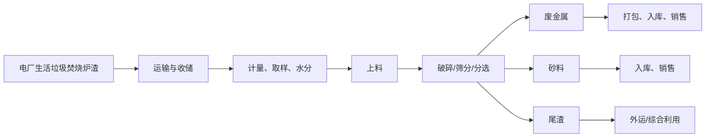
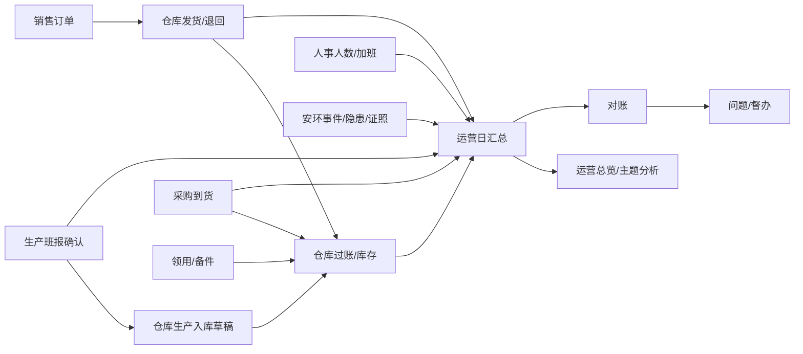

# 运营模块实施方案

> 状态：方案 v3.7；运营总览、销售/采购/人事聚合、设备维修/停机计数、问题督办、月度目标已落盘。文中标“默认建议”的条目，在未否决前按此设计。
>
> 日期：2026-10-21
>
> 范围：集团 ERP → 职能平台 → 运营
>
> 关联资料：[生产模块实施方案](生产模块实施方案.md)、[安环模块实施方案](安环模块实施方案.md)、[PLC 数据采集与总部监控阶段总结](../../PLC数据采集与总部监控阶段总结.md)、[采购销售仓库与物料治理架构方案](采购销售仓库与物料治理架构方案.md)、[数量业务 B 阶段交接](数量业务B阶段交接-2026-10-19.md)、[工程规范](../AGENTS.md)

> **执行收敛（2026-10-21）**：P1 只做一张经营总览（8 个指标 + 项目矩阵 + 异常清单）+ 目标/督办；主题分析、集团监控墙、人效/成本先不做。先让项目每天愿意填，再谈分析。
> **实施进展（2026-10-21）**：已落盘 `GET /operations/overview`、`GET /operations/options`、`GET|POST /operations/issues`、`PATCH /operations/issues/:id`、`GET /operations/targets`、`PUT /operations/targets`，页面 `/functions/operations/overview`、`/functions/operations/issues` 与 `/functions/operations/targets`。当前按日实时聚合：已确认班报（处理量/金属/砂料/产率）、生产入库草稿与已过账数、产品库存结存、销售未结订单/已过账发货、采购未结订单/已过账到货、在岗人数（有效主职去重）与生产岗位人数、安环未闭事件/隐患/逾期/证照到期、生产设备待处理/维修中工单、停机中数量与当日停机分钟、问题未闭/逾期；按公司授权，集团角色可跨公司。**尚未落盘**：`opsDailyRollups`、集团监控墙、销售金额/毛利、采购金额/到货率、人事编制/出勤/人工成本。目标已落 `opsKpiTargets`，当前为公司级月度目标，产线级目标后续再拆。库存是账面结存，未扣预留；发货/到货只统计已过账单据；在岗人数不等同于考勤出勤。

## 修订说明

v1 把生产运行（班报、计划、停机、质量、能耗、设备、交接）放在运营模块里，是按“先跑通”的临时设计。v2 按“生产与采购、仓库并行独立成模块”调整：

- **生产模块**管执行事实：排班、加班、计划、班报、停机、设备点检保养维修、质量取样、能耗读数。
- **运营模块**管跨模块经营：总览、主题分析、目标、对账、督办、集团监控墙；只读生产结果，不重复录入。
- v1 中的班报、生产计划、质量、设备、能耗、交接班、报警等页面和表，迁到生产模块；运营保留跨模块汇总、目标和问题闭环。
- v3 补充人事数据：在岗人数、岗位/用工结构、入离职、司龄、生产加班接入运营；只读聚合，不建员工副本，不取工资/身份证/电话。
- v3 补充运营域缺口：安环、质量、能源、设备、财务成本、合规证照、客户/合同、项目全周期、物流称重，按 P1–P3 排，不在首期全做。
- v3.1 补充岗位资质/技能/证书与人员风险；明确“产线人数”必须有人员-产线归属，不能用班组人数冒充全员。
- v3.2 补充安环模块：安环独立管事件、隐患、检查、作业票、排放、危废、证照、培训、职业健康；运营只读聚合，不建 HSE 台账，不签发作业票。
- v3.5 落地公司级月度目标（处理量、金属、砂料、金属产率）；目标只作为对标值，不自动生成考核或奖金。
- v3.6 接入生产设备维修工单计数：总览显示待处理/维修中工单数；只读生产明细，不建设备副本。
- v3.7 接入生产停机事件聚合：总览显示停机中数量与当日停机分钟；只读生产 `prdDowntimeEvents`，不建停机副本。

## 0. 结论摘要

运营不是“生产报表加几个库存数字”，而是集团层面的跨模块经营驾驶舱：

1. **运营总览**：十几个项目公司/产线的经营情况一屏看清，数据来自生产、仓库、采购、销售、领用、人事、安环，支持按项目、区域、时间下钻。
2. **主题分析**：产量与产率、库存与交付、采购与成本、设备与停机、人效与人力、安环与质量，每个主题都能追到来源单据。
3. **集团监控**：把十几个项目的 PLC 组态接进来做集团监控墙；单项目组态归生产模块，运营只做跨项目轮播和只读总览。
4. **目标与督办**：运营维护指标目标、跨模块对账差异、经营异常和整改动作；生产、仓库、采购、销售、安环各自处理自己的单据。

人事数据首期只做“在岗人数、岗位/用工结构、入离职、司龄、生产加班”的聚合；出勤、计薪、编制、关键岗位标记等没有可靠数据的，明确显示“未接入/待补全”，不在运营里猜。

安环数据首期只做“事故/未遂、隐患逾期、作业票异常、证照到期、培训覆盖”的聚合；排放/危废 P2 接，职业健康只给覆盖率/复查率，不把个人体检结果给运营。运营不建 HSE 台账，明细跳安环并按安环权限重新校验。

首期不依赖 PLC 和仓库 B 数量账：先用“生产单元 + 班报 + 仓库/销售/采购只读数据 + 运营汇总”把十几个项目的口径跑通；实时监控、库存联动、主题分析分阶段接入。

## 1. 业务理解与模块边界

### 1.1 业务链路



具体工艺以现场为准。方案只抽象“处理量、金属产出、砂料产出、尾渣、运行、能耗、质量”这些经营对象，不假定一定有涡电流、水洗或几条产线。

### 1.2 模块边界

| 事项                 | 归属             | 运营模块的角色                                              | 不做什么                         |
| -------------------- | ---------------- | ----------------------------------------------------------- | -------------------------------- |
| 项目公司/产线经营    | 运营             | 目标、总览、主题分析、对账、督办、集团监控                  | 不录班报、排班、设备、质量单据   |
| 生产执行             | 生产             | 只读产量、运行、停机、质量、能耗、排班/加班                 | 不重写生产单据、不重复录班报     |
| 实际库存数量         | 仓库             | 读库存、流水、可售量，参与对账                              | 不另记一套库存                   |
| 采购与供应商         | 采购             | 读到货、在途、价格，参与对账                                | 不重写采购申请和订单             |
| 销售与客户           | 销售             | 读订单、发货、退回，计算交付与可售量                        | 不重写销售订单                   |
| 领用与物耗           | 领用             | 读生产领料、备件领用，作为物耗和成本动因                    | 不重复发放                       |
| 人员、任职、薪酬     | 人事             | 读在岗人数、岗位/用工结构、入离职、司龄、生产加班；只做聚合 | 不办入转调离、不算工资、不取 PII |
| 设备资产与技术       | 设备技术（规划） | 读设备可靠性、维修、停机；近期由生产管日常运维              | 不建设备主档、不做大修技改       |
| 安环合规             | 安环（新建）     | 读事故/隐患/作业票/排放/危废/证照/培训汇总，做风险展示      | 不建 HSE 台账、不签发作业票      |
| 成本、收入、利润     | 财务（规划）     | 提供产量、库存、采购、销售、工时等动因；读财务结果          | 首期不做金额核算                 |
| 项目拓展、投资、建设 | 公司发展（规划） | 使用已投产单元，读投产日期和设计产能                        | 不重写项目立项和投资             |

**边界原则**：生产、仓库、采购、销售、人事各自是事实入口；运营只引用、汇总、对标和督办，不复制单据。运营可以“提出问题”，但不能替业务模块“改事实”。

### 1.3 “生产数据进运营”的规则

- 生产模块是产量、运行、停机、质量、能耗、排班、加班的唯一事实来源；运营不设第二套班报。
- 运营通过生产模块的只读服务/API 取数，不直接跨模块写表；日汇总落 `opsDailyRollups`，保留 `sourceHash` 和来源时间。
- 生产事实变更（班报作废/重报、停机修正）必须让对应日汇总失效并重算；报表标注“暂定/最终”。
- 跨模块对账差异进运营问题清单，由责任模块处理；运营不静默调平。
- 生产模块不可用时，运营显示“数据未就绪/过期”，不用 0 或手工数掩盖。

### 1.4 人事数据接入规则

人事是人员事实的唯一来源，运营只读汇总，不建员工副本、不办人事业务。

- 人数按“业务日期”取有效任职，不数 `personnelEmployees` 全表，也不按 `createdAt` 推算。
- 默认“在岗人数”= 有效主职（primary）正式员工去重人数；劳务、实习、兼职单列，不混进同一分母；兼职不重复计入总人数。
- 项目/公司：以 `subjectId` 汇总公司总人数；一个公司多产线时，产线人数必须有“人员-产线归属”才能算，不能拿班组人数冒充全员。
- 产线归属：如果业务必须按产线看人数，建议在人事增加 `personnelWorkAssignments`（`personId`、`unitId`、`effectiveFrom/To`、`allocationPct`、`isPrimary`），或在 `personnelAssignments` 增加可空的 `productionUnitId`；共享人员按明确比例分摊，无比例只进公司总数。
- 岗位：取有效任职的 `positionId` → `orgPositions`；无岗位显示“未分配岗位”，不归到“其他”掩盖。
- 入离职/调动：取已生效的 `personnelChanges`；司龄从 `personnelEmployments.startDate` 起算，不用员工记录创建时间。
- 加班：只取生产模块审批通过的结果；运营不算加班费、不判断合规。
- 隐私：运营只取聚合数和岗位名，不取身份证、手机号、工资、住址、紧急联系人；需要看人时跳转人事，并按人事权限校验。
- 缺口：人事假勤/请假、计薪、编制数、关键岗位标记、年龄/性别目前没有可靠数据，不在运营里造；生产“当班到勤”已在生产模块落盘，但只覆盖生产岗位，运营 P2 再接生产口径出勤率，不能当全公司考勤。

### 1.5 安环数据接入规则

安环是安全、环保、职业健康事实的唯一来源，运营只读汇总，不建 HSE 副本、不签发/审批作业票。

- 事故/未遂：按业务日期和发生单元归集；只读已上报记录，草稿不算；严重事件在运营只显示“已上报/调查中/已关闭”，不展示调查细节。
- 隐患：运营看“未关闭/逾期/闭环率”，不看整改附件和人名；逾期按安环的 `dueAt` 计算，运营不另设期限。
- 作业票：运营只看“有效/过期/异常”数量，不把“已申请”当“已批准”；无票作业由安环/生产拦截，运营不做开工校验。
- 排放/危废：只读有效监测和台账；缺报/无效数据不算达标，危废库存异常显式提示，不静默调平。
- 证照/培训：只读到期数和覆盖率；证照办理归法务行政/安环，运营不办证、不判定证书有效性。
- 职业健康：只给体检覆盖率、异常复查率等聚合；个人体检结果不进运营，需要看人跳安环/人事并重新鉴权。
- 安环事实变更（事件升级、隐患关闭、排放超标复核、危废转移）必须让对应日汇总失效并重算；报表标注数据状态。

## 2. 五个关键设计决策

### D1 单一生产单元主档，运营不再建 `opsUnits`

- 生产模块以现有 `orgUnits` 为单元/产线唯一主档，生产属性放 `prdUnitProfiles`（产线、工艺、设计产能、投产日期、区域、网关/组态页面键），产出映射放 `prdOutputMappings`；不新建 `prdUnits`。
- 运营只引用 `unitId`；区域等分析属性从 `prdUnitProfiles` 读取，不另建“运营单元”第二套主档。
- 运营目标 `opsKpiTargets`、问题 `opsIssues`、日汇总 `opsDailyRollups` 都引用 `unitId`。
- 公司发展未来建项目档案时，由 `orgUnits` 或 `prdUnitProfiles` 增加 `projectId` 引用；历史 `subjectId` 保留，不重写业务单据。

这样避免“生产一套单元、运营一套单元、公司发展一套项目”的三套编码。

### D2 总览与监控分离：生产管单项目，运营管集团墙

- **运营总览**：每个项目一张轻量卡片，显示经营状态、当日/当月产量、产率、运行率、库存/可售、销售交付、采购到货、报警/数据质量；实时值走聚合接口，2–5 秒刷新。
- **生产实时监控**：单项目/单产线的 FUXA 组态、实时值、报警处置，归生产模块；厂长/中控使用。
- **运营集团监控**：跨项目监控墙，默认“状态卡片 + 一个活动组态画面 + 30–60 秒轮播”；不默认同时开十几张 FUXA 画面。集团运营只读，不操作。
- 两处共用同一套 FUXA 反向代理、一次性票据、点位映射和只读约束，不建两套嵌入代码。

原因：十几张 FUXA 画面同时打开会叠加 Socket.IO 连接、100 ms 轮询和浏览器渲染压力；现有验证只覆盖单项目基础页面，没有多项目并发结论。FUXA 当前也不能按用户细分项目范围，集团墙先只对集团运营角色开放更安全。

### D3 数据分层：经营汇总与业务事实分离

| 数据     | 来源                                               | 运营用途                     | 约束                         |
| -------- | -------------------------------------------------- | ---------------------------- | ---------------------------- |
| 生产事实 | 生产模块（班报、停机、质量、能耗）                 | 产量、产率、运行、成本动因   | 只读；变更触发汇总重算       |
| 库存事实 | 仓库（流水、余额、可售）                           | 库存、交付、对账             | 只读；不另记库存             |
| 采购事实 | 采购（申请、订单、到货）                           | 到货、在途、价格、对账       | 只读；不建采购单             |
| 销售事实 | 销售（订单、发货、退回）                           | 交付、退回、收入动因         | 只读；不建销售单             |
| 人事事实 | 人事（人数、任职、岗位、入离职、加班结果）         | 人效、用工结构、人工成本动因 | 只读聚合；不取 PII、不算工资 |
| 安环事实 | 安环（事件、隐患、作业票、排放、危废、证照、培训） | 安全/环保结果、合规风险      | 只读聚合；不建 HSE 台账      |
| 运营自有 | 目标、日汇总、问题/督办                            | 对标、分析、闭环             | 运营唯一可写；不复制业务单据 |

运营自有数据只有三类：日汇总、指标目标、问题/督办。其余全部只读。

### D4 生产产出不直接改库存，走“生产班报确认 → 仓库生产入库草稿 → 仓库过账”

- 生产班报确认后，按金属/砂料产出生成**生产入库草稿**（来源=`production`，关联班报 ID）。

> 实施进度：班报确认后固化产出快照（SKU、数量、默认仓库）；具备仓库权限时可生成生产入库草稿并回写班报产出 `stockDocumentId`。草稿未过账前，运营不把产量当作可售库存。

- 仓库按实际计量/验收过账，形成库存流水和余额。
- 未启用仓库 B 数量账时，草稿保留为“待库存启用”，运营报表仍可看产量，但不承诺可售库存。
- 销售发货从仓库扣减，运营只读“可售量/库存/发货”，不重复扣减。

这样避免“生产一套产量、仓库一套入库、销售一套出库”三套数字对不上。

### D5 指标与对账：一个指标一个定义，差异必须显性

- 运营维护《指标字典》：指标 key、名称、口径、单位、来源模块、刷新频率、责任部门；页面和报表只引用 key。
- 同一指标只认一个事实来源：产量认生产确认班报，库存认仓库余额，发货认销售/仓库出库；不用“页面自己算一套”。
- 每日对账：生产产量 vs 仓库生产入库、销售发货 vs 仓库出库、采购到货 vs 仓库入库、库存流水 vs 余额。
- 差异超过阈值进 `opsIssues`，标来源、金额/数量、责任模块；不静默调平，不在运营改业务单据。
- 报表展示“数据状态”（已确认/暂定/缺失/过期），不把缺失值算成 0。

## 3. 指标口径

### 3.1 核心指标

| #   | 指标            | 建议口径                                                 | 数据来源          | 频度       |
| --- | --------------- | -------------------------------------------------------- | ----------------- | ---------- |
| 1   | 收储量          | 入厂炉渣湿基吨，按车/按日                                | 生产/地磅、收储单 | 车/日      |
| 2   | 处理量          | 入线炉渣湿基吨                                           | 生产班报          | 班/日      |
| 3   | 金属产量        | 废金属实际计量吨                                         | 生产班报/地磅     | 班/日      |
| 4   | 砂料产量        | 砂料实际计量吨                                           | 生产班报/地磅     | 班/日      |
| 5   | 尾渣量          | 外运/堆存计量吨                                          | 生产班报/外运单   | 日         |
| 6   | 金属产率        | 金属产量 ÷ 处理量 × 100%                                 | 生产计算          | 班/日      |
| 7   | 砂料产率        | 砂料产量 ÷ 处理量 × 100%                                 | 生产计算          | 班/日      |
| 8   | 综合产品率      | （金属 + 砂料）÷ 处理量 × 100%                           | 生产/运营计算     | 班/日      |
| 9   | 物料平衡差      | （处理量 − 金属 − 砂料 − 尾渣 − 水分损失）÷ 处理量       | 生产计算          | 班/日      |
| 10  | 金属品位        | 金属样品金属含量                                         | 生产质量          | 批         |
| 11  | 砂料质量        | 含泥量、含水率、细度模数、级配                           | 生产质量          | 批         |
| 12  | 运行率          | 运行小时 ÷ 计划小时 × 100%                               | 生产/PLC          | 班/日      |
| 13  | 停机次数/时长   | 按原因分类统计                                           | 生产停机          | 日         |
| 14  | 吨处理电耗      | 总电耗 ÷ 处理量                                          | 生产能耗/PLC      | 日         |
| 15  | 吨金属电耗      | 总电耗 ÷ 金属产量                                        | 生产/运营计算     | 日         |
| 16  | 计划完成率      | 实际产量 ÷ 计划产量 × 100%                               | 生产计划 + 班报   | 日/月      |
| 17  | 产品库存/可售量 | 仓库实际库存 − 已预留                                    | 仓库              | 实时/日    |
| 18  | 库存周转天数    | 平均库存 ÷ 日均出库                                      | 仓库/运营计算     | 月         |
| 19  | 采购到货率      | 已到货数量 ÷ 到期订单数量                                | 采购              | 周/月      |
| 20  | 采购在途量      | 已下单未到货数量                                         | 采购              | 实时/日    |
| 21  | 订单准时交付率  | 准时发货订单 ÷ 应发货订单                                | 销售/仓库         | 周/月      |
| 22  | 销售退回率      | 退回数量 ÷ 发货数量                                      | 销售              | 周/月      |
| 23  | 维修停机率      | 维修停机小时 ÷ 计划运行小时                              | 生产设备          | 月         |
| 24  | 保养按期完成率  | 按期完成保养数 ÷ 到期保养数                              | 生产设备          | 月         |
| 25  | 加班工时/人     | 审批通过加班小时 ÷ 在岗人数                              | 生产/人事         | 月         |
| 26  | 数据在线率      | 有效采集分钟 ÷ 应采集分钟                                | 生产/采集服务     | 实时/日    |
| 27  | 报警处置率      | 已关闭报警 ÷ 新增报警                                    | 生产报警          | 日         |
| 28  | 单位成本        | 总成本 ÷ 处理量（或 ÷ 金属产量）                         | 财务              | 月（后置） |
| 29  | 在岗人数        | 截至业务日期有效主职正式员工去重人数；劳务/实习/兼职单列 | 人事              | 日/月      |
| 30  | 用工结构        | 正式/劳务/实习/其他占比；兼职单列                        | 人事              | 月         |
| 31  | 岗位结构        | 按 `orgPositions` 统计在岗人数；未分配岗位单列           | 人事              | 月         |
| 32  | 关键岗位覆盖率  | 有关键岗位在岗人 ÷ 关键岗位数（有标记才计算）            | 人事（需标记）    | 月         |
| 33  | 入离职率        | 期间入职/离职人数 ÷ 期间平均在岗人数                     | 人事              | 月         |
| 34  | 平均司龄        | 平均（业务日期 − 入职日期）                              | 人事              | 月         |
| 35  | 人均处理量      | 处理量 ÷ 在岗人数                                        | 生产/人事         | 月         |
| 36  | 吨人工成本      | 人工成本 ÷ 处理量                                        | 财务/人事（后置） | 月         |
| 37  | 证书到期数      | 未来 30/60/90 天到期的特种作业/安全/环保证书数           | 人事（需新增）    | 月         |
| 38  | 关键岗位空缺    | 关键岗位无在岗人数量（需编制/关键岗位标记）              | 人事（需新增）    | 月         |
| 39  | 加班集中度      | 前 10% 人员加班小时 ÷ 总加班小时                         | 生产/人事         | 月         |
| 40  | 可记录事故数    | 除急救外的工伤/职业病/环境事件数                         | 安环事件          | 月         |
| 41  | 损工天数        | 因工伤缺勤的日历天数                                     | 安环事件/人事     | 月         |
| 42  | 未遂事件数      | 未造成伤害/损失但可能造成事故的事件数                    | 安环事件          | 月         |
| 43  | 隐患逾期数      | `dueAt < 今天` 且未关闭的隐患数                          | 安环隐患          | 日         |
| 44  | 隐患闭环率      | 已关闭隐患 ÷ 当期新增隐患                                | 安环隐患          | 月         |
| 45  | 作业票异常数    | 无票作业/过期作业/气体检测缺失/措施未确认                | 安环作业票/检查   | 月         |
| 46  | 排放达标率      | 达标监测次数 ÷ 有效监测次数                              | 安环排放          | 月         |
| 47  | 危废合规处置率  | 有联单且接收单位有资质的处置量 ÷ 应处置量                | 安环危废          | 月         |
| 48  | 证照到期数      | 未来 90 天内到期的企业证照/人员证书数                    | 安环证照          | 月         |
| 49  | 安全培训覆盖率  | 已完成必修培训人数 ÷ 应培训人数                          | 安环培训          | 月         |

29–49 是人力与安环主题，不全部上首屏；在岗人数是时点值，不做跨期加总；安环指标没有有效数据时显示“未接入/缺报”，不按 0 处理。

### 3.2 必须说清的四组口径

**产量 vs 销量**

- 产量认生产确认班报；销量认销售发货/仓库出库；库存认仓库余额。三者不能互相替代。
- 页面同时展示“产量、入库、出库、库存”，差额进对账，不把产量直接当销量。

**湿基 vs 干基**

- 炉渣、砂料默认按湿基计量（现场地磅/皮带秤读数）。
- 水分、含水率单独化验；需要干基对比时，用“湿基 ×（1 − 含水率）”换算，并在报表标注口径。
- 不在没有水分数据时自动推算干基。

**班次与业务日期**

- 沿用集团业务日期（`Asia/Shanghai`）。跨零点夜班归**班次开始日**，不按自然日切分。
- 班次边界由生产模块配置（默认建议 08:00–20:00、20:00–08:00 两班，最终以现场为准），运营只读。
- 日报按业务日期汇总；月报按业务日期自然月汇总。

**人数口径**

- 在册 ≠ 在岗 ≠ 在编：在册是人事档案人数，在岗是业务日期有效任职人数，在编需要编制数（当前没有），三者不能混用。
- 默认“在岗人数”只算有效主职正式员工；劳务/实习/兼职单列；兼职不重复计入总数。
- 一人多公司/多项目：按主职公司统计一次；共享职能人员不按项目重复分摊；需要分摊时由业务给明确比例，运营不自动猜。
- 时点值不跨期相加；月/季“平均人数”用期末快照或日均，报表标注算法。
- 任职/岗位缺失显示“待补全”，不显示 0；无权限不显示人名。

### 3.3 安环口径（新增）

- 事故按**发生日期**归期，不按上报日期；跨月补报要同时标“发生期/上报期”，不改历史已确认报表。
- 损工天数按工伤缺勤日历天数；没有工伤认定/考勤数据时只显示“事件数”，不估算损工天数。
- 隐患逾期按安环 `dueAt` 与业务日期比较；闭环率固定“已关闭 ÷ 当期新增”，同时显示期末未闭数。
- 作业票异常只统计“无票作业、过期作业、气体检测缺失、措施未确认”，不把“已申请未批准”算异常；运营不判定作业票是否有效，以安环状态为准。
- 排放达标率只统计有效监测；缺报、无效、停运不计入分母，也不算达标；超标次数按监测事件计，不按天数重复计。
- 危废合规处置率只统计有联单且接收单位有资质的处置量；库存 = 期初 + 产生 − 转移 − 处置，允许计量误差但必须说明。
- 证照到期数按自然日计算，未来 90 天（含已过期）分档；运营不判定证书真伪，以安环/法务登记为准。
- 职业健康只做覆盖率/复查率聚合；没有体检数据时显示“未接入”，不推断职业病。
- 不把事故、隐患、排放、证照合成一个“安全分”做排名，除非业务给出明确权重并签字；首期只做分项对标。

### 3.4 对账规则

| 对账项        | A 方             | B 方         | 容差（默认）   | 差异处理                       |
| ------------- | ---------------- | ------------ | -------------- | ------------------------------ |
| 金属/砂料产出 | 生产确认班报     | 仓库生产入库 | 0.5% 或 0.5 吨 | 超差进问题清单，仓库/生产说明  |
| 销售出库      | 销售发货单       | 仓库出库流水 | 0.5% 或 0.5 吨 | 超差进问题清单，销售/仓库说明  |
| 采购到货      | 采购到货单       | 仓库入库流水 | 0.5% 或 0.5 吨 | 超差进问题清单，采购/仓库说明  |
| 库存余额      | 仓库流水重算余额 | 仓库余额     | 0              | 任何差异都必须查清，不能带账   |
| 生产领用/备件 | 领用单           | 仓库出库流水 | 0              | 差异进问题清单                 |
| 项目产量汇总  | 生产班报汇总     | 运营日汇总   | 0              | 重算；源数据变更必须使汇总失效 |

容差按单元/物料可配置；对账结果保留快照，不覆盖历史。

### 3.5 数据质量

- 每张卡片/图表标注数据时间、来源、状态（已确认/暂定/缺失/过期）。
- 离线、过期、坏值、映射缺失必须显式显示，不用 0 代替。
- 总览顶部显示“应报/已报/已确认单元数”和“数据完整率”。
- 数据质量问题和业务对账问题分开：前者找采集/生产，后者找业务模块。

### 3.6 还需要补的运营域（按优先级）

人事数据接进来后，运营驾驶舱还缺几类“结果”。建议按 P1 占位、P2 接入、P3 深化的节奏补，不在首期全做：

| 域         | 首屏要回答                      | 现有数据           | 缺口/做法                                                         | 优先级 |
| ---------- | ------------------------------- | ------------------ | ----------------------------------------------------------------- | ------ |
| 安环       | 有没有事故、隐患、排放/危废风险 | 安环模块（新建）   | P1 接事件/隐患/作业票/证照/培训；P2 接排放/危废；P3 职业健康/应急 | P1/P2  |
| 质量       | 金属品位、砂料合格、客户投诉    | 生产质量、销售退回 | P2 接生产化验 + 销售退货/投诉                                     | P2     |
| 能源       | 吨电耗/水耗、峰谷、电费         | 生产能耗/PLC       | P2 接读数；P3 接电费                                              | P2     |
| 设备       | 可用率、MTBF/MTTR、保养按期     | 生产设备/维修      | P2 接生产工单；P3 接设备技术                                      | P2     |
| 财务       | 吨成本、吨售价、毛利、应收      | 财务未建           | P3 只做占位/手工，不先做核算                                      | P3     |
| 合规证照   | 排污/危废/计量/安全证照到期     | 安环证照台账       | P1 安环证照到期；P3 法务合同/许可办理                             | P1/P3  |
| 客户/合同  | 交付、投诉、回款                | 销售/财务          | P2 销售；P3 回款                                                  | P2/P3  |
| 项目全周期 | 投产、爬坡、投资                | 公司发展未建       | P3 读项目档案，不重写                                             | P3     |
| 物流/称重  | 收储、出厂、运费                | 生产/仓库          | P2 地磅/收储单；P3 运费                                           | P2     |

**建议**：安环 P1 不再做“手工月报占位”，接安环模块的事件/隐患/作业票/证照/培训骨架；财务仍做明确的“未接入”占位。P2 优先质量、能源、设备、排放/危废、客户，因为它们直接解释产率、成本、交付、合规；P3 再做财务成本、职业健康/应急、项目全周期。

## 4. 信息架构

```text
职能平台
├─ 运营
│  ├─ 运营总览          /functions/operations/overview
│  ├─ 主题分析          /functions/operations/analysis
│  ├─ 目标与督办        /functions/operations/targets
│  ├─ 集团监控          /functions/operations/monitor
│  ├─ 报表              /functions/operations/reports
│  ├─ 运营配置          /functions/operations/settings
│  └─ 单元详情          /functions/operations/units/:id（不占导航）
├─ 生产
│  ├─ 生产总览          /functions/production/overview
│  ├─ 生产计划          /functions/production/plans
│  ├─ 排班              /functions/production/schedules
│  ├─ 加班              /functions/production/overtime
│  ├─ 班报              /functions/production/shift-reports
│  ├─ 停机              /functions/production/downtime
│  ├─ 设备              /functions/production/equipment
│  ├─ 点检保养          /functions/production/maintenance/plans
│  ├─ 维修工单          /functions/production/maintenance/orders
│  ├─ 质量化验          /functions/production/quality
│  ├─ 能耗              /functions/production/energy
│  ├─ 实时监控          /functions/production/monitor
│  └─ 报警              /functions/production/alarms
├─ 安环
│  ├─ 安环总览          /functions/hse/overview
│  ├─ 事件事故          /functions/hse/incidents
│  ├─ 隐患排查          /functions/hse/hazards
│  ├─ 检查              /functions/hse/inspections
│  ├─ 作业票            /functions/hse/permits
│  ├─ 环保台账          /functions/hse/environment
│  ├─ 危废              /functions/hse/waste
│  ├─ 证照培训          /functions/hse/compliance
│  ├─ 承包商安全        /functions/hse/contractors
│  ├─ 职业健康          /functions/hse/occupational-health
│  ├─ 应急              /functions/hse/emergency
│  └─ 安环设置          /functions/hse/settings
├─ 物料中心
├─ 仓库
├─ 采购
├─ 销售
├─ 领用
└─ 人事
```

### 4.1 页面清单

| 页面       | 页面 ID                  | 首期 | 说明                                                                       |
| ---------- | ------------------------ | ---- | -------------------------------------------------------------------------- |
| 运营总览   | `operations-overview`    | P1   | 集团驾驶舱、项目矩阵、跨模块 KPI、下钻入口                                 |
| 单元详情   | `operations-unit-detail` | P1   | 不占导航；从卡片/图表进入，含经营/生产/库存/销售/采购/人力/设备/安环标签页 |
| 主题分析   | `operations-analysis`    | P2   | 产量与产率、库存与交付、采购与成本、设备与停机、人效与人力、安环与质量     |
| 目标与督办 | `operations-targets`     | P1   | 指标目标、对账差异、问题分派、整改闭环                                     |
| 集团监控   | `operations-monitor`     | P3   | 跨项目监控墙、单画面轮播、只读；单项目组态在生产模块                       |
| 报表       | `operations-reports`     | P4   | 日报/月报、排名、同比环比、导出                                            |
| 运营配置   | `operations-settings`    | P1   | 目标、问题原因、对账容差、监控墙布局；单元/点位配置在生产模块              |

页面 ID 一旦分配不轻易改名；后续拆页面保留旧 ID 兼容授权。

## 5. 运营总览（集团驾驶舱）

### 5.1 首屏布局

从上到下：

1. **顶部筛选**：业务日期/期间、区域、公司、产线、产品；默认“今天 + 全部授权单元”。
2. **集团 KPI 带**：处理量、金属产量、砂料产量、金属产率、库存/可售、订单准时交付、采购到货率、在岗人数/岗位结构、安环状态（事故/逾期隐患/证照到期；排放/危废 P2）、设备待处理/维修中工单、停机中数量/当日停机分钟、异常单元数；每张卡显示目标、实际、差异、数据状态。
3. **项目矩阵**：一项目一行/一卡，按区域或公司分组；列含状态、今日产量、产率、运行率、库存、销售交付、采购到货、在岗人数/岗位结构、安环状态、报警、数据新鲜度。
4. **四张主题图**：产量趋势、库存与发货、采购到货/在途、停机/维修；首屏只放 4 张，不把 20 张图堆满。人力/安环不占首屏图，进主题分析和单元详情。
5. **待办与异常**：未确认班报、离线单元、对账差异、重大报警、逾期隐患、证照到期、超期督办。
6. **数据质量条**：应报/已报/已确认、在线率、过期点、映射缺失。

### 5.2 项目卡片字段

`unitId`、名称、公司、区域、状态、今日处理量、今日金属、今日砂料、金属产率、运行率、库存/可售、今日发货、采购在途、维修停机、在岗人数、岗位结构摘要、关键岗位覆盖率（有标记才显示）、本月加班工时、安环状态、逾期隐患、证照到期（排放/危废 P2）、未处置报警、数据新鲜度、组态入口（有权限才显示）。

### 5.3 交互与下钻

- 点项目卡 → 单元详情；点 KPI → 主题分析；点异常 → 问题清单/来源单据。
- 所有图表支持“看数 → 看趋势 → 看明细 → 看来源单据”四级下钻。
- 跨公司数据由服务端 scope 过滤；无权限的单元不显示，不显示空壳。
- 空态区分“无数据”“无权限”“数据未就绪”，不显示假 0。

### 5.4 首屏取舍

十几个项目、几十个指标不可能都上首屏。默认建议首屏只保留：

- 经营结果：处理量、金属产量、砂料产量、金属产率。
- 交付与库存：库存/可售、订单准时交付。
- 供应：采购到货率/在途。
- 人力：在岗人数、岗位结构（只显示汇总，不显示人名；关键岗位覆盖有标记才显示）。
- 风险：异常单元、对账差异、未处置报警、逾期隐患、排放超标、证照到期。

其他指标进主题分析和单元详情，不在首屏堆叠。

### 5.5 人力主题（P1 只读）

- **项目/公司视角**：在岗人数、用工结构（正式/劳务/实习/其他）、岗位结构（按 `orgPositions` 分组）、入离职、平均司龄、本月加班工时。
- **岗位/资质**：特种作业、叉车、电工、焊工、安全员、危废管理等证书到期；技能矩阵（谁能操作哪条线/哪类设备）。证书/技能目前人事没有标准表，P2 需新增，不在运营硬编码。
- **人员风险**：关键岗位空缺/继任、离职率与原因、加班集中度、连续工时、承包商/劳务占比；没有数据的明确标“未接入”。
- **对比**：项目间“人均处理量、人均金属产量、加班工时/人”；吨人工成本要等薪酬/财务数据，P3 后置。
- **预警**：岗位未分配、任职缺失、关键岗位空缺（有人事标记才显示）、加班超阈值、离职率异常。
- **下钻**：项目 → 岗位 → 人事人员列表；最后一步跳转人事，按人事权限校验，运营页面不展示身份证/电话/工资。
- **不做**：全公司出勤率、编制满足率、年龄/性别画像、工资明细、证书自动判定；生产当班到勤可在 P2 做生产口径出勤率，不拿估算值充数。

### 5.6 安环主题（P1 只读）

- **安全结果**：可记录事故、损工天数、未遂事件、最后事故间隔天数；按项目/单元/月看。
- **过程**：隐患新增/关闭/逾期、检查问题数、作业票异常、培训覆盖率、特种作业持证率。
- **环保（P2 接）**：排放达标率/超标次数、危废库存/转移/合规处置率、排污许可/危废备案到期。
- **合规**：企业证照、人员证书到期；未来 90 天分档；过期项标红。
- **对比**：项目间事故数、隐患逾期率、排放超标次数、证照到期数；不做“安全分”排名，除非业务给出权重并签字。
- **下钻**：项目 → 安环总览/事件/隐患/作业票/排放/危废/证照；跳安环后按安环权限重新校验。
- **预警**：逾期隐患、无票/过期作业、排放超标、证照过期、培训缺口；推送责任人和厂长。
- **不做**：事故率（缺工时分母）、职业病诊断、安全绩效工资、把缺报当达标、把未上报当零事故。

## 6. 集团监控（PLC 组态）

### 6.1 职责划分

| 能力            | 生产模块               | 运营模块                   |
| --------------- | ---------------------- | -------------------------- |
| 点位映射/变量表 | 维护                   | 只读                       |
| 单项目组态      | 生产实时监控           | 不重复建                   |
| 报警确认/关闭   | 生产报警中心           | 只读汇总/跳转              |
| 跨项目监控墙    | 提供实时数据和组态入口 | 集团监控墙、轮播、经营叠加 |
| FUXA 账号/代理  | 共用基础设施           | 共用基础设施               |
| 项目用户权限    | 按生产单元授权         | 集团运营只读               |

### 6.2 目标架构

```text
现场 PLC/WinCC（不动）
  → 项目网关 Node-RED
  → MQTT TLS 8883
  → Go 采集服务（实时状态/HTTP/WebSocket/报警）
  → 生产实时监控（单项目）
  → 运营集团监控（跨项目只读）
  → FUXA 1.3.4（组态画面，独立部署）
  → ERP 反向代理 + 一次性票据 + iframe
```

ERP 不重写 FUXA 组态编辑器；只做项目切换、统一入口、短期票据、只读约束、页面框架、报警/指标联动。

### 6.3 刷新与并发

- 总览卡片实时值 2–5 秒刷新；历史趋势按需查询。
- 集团监控墙默认只加载一个活动 FUXA 画面，30–60 秒轮播；其余项目显示状态卡。
- 四宫格/多画面只在浏览器和服务器负载验证通过后开放，不作为默认。
- 单项目生产监控可独立打开，不与集团墙共享同一个 iframe 会话。

### 6.4 FUXA 内嵌方式

- FUXA 继续独立部署（当前 `http://192.168.5.189:13020/`）。
- ERP 通过同源反向代理嵌入；使用一次性短期票据换会话，票据 60 秒过期、单次使用、绑定用户/单元。
- 不把长期 reader token 放进 URL、页面或 FUXA 工程；`Referrer-Policy: no-referrer`。
- 隐藏 FUXA 导航/编辑入口；只读账户不能写变量、启停、改工程。
- 13020 不对办公网直接开放；只允许 ERP 代理访问。
- iframe 加 `sandbox`/`allow` 最小权限；CSP 只放行代理域名。

### 6.5 项目级权限的现实限制

FUXA 当前不能按用户细分项目范围。首期：

- 集团监控墙只对集团运营角色开放；项目用户看生产模块的 ERP 原生实时页/趋势，不直接进 FUXA。
- 生产单项目组态只对厂长/中控开放；代理层按单元路径过滤，但不能替代 FUXA 数据授权。
- 等 FUXA 支持项目级授权或改为多租户部署后，再开放项目用户直连。

### 6.6 数据质量

- 2 秒测点过期阈值；断线、过期、坏值、恢复四种状态必须显式。
- 每个单元至少配置 5 个关键实时指标，映射覆盖率 100%。
- 总览显示离线/异常单元数量；缺失值不参与均值/产率计算，不用 0 代替。
- 采集服务缺历史/报警 API 时，P3 不硬上；先用生产人工记录过渡。

## 7. 数据模型

### 7.1 通用约定

- 主键 `id` 字符串 36 位 UUID；业务编码 `code` 在公司/单元内唯一。
- 公司范围 `subjectId`；单元范围 `unitId`；查询必须带范围条件。
- 数量沿用定点字符串（长度 25，最多 18 位整数 + 6 位小数）和 CHECK 约束，避免 SQLite REAL 精度问题；不新造 float。
- 时间 `datetimeTz` 存 UTC，展示 `Asia/Shanghai`；业务日期用 `date`。
- 并发 `version` 乐观锁；关键动作带 `nonce` 幂等键；冲突明确提示，不自动覆盖。
- 审计 `createdBy/updatedBy/createdAt/updatedAt`；关键动作写办理历史。
- 业务记录不物理删除；作废保留，报表可追溯。

### 7.2 表清单

运营自有表只有三张，避免变成第二个 ERP：

| 表                | 阶段 | 用途       | 关键字段                                                                                                                                                 |
| ----------------- | ---- | ---------- | -------------------------------------------------------------------------------------------------------------------------------------------------------- |
| `opsDailyRollups` | P1   | 单元日汇总 | `unitId`、`businessDate`、`metrics` JSON（含生产/库存/销售/采购/人力/安环聚合）、`sourceHash`、`status`（provisional/final）、`computedAt`、`sourceAsOf` |
| `opsKpiTargets`   | P1   | 指标目标   | `unitId`、`periodType`、`periodStart`、`metricKey`、`targetValue`、`version`                                                                             |
| `opsIssues`       | P1   | 问题与督办 | `unitId`、`type`（对账/异常/整改）、`severity`、`sourceType`、`sourceId`、`title`、`description`、`ownerId`、`dueAt`、`status`、`closedAt`、`resolution` |

不建：`opsUnits`、`opsShiftReports`、`opsPlans`、`opsQualityTests`、`opsEnergyReadings`、`opsEquipment`、`opsDowntimeEvents`、`opsAlarms`、`opsMetricBindings`、`opsHandovers`。这些归生产模块。

也不建 `opsHseIncidents`、`opsHseHazards`、`opsHsePermits`、`opsHseEmissions`、`opsHseWaste`、`opsHseCertificates`、`opsHseTraining` 等 HSE 副本：安环事件/隐患/作业票/排放/危废/证照/培训只进 `opsDailyRollups.metrics.hse` 聚合，明细跳转安环。

也不建 `opsEmployees`/`opsPositions` 等人事副本：人力只进 `opsDailyRollups.metrics` 聚合，明细跳转人事。

### 7.3 关键约束

- `opsDailyRollups`：唯一 `(unitId, businessDate)`；`sourceHash` 由生产/仓库/销售/采购/人事/安环的来源版本计算；任一来源变更标记 `provisional` 并重算。
- 人力聚合按业务日期取有效任职：`headcount` 是时点值，不跨日累加；`headcountByType`、`positionCounts`、`entries`、`exits`、`overtimeHours`、`avgTenureYears` 随日汇总快照，历史不随人事改档回写。
- 人事来源版本至少包含任职、岗位、劳动合同/用工类型、已生效异动的 `updatedAt` 或版本；缺一项就可能出现“人数变了汇总没变”。
- 安环聚合随日汇总快照：事故/未遂、损工天数、隐患新增/关闭/逾期、作业票有效/过期/异常、排放达标/超标、危废库存/转移、证照到期、培训覆盖；历史不随安环事后改档回写。
- 安环来源版本至少包含事件/隐患/作业票/排放/危废/证照/培训的 `updatedAt` 或版本；缺一项就可能出现“隐患关了、运营还显示逾期”。
- `opsKpiTargets`：唯一 `(unitId, periodType, periodStart, metricKey)`；目标变更留版本；历史报表按当期目标快照，不随新目标改历史。
- `opsIssues`：`sourceType + sourceId` 可空（人工问题）；`sourceType` 可以是 `production`/`warehouse`/`procurement`/`sales`/`hr`/`hse`；关闭必须有 `resolution` 和关闭人；超期未关闭在总览提示。
- 所有跨公司查询必须由服务端 scope 注入，不能只靠前端过滤。
- 运营表不存生产/HSE 明细；单元详情通过生产/安环只读 API 取明细，避免双写。

### 7.4 迁移与种子

生产模块先落库（`202610210001`–`202610210006`），运营接在其后：

- `202610220001_operations_core`：`opsDailyRollups`、`opsKpiTargets`、`opsIssues`。
- `202610220001_operations_defaults`（seed）：页面权、动作权、问题原因字典、对账容差默认值、指标定义；不写入真实项目、产量、库存。

单元清单由生产模块维护；运营不另建单元 seed。指标定义可先放代码/共享常量，后续需要业务自维护再建表。

安环模块在其后落库（建议 `202610230001`–`202610230003`，见[安环模块实施方案](安环模块实施方案.md)）；运营不因安环新增表，只增加 `metrics.hse` 聚合和只读接口。上线顺序可以是：生产/运营先跑，安环 P1 就绪后接安环卡；安环未就绪时明确显示“未接入”，不用手工数冒充。

## 8. API 轮廓

全部走 `/api/operations/*`，`auth.required()` + 显式授权 + `apiValidator()` + `describeRoute()`，成功返回 `{ data }`，失败用 `ApiError`。

| 方法/路径                                     | 用途                                                                  |
| --------------------------------------------- | --------------------------------------------------------------------- |
| `GET /overview`                               | 总览 KPI、项目矩阵、异常摘要、数据质量                                |
| `GET /units`                                  | 当前用户可见单元（读生产单元主档）                                    |
| `GET /units/:id`                              | 单元详情（跨模块聚合）                                                |
| `GET /units/:id/workforce`                    | 人力汇总：人数、用工/岗位结构、入离职、司龄、加班；不含 PII           |
| `GET /units/:id/hse`                          | 安环汇总：事故/隐患/作业票/排放/危废/证照/培训；不含个人敏感数据      |
| `GET /units/:id/trend`                        | 趋势（metric/from/to/interval）                                       |
| `GET /units/:id/sources`                      | 来源单据/数据状态                                                     |
| `GET /analysis/:topic`                        | 主题分析（production/inventory/sales/procurement/hr/maintenance/hse） |
| `GET/PUT /targets`                            | 指标目标                                                              |
| `GET/POST /issues`                            | 问题列表/新建                                                         |
| `PATCH /issues/:id`                           | 分派/关闭/改期                                                        |
| `GET /reports/daily` / `GET /reports/monthly` | 日报/月报                                                             |
| `GET /data-quality`                           | 在线率、过期点、映射缺失、应报/已报                                   |
| `POST /units/:id/monitor-ticket`              | 集团监控墙 FUXA 一次性入口票据                                        |
| `GET/PUT /settings/targets`                   | 目标配置                                                              |
| `GET/PUT /settings/reconciliation`            | 对账容差/规则                                                         |

不提供班报、排班、质量、设备、能耗、安环事件/隐患/作业票/排放/危废的写接口；这些在生产/安环模块。人力接口只返回聚合数，不返回员工姓名/电话/身份证；安环接口只返回聚合数，不返回个人体检结果/事故调查细节；看人/看事件跳转来源模块并重新鉴权。

## 9. 权限与角色

### 9.1 角色建议

| 角色          | 数据范围     | 主要动作                                   |
| ------------- | ------------ | ------------------------------------------ |
| 集团运营总监  | 全部授权公司 | 看全部、定目标、确认跨项目报表、督办、导出 |
| 集团运营专员  | 全部授权公司 | 看全部、维护目标、对账、问题分派、导出     |
| 项目经理/厂长 | 本公司       | 看本公司经营、处理本公司问题、确认数据     |
| 财务（后置）  | 授权公司     | 只读经营报表和成本动因                     |
| 集团人力/HRBP | 授权公司     | 只看人力汇总；看人跳人事，按人事权限       |
| 安环负责人    | 授权公司     | 只看安环汇总；看事件/隐患/作业票跳安环     |
| 管理员        | 全部         | 目标、问题原因、对账容差、监控墙配置       |

生产角色（生产总监、厂长、排班员、值班长、设备员、维修工、化验员）在生产模块授权，不重复放运营。

### 9.2 授权粒度

- 页面权：`operations-overview`、`operations-analysis`、`operations-targets`、`operations-monitor`、`operations-reports`、`operations-settings`。
- 动作权：`operations.target.configure`、`operations.issue.create`、`operations.issue.assign`、`operations.issue.close`、`operations.report.export`、`operations.monitor.view`、`operations.reconciliation.configure`、`operations.hse.view`。
- 数据范围：按 `subjectId` 注入；集团角色跨公司，项目角色只本公司；跨公司访问返回 403，不返回空列表冒充无权限。
- 监控票据：只有 `operations.monitor.view` + 单元范围才签发；票据不继承其他权限；只读。
- 人力数据：聚合数按 `subjectId` 授权；员工明细不在运营接口返回；跳转人事后按人事的数据范围重新校验，不能借运营权限看全集团人名。
- 安环数据：`operations.hse.view` 控制聚合可见；按 `subjectId` 授权；明细跳安环重新鉴权；不返回体检结果/事故调查细节。

## 10. 与其他模块的集成

| 集成点   | 方向            | 规则                                                                                      |
| -------- | --------------- | ----------------------------------------------------------------------------------------- |
| 生产     | 运营 ← 生产     | 只读单元、产量、运行、停机、质量、能耗、排班/加班；不写生产单据                           |
| 仓库     | 运营 ← 仓库     | 读库存、流水、可售量；生产入库草稿由生产生成、仓库过账                                    |
| 采购     | 运营 ← 采购     | 读到货、在途、价格；不建采购单                                                            |
| 销售     | 运营 ← 销售     | 读订单、发货、退回；不建销售单                                                            |
| 领用     | 运营 ← 领用     | 读生产领料/备件领用；不重复发放                                                           |
| 人事     | 运营 ← 人事     | 读在岗人数、岗位/用工结构、入离职、司龄、加班结果；只读聚合，不取 PII                     |
| 设备技术 | 运营 ← 设备技术 | 远期读设备可靠性/资产；近期生产管日常运维                                                 |
| 安环     | 运营 ← 安环     | 读事件/隐患/作业票/排放/危废/证照/培训聚合；不建 HSE 台账；明细跳转；无票作业只预警不审批 |
| 财务     | 运营 ↔ 财务     | 提供产量、库存、采购、销售、工时等动因；读财务成本/收入（后置）                           |
| 公司发展 | 运营 ← 公司发展 | 读项目/投产/移交；未来 `projectId` 关联，不重写项目主档                                   |
| 文件     | 运营 → 文件     | 报表、问题附件复用现有文件服务，不新建存储                                                |

**跨模块数据流**：



运营不直接写库存、采购、销售、生产单据；发现问题通过 `opsIssues` 分派给责任模块。

人事接入的现有字段、可用性和缺口见附录 E。运营不补人事主数据；如果业务要坚持“项目/产线总人数”，必须先补明确的组织归属，不能用班组人数冒充全员。

安环接入的字段、可用性和阶段见附录 F。运营不建 HSE 表、不代替安环审批；无票作业/逾期隐患/证照到期只在运营预警，闭环回安环。项目用户默认只看本公司安环聚合，集团安环角色按授权公司看。

## 11. 实施阶段

> 工作量为粗略人周，用于排优先级，不是承诺工期；实际取决于生产模块进度、现场点位和业务确认速度。

### P0 口径与准备（约 1 周，业务为主）

- 确认项目/产线清单、生产单元主档、组织主体对应关系。
- 确认指标字典：产量/销量/库存、湿基/干基、金属产率/回收率、班次归属。
- 确认跨模块数据来源和接口责任人：生产、仓库、采购、销售、人事、安环。
- 确认安环口径：事故/未遂/损工、隐患逾期、作业票有效/过期、证照到期、排放/危废；明确“未接入/缺报”显示规则，不用 0 代替。
- 确认对账容差、问题分派规则、目标责任部门。
- 确认十几个项目的 PLC 点位/组态画面清单、谁维护。
- 输出《运营指标字典》《跨模块对账规则》《项目上线检查表》，签字后再开发。

**通过条件**：上述条目有书面结论；没有结论的按“默认建议”标注，不阻塞 P1 的总览和汇总。

### P1 运营骨架（约 2–3 周）

- 运营总览：集团 KPI、项目矩阵、4 张主题图、异常/待办、空态。
- 单元详情：经营/生产/库存/销售/采购/人力/安环基础标签页（只读）。
- 接人事只读聚合：在岗人数、岗位/用工结构、入离职、司龄；总览加在岗人数/岗位结构，单元详情加人力标签页。
- 接安环 P1 只读聚合：事故/未遂、隐患/逾期、作业票异常、证照到期、培训覆盖；总览加安环状态，单元详情加安环标签页。安环 P1 未就绪时显示“未接入”，不阻塞总览。
- 指标目标、问题/督办、日汇总。
- 页面权/动作权/数据范围；seed 只补权限/字典，不塞业务数据。
- 接仓库/销售/采购已有只读数据；生产数据等生产 P1 接口就绪后接入。
- 不接 PLC、不接 FUXA。

**通过条件**：10+ 单元正确显示；集团/项目用户看到各自范围；总览与来源明细一致；在岗人数与人事同口径抽查一致；安环状态与安环源一致，未接入/缺报不显示为 0；无权限访问返回 403；空态不显示假 0；生产未就绪时明确标“数据未就绪”。

### P2 主题分析与对账（约 2–3 周）

- 主题分析：产量与产率、库存与交付、采购与成本、设备与停机、人效与人力、质量、能源、安环（安全基础 P1 已接，P2 补环保/危废/职业健康/培训）。
- 生产 vs 仓库 vs 销售 vs 采购对账；差异进问题清单。
- 数据质量页：应报/已报/已确认、在线率、过期/缺失。
- 目标排名、同比环比基础。

**通过条件**：每个主题可下钻到来源单据；对账差异可复现；目标/实际/差异口径一致；人数/岗位/入离职与人事报表抽查一致；安环主题可下钻到事件/隐患/作业票/排放/危废/证照，缺报不显示为达标；导出可追溯。

### P3 集团监控（约 2–3 周）

- 采集服务实时聚合接口 + ERP 代理；总览/详情 2–5 秒刷新。
- 数据质量：在线、过期、坏值、断线、映射覆盖率。
- FUXA 反向代理、一次性票据、只读会话、隐藏导航；集团监控墙 + TV 轮播。
- 报警同步（采集服务 API 就绪后）；人工问题先行的过渡方案。
- 单项目组态由生产模块提供，运营只做集团墙。

**通过条件**：断线/过期/恢复显示正确；票据单次有效、无长期 token 泄漏；集团角色可进 FUXA、项目角色被拒；一个活动组态画面稳定运行 1 小时；总览 20 单元 5 秒刷新无内存泄漏。

### P4 报表与大屏（约 2 周）

- 集团/项目日报、月报、排名、同比环比、导出。
- 大屏轮播、报警通知（站内/企业微信后置）、移动端适配。
- 运营配置完善、数据质量周报。

**通过条件**：日报可定时生成并追溯来源；排名/同比口径与明细一致；TV 模式连续运行 8 小时无断连。

### 不建议首期做

- 完整 EAM（设备资产、备件、检修工单、润滑、点检）——归生产模块分阶段做。
- 安环全套（P1 只做事件/隐患/作业票/证照/培训基础；排放、危废、职业健康、应急、承包商后置）。
- 财务成本核算、利润表。
- 人事考勤、请假、计薪、编制管理、年龄/性别画像；首期只做在岗人数/岗位/用工结构/入离职/司龄。
- 原生 SVG 组态编辑器。
- 视频监控墙。
- 条码/扫码/无人地磅。
- 十几个 FUXA 画面同时渲染的“组态墙”。

这些不是不重要，而是会稀释首期“十几个项目经营一览 + 跨模块对账”的价值，等主链路稳定后单独立项。

## 12. 验收与测试

### 12.1 测试矩阵

| 类型     | 覆盖                                                                   |
| -------- | ---------------------------------------------------------------------- |
| 汇总单测 | 生产/仓库/销售/采购/人事/安环 → 日汇总；`sourceHash` 重算；作废/重报   |
| 对账单测 | 产量 vs 入库、发货 vs 出库、到货 vs 入库、库存流水 vs 余额             |
| 安环     | 事故/隐患/作业票/证照聚合；未接入/缺报不显示 0；明细跳转重新鉴权       |
| API      | 401 未登录、403 跨公司/无页面权、400 校验、409 版本冲突、幂等重试      |
| 迁移     | PostgreSQL 与 SQLite 的 up/down/up；唯一键、外键、CHECK                |
| 组件     | 总览 KPI/矩阵/空态/过期态/权限菜单；单元详情标签页；问题清单           |
| 浏览器   | 集团 vs 项目用户；主题下钻；问题分派/关闭；FUXA 票据单次使用           |
| 安全     | 票据重放、URL/Referrer 泄漏、13020 直连、只读约束、跨公司 ID 枚举      |
| 负载     | 20 单元总览 5 秒刷新 1 小时；单 FUXA 画面 1 小时；可选四宫格压力测试   |
| 对账     | 生产产量 vs 生产入库 vs 销售出库；日报 vs 明细；数据在线率 vs 采集服务 |

### 12.2 性能目标（建议）

- 总览首屏（不含图片）LCP < 2.5 s（办公网、1440p）。
- 总览 API p95 < 500 ms（不含实时上游）；实时聚合 p95 < 800 ms。
- 20 单元 × 每单元 8 指标 + 3 实时值，单次响应 < 200 KB。
- 一个 FUXA iframe 内存增长 < 200 MB/小时；四宫格另测。
- 浏览器 8 小时不崩溃、不持续增长；断线自动恢复。

### 12.3 数据质量验收

- 每个单元至少配置 5 个关键实时指标，映射覆盖率 100%。
- 断网 10 秒内显示“数据过期”；恢复后 10 秒内自动恢复。
- 坏值/不确定不显示为正常值。
- 总览明确显示离线/异常单元数量，不把缺失值算成 0。
- 安环未接入/缺报显示“未接入/缺报”，不显示 0 或“达标”。
- 证照到期按 90/30/过期分档；作业票过期/无票作业必须可见。
- 事故/未遂/隐患按业务日期归属；隐患新增按发现日、关闭按关闭日统计，跨月整改在报表注明。

## 13. 风险与对策

| 风险                                   | 影响                         | 对策                                                         |
| -------------------------------------- | ---------------------------- | ------------------------------------------------------------ |
| 生产模块未就绪                         | 运营总览没有生产数据         | 生产 P1 与运营 P1 并行；运营先接仓库/销售/采购，不手工补生产 |
| 安环模块未上线/缺报                    | 运营安环卡空或误判           | 未接入占位；安环 P1 基础表先行；不手工补、不把缺报当达标     |
| HSE 数据敏感                           | 越权或泄露                   | 运营只取聚合；明细跳转安环；按公司 scope；不取体检/调查细节  |
| 事故/隐患口径不一致                    | 数字不可比、瞒报争议         | 按发现日/关闭日；缺报标注；不做安全分排名，除非业务定权重    |
| 无票作业/逾期隐患                      | 安全风险                     | 运营只读预警；闭环在安环；运营不代替审批                     |
| 现场无真实数据、仓库 B 未启用          | 首期只有手工数据，价值感不足 | P1 先跑生产班报/汇总；P3 再接库存；不承诺未启用能力          |
| 指标口径争议（湿基/干基、产率/回收率） | 报表不可比、考核争议         | 指标字典签字；页面标注口径；原始值与确认值都留               |
| 运营/生产/仓库/销售重复记账            | 多套数字对不上               | 单一事实来源；运营只读；生产入库草稿；对账报表               |
| 十几个项目点位命名/质量不一致          | 实时页不可信                 | 每项目上线检查表；映射覆盖率门槛；数据质量页                 |
| FUXA 不能按项目隔离                    | 项目用户越权看到其他项目     | 集团墙只对集团运营开放；项目用户走生产原生页；二期再选型     |
| 十几张组态图同时打开                   | 浏览器/服务器过载            | 默认单画面 + 轮播；四宫格需负载验收                          |
| 采集服务缺少历史/报警 API              | P3 卡住                      | P0/P1 就确认接口排期；P2 用人工问题过渡                      |
| HTTPS/iframe/CSP                       | 组态页打不开或票据泄漏       | 统一反向代理；同源 HTTPS；`no-referrer`；上线前浏览器验证    |
| 历史查询拖垮 ClickHouse                | 页面慢、影响采集             | 聚合查询 + 缓存 + 日汇总；限制原始点范围                     |
| 范围蔓延到 EAM/财务/安环全套           | 首期做不完                   | 边界表 + “不建议首期做”清单；单独立项                        |

## 14. 需要确认的问题

### 阻塞 P1

1. **生产模块范围/排期**：生产 P1 先做哪些页面？谁负责？默认建议：单元/班组/排班/班报/停机/计划先行，运营 P1 并行接仓库/销售/采购。
2. **项目清单**：十几个项目公司的名称、组织主体、是否一公司多产线？默认建议：一公司一单元，多产线拆单元并可汇总到公司。
3. **指标口径**：产量/销量/库存怎么定义？金属用“产率”还是“回收率”？默认建议：产量认生产确认班报，销量认销售发货，库存认仓库；首期“金属产率”。
4. **库存启用**：金属/砂料是否走仓库 B 数量账？谁计量、谁确认？默认建议：生产班报确认生成草稿，仓库过账。
5. **目标与责任**：谁定项目目标、谁对对账差异负责？默认建议：集团运营定目标，厂长对生产/库存差异负责，采购/销售对各自差异负责。

### 影响 P2/P3

6. **组态画面**：每个项目现有 WinCC 画面能否截图/导出？变量表谁提供？FUXA 画面谁维护？默认建议：标准“炉渣处理线”模板 + 每项目实例化。
7. **大屏场景**：会议室 TV 轮播，还是电脑各自看？是否需要十几张组态同时动态？默认建议：TV 轮播，单画面。
8. **用户范围**：项目公司用户是否只看本公司？能否接受首期项目用户不进 FUXA？默认建议：接受，项目用户看生产模块原生页。
9. **数据接口**：生产/仓库/销售/采购/人事谁提供只读接口？何时可用？默认建议：P0 定接口清单，P1 先接已有模块，生产接口随生产 P1 上线。
10. **报表样表**：现有集团日报/月报 Excel 能否给样表？默认建议：按第 5 节和附录 C 先做，样表到了再裁剪。
11. **人数口径**：要“在册、在岗还是在编”？是否含劳务/实习/兼职？默认建议：在岗=有效主职正式员工，劳务/实习/兼职单列，在编暂不做。
12. **项目/产线人数**：人数按公司还是按产线？一个公司多产线怎么分？默认建议：P1 公司给总人数；P2 如果必须到产线，新增人员-产线归属（`personnelWorkAssignments` 或 `productionUnitId`），共享人员按明确比例分摊。
13. **岗位/编制**：是否需要编制数、关键岗位标记、缺员/超员？默认建议：首期只做岗位结构；需要编制/关键岗位时先在人事加字段，不在运营硬编码。
14. **人事明细权限**：运营里是否允许看员工姓名/岗位明细？默认建议：只看聚合；看人跳人事并重新鉴权，不取工资/身份证/电话。
15. **安环 P1 范围/责任人**：P1 先做哪些？谁维护？默认建议：事件/隐患/检查/作业票/证照/培训先行；排放、危废、职业健康、应急、承包商后置；安环负责人维护，运营只读。
16. **事故/未遂/损工口径**：谁认定、什么算损工？默认建议：安全员认定、厂长复核；损工按医生建议休息日；没有工时数据不做事故率。
17. **安环明细权限**：运营里能否看事件调查、体检、处罚？默认建议：只看聚合；明细跳安环并重新鉴权；项目用户只看本公司。
18. **现有安环台账**：证照、作业票、隐患是否已有 Excel/系统？默认建议：先导入证照清单和作业票类型，不重建审批流；没有台账就先在安环建档。
19. **财务/成本**：首期是否接受“未接入”占位？默认建议：接受，P1 明确标注未接入，P3 后再接成本。

## 15. 其他模块改名（已执行）

按“模块名去掉‘管理’二字”的要求，只改模块级显示名，不改路由、页面 ID、权限键和实体名称。

| 原显示名             | 新显示名  | 位置                                                                         |
| -------------------- | --------- | ---------------------------------------------------------------------------- |
| 仓库管理             | 仓库      | `client/locales/materials-zh.ts:3`                                           |
| 采购管理             | 采购      | `client/locales/procurement-zh.ts:27`、`server/locales/procurement-zh.ts:21` |
| 销售管理             | 销售      | `client/locales/customers-zh.ts:6`                                           |
| 领用管理             | 领用      | `client/locales/requisitions-zh.ts:3`                                        |
| 人事管理             | 人事      | `client/locales/people-zh.ts:5`、`openPersonnel` 改为“进入人事”              |
| Warehouse management | Warehouse | `client/locales/materials-en.ts:3`                                           |
| Personnel management | Personnel | `client/locales/people-en.ts:5`                                              |

保留不动：

- “物料中心”“人力资源”“组织架构”本来就不含“管理”。
- “任职管理”“人员与账号关联管理”是实体/子页面名称，不是模块名。
- “管理员工档案”“管理仓库”等是动词，不改。
- 页面路径、路由名、页面授权 ID、权限资源键全部不变，避免影响已发布授权。

影响面：

- `client/pages/materials/routes.ts:148`、`client/pages/suppliers/routes.ts:8`、`client/pages/requisitions/routes.ts:7`、`client/pages/execution/routes.ts:176`、`client/pages/people/routes.ts:167`、`client/pages/materials/workbench.tsx:222` 都使用这些 locale 键，值变即生效。
- 服务端权限区标题引用 `procurement.title`，已同步改为“采购”。
- 测试未硬编码这些中文标题；英文测试使用 `enUS.people.personnel` 等键，值变后自动适配。

验证范围：改动文件的 Prettier 检查；`tests/components/functions-workbench.test.tsx`、`tests/components/people.test.tsx`、`tests/components/home.test.tsx` 定向复跑；不跑全量 `pnpm check`。

## 附录 A：项目卡字段清单

`unitId`、名称、公司、区域、状态、今日处理量、今日金属、今日砂料、金属产率、运行率、库存/可售、今日发货、采购在途、维修停机、在岗人数、岗位结构摘要、关键岗位覆盖率（有标记才显示）、本月加班工时、安环状态、逾期隐患、证照到期（排放/危废 P2）、未处置报警、数据新鲜度、组态入口。

## 附录 B：集团日报结构

1. 封面：日期、应报/已报/已确认单元数、数据完整率。
2. 集团 KPI：处理量、金属、砂料、产率、运行率、库存、发货、采购到货、异常。
3. 项目明细：每单元一行，含计划/实际/差异/库存/发货/停机/异常。
4. 人力：在岗人数、用工/岗位结构、入离职、司龄、加班；只放聚合，不放人名。
5. 安环：事故/未遂/损工、隐患新增/关闭/逾期、作业票异常、排放/危废、证照到期、培训覆盖；缺报/未接入明确标注，不放个人体检/调查细节。
6. 对账：生产 vs 入库、发货 vs 出库、到货 vs 入库、库存流水 vs 余额。
7. 异常与待办：未确认班报、离线单元、重大报警、质量异常、逾期隐患、证照到期、超期督办。
8. 数据质量：在线率、过期点、映射缺失、人事任职/岗位缺失、安环缺报。
9. 附注：口径、排除单元、数据来源。

## 附录 C：FUXA 上线检查清单

- [ ] 反向代理路径、HTTPS、CSP/X-Frame-Options 验证
- [ ] 票据一次性、60 秒过期、重放拒绝、Referrer 不泄漏
- [ ] 13020 不对办公网直接开放
- [ ] 只读账户不能写变量/启停/改工程
- [ ] 项目/网关/点位键与采集服务一致
- [ ] 组态画面变量逐点核对
- [ ] 断线、坏值、过期、恢复四种状态实测
- [ ] 一个画面 1 小时内存/连接稳定
- [ ] 项目用户被正确拒绝（如首期不开放）
- [ ] 大屏轮播 8 小时无断连

## 附录 D：术语

- **运营单元**：一个项目公司的一条生产线；一个公司可有多个单元；主档复用组织架构 `orgUnits`，生产属性在 `prdUnitProfiles`。
- **处理量**：进入生产线的炉渣量，湿基。
- **金属产率**：金属产量 ÷ 处理量；不依赖入料品位。
- **金属回收率**：金属产量 ÷（处理量 × 入料金属品位）；需要化验。
- **综合产品率**：（金属 + 砂料）÷ 处理量。
- **物料平衡差**：处理量减去各产出和水分损失后的相对偏差。
- **数据在线率**：有效采集时间 ÷ 应采集时间。
- **生产入库草稿**：生产班报确认后生成、等待仓库过账的入库依据，不等于实际库存。
- **对账差异**：两个来源模块同一业务事实的数量/金额差；进问题清单，不静默调平。
- **在册人数**：人事档案中未离职的人数，不等于每天在岗人数。
- **在岗人数**：截至业务日期有有效任职的人数；默认只算有效主职正式员工。
- **编制**：经批准的岗位员额；当前人事没有可靠的编制数，运营不把 `hrWorkforcePlans` 直接当编制。
- **关键岗位**：缺员会直接影响生产/安全/合规的岗位；需要人事先标记，未标记前不算“关键岗位覆盖率”。
- **人员-产线归属**：明确某人在哪个生产单元/产线、从何时到何时、是否主岗、是否按比例分摊；没有它就只能按公司汇总，不能按产线拆人数。
- **安环（HSE）**：安全、环保、职业健康；运营只读汇总，不替代安环台账与审批。
- **未接入/缺报**：来源模块未上线或当期未上报；显示为“未接入/缺报”，不显示 0，也不视为达标。
- **损工事件**：导致员工按医生建议休息一天及以上的工伤/职业病事件；没有工时数据时只报次数/天数，不做事故率。
- **逾期隐患**：超过计划完成日期仍未关闭的隐患；按发现日统计新增，按关闭日统计关闭。
- **无票作业**：高风险作业未取得有效作业票或票已过期；运营只读预警，闭环在安环。

## 附录 E：人事数据接入清单

| 运营需要      | 现有来源                                                 | 可用性         | 说明                                                                                               |
| ------------- | -------------------------------------------------------- | -------------- | -------------------------------------------------------------------------------------------------- |
| 在岗人数      | `personnelEmployments` + `personnelAssignments` 有效日期 | 可用           | 按业务日期取有效主职；不数 `personnelEmployees` 全表                                               |
| 岗位          | `personnelAssignments.positionId` → `orgPositions`       | 可用           | 无岗位显示“未分配岗位”                                                                             |
| 用工结构      | `personnelEmployments.type/status`                       | 可用           | 正式/劳务/实习/其他；兼职单列                                                                      |
| 入离职/调动   | `personnelChanges`                                       | 可用           | 取已生效记录；草稿不算                                                                             |
| 司龄          | `personnelEmployments.startDate`                         | 可用           | 不用 `personnelEmployees.createdAt`                                                                |
| 生产加班      | 生产模块加班审批结果                                     | 生产上线后可用 | 运营只读，不算工资                                                                                 |
| 技能/证书     | 无                                                       | 缺             | 需新增 `personnelSkills`/`personnelCertificates`；P2                                               |
| 承包商/外包   | `personnelEmployments.type` 可能含劳务                   | 部分           | 需区分劳务公司/外包；否则只能归“其他”                                                              |
| 岗位空缺/继任 | 无                                                       | 缺             | 需编制 + 关键岗位 + 继任人；P3                                                                     |
| 离职原因      | `personnelChanges.reason`                                | 部分           | 自由文本，需字典化后才能统计                                                                       |
| 关键岗位      | `orgPositions`                                           | 缺标记         | 需增加 `criticality` 或岗位映射；没有就不算覆盖率                                                  |
| 编制数        | 无                                                       | 缺             | `hrWorkforcePlans` 是战略性人力规划，不等于岗位编制；不要直接当编制                                |
| 出勤/请假     | 无                                                       | 缺             | 需人事考勤/请假；生产排班不是出勤                                                                  |
| 人工成本      | 无                                                       | 缺             | 需薪酬/财务；P3 后置                                                                               |
| 年龄/性别     | 无                                                       | 缺             | 不在运营画像；涉及隐私，非必要不加                                                                 |
| 学历          | `personnelEmployees.data.education`                      | 部分           | 自由文本，先不聚合；需字典化                                                                       |
| 产线人数      | 无直接字段；`prdTeamMembers`/`prdSchedules` 只覆盖班组   | 缺             | 需人员-产线归属（`personnelWorkAssignments` 或 `productionUnitId`）；否则只能公司总人数 + 班组覆盖 |

**结论**：现有数据足够做“在岗人数、岗位/用工结构、入离职、司龄、生产加班”；不够做“编制满足率、出勤率、人工成本、年龄/性别结构、技能/证书、产线人数”。后者要么先补人事数据，要么在运营明确标“未接入”；产线人数必须先补人员-产线归属。

## 附录 F：安环数据接入清单

| 运营需要       | 安环来源                | 可用性 | 说明                                       |
| -------------- | ----------------------- | ------ | ------------------------------------------ |
| 事故/未遂/损工 | `hseIncidents`          | HSE P1 | 按发生日期、公司/单元；损工天数单列        |
| 隐患/逾期      | `hseHazards`            | HSE P1 | 发现日新增、关闭日关闭；逾期按计划完成日   |
| 检查问题       | `hseInspections`        | HSE P1 | 检查次数、问题数、整改完成率               |
| 作业票         | `hseWorkPermits`        | HSE P1 | 有效/过期/无票作业；只给状态，不给审批细节 |
| 证照           | `hseCertificates`       | HSE P1 | 企业证照/人员证书；90/30/过期分档          |
| 培训           | `hseTrainingRecords`    | HSE P1 | 应训/参训/合格；覆盖率                     |
| 排放           | `hseEmissions`          | P2/P3  | 达标/超标次数；在线监测数据后接            |
| 危废           | `hseWasteLedger`        | P2/P3  | 产生/贮存/转移/处置；合规处置率            |
| 职业健康       | `hseOccupationalTests`  | P3     | 只给体检覆盖率/异常人数，不给个人结果      |
| 承包商         | `hseContractorProfiles` | P2/P3  | 资质/入场培训/违章；与采购外委维修关联     |
| 应急           | `hseEmergencyDrills`    | P3     | 预案/演练/应急物资；首期只占位             |

**结论**：运营不建 HSE 表，只把上述聚合写进 `opsDailyRollups.metrics.hse`；明细跳转安环并重新鉴权。安环未上线/缺报时显示“未接入/缺报”，不显示 0，也不视为达标。
