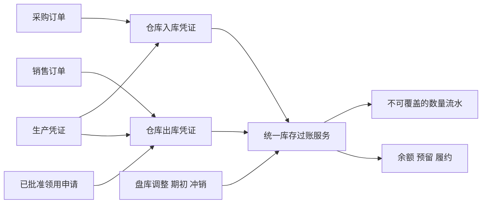

# 集团 ERP 采购销售领用与仓库管理架构方案

更新：2026 年 10 月 19 日。A1、A2.1及A2.2已发布；A2.3领用和A2.4治理/私有附件已本地实现并完成专项验收，尚未发布。当前继续B数量账及采购销售仓库闭环，底层实现不代表业务入口已完成。已收敛部分均在本轮实施范围，未收敛的金额/成本/完整生产等留待后续沟通。当前进度见[实施进度](已收敛方案实施进度.md)。实施工程：现有 `group-erp`，NocoBase 3 源码应用。

2026-10-17 归属修订：用户明确物料中心须与仓库管理平级。平级菜单、职能工作台独立入口及完整分类移除已随 `materials-tags-20261018-043000` 发布到搭建环境，见 [分类移除发布记录](物料中心分类移除发布记录.md)；后续采购版本见 [当前发布记录](采购A2.2发布记录.md)。除分类页面外，原有路径、路由名和页面授权 ID 保留兼容。增量迁移将旧分类归属转为标签并删除旧表/字段；用户确认仍在搭建阶段、没有实际生产数据，本批不做数据备份，保留原组织配置、账号和存储。

阅读顺序：本文说明整体业务和架构 → [A1 实施与现状](仓库物料中心首期实施方案.md) → [A1 发布证据](仓库物料中心发布记录.md) → [交接文档第 8 节的下一步计划](../../ERP项目交接文档.md#8-下一步计划与接手顺序)。原始文本保留为设计输入；条码、模块归属等有后续澄清的地方，以本文整理的沟通结果为准。

在现有“职能平台”内并列建设物料中心、采购管理、销售管理、领用管理和仓库管理，生产管理按业务进度扩展。物料中心负责共享主数据及治理；仓库管理负责入库、出库、盘库和仓库基础资料。各模块的基础资料在所属模块维护，通过稳定 ID 共同引用。

采购、销售、领用和生产管理业务依据，仓库根据业务依据办理实际收发；采购入库和销售出库分别是入库、出库的一种来源。采购申请允许先描述需求，正式库存作业必须落实到已确认的具体物料。所有库存变化通过统一过账服务形成流水。

当前采用人工选料和数量录入。内部标签打印与扫码作为后续可选入口，适合贴标的物品可以启用，砂石等散装物料按实际计量方式办理。首先建设物料中心，再接入采购、领用需求和各类实际收发。

## 当前交付与设计范围

| 范围                       | 当前状态                                        | 本文的使用方式                                               |
| -------------------------- | ----------------------------------------------- | ------------------------------------------------------------ |
| 组织、人事、人力资源       | 已有上线能力                                    | 直接引用组织与人员身份、权限和业务日期，不另建字典           |
| A1 物料中心与仓库基础      | 已发布，当前采购版本保留既有能力                | 实际字段、状态、路由和限制以 A1 说明及代码为准               |
| A2 采购及领用需求          | A2.1、A2.2已发布；A2.3/A2.4本地专项通过，待发布 | 已实现的领用/来源/附件继续复用，发布事实仍以发布记录为准     |
| B 数量账及采购销售仓库闭环 | 底层数量引擎实施中，业务闭环未完成              | 本文的库存维度、过账和履约规则是本轮实施约束，不是已交付功能 |
| C 业务深化、D 线下扫码     | 后续扩展                                        | 对应阶段再确认业务参数、设备和详细规则                       |

后文采购订单、销售、预留、退货、调拨、盘库、成本和标签实例均描述后续目标。金额精度、审批参数、批次和跨主体规则等细节须在对应阶段定稿；不能据此认为已具备运行接口或数据表。

## 现有架构与接入边界

| 已有能力                     | 当前依据                                                                                                          | 本方案的接入方式                                                               |
| ---------------------------- | ----------------------------------------------------------------------------------------------------------------- | ------------------------------------------------------------------------------ |
| 四个一级业务域               | [总体规划](../../ERP总体规划与组织架构设计.md)                                                                    | 保持组织架构、人力资源、职能平台、公司发展；采购销售仓库进入职能平台           |
| 组织主体、单元、岗位         | [组织模型](../server/providers/organization-model.ts)                                                             | 直接引用组织 ID；业务模块不复制公司、部门、岗位档案                            |
| 员工、用工、任职             | [人事模块规则](../.agents/rules/people.md)                                                                        | 用于申请人、领用人、审批岗位对应的实际人员；保留业务发生时快照                 |
| 登录、权限、文件、消息、调度 | [服务端插件注册](../server/plugins.ts)                                                                            | 复用已注册官方能力；新业务声明自己的资源、动作和数据范围                       |
| 固定阶段单据生命周期         | [现有人事服务](../server/providers/people.ts)                                                                     | 继续使用 `@nocobase/lifecycle`；复用现有生命周期日志表                         |
| 公司范围权限模式             | [现有权限资源](../server/providers/people-resources.ts)                                                           | 复用实现模式，新增采购销售仓库的范围声明；现有 `people.*` 范围只覆盖人事相关表 |
| 业务日期                     | [业务日期函数](../server/providers/business-date.ts)                                                              | 复用 `businessDate()`，保持与现有集团业务时区一致                              |
| 前端导航与首页               | [路由](../client/routes.ts)、[人事路由](../client/pages/people/routes.ts)、[首页](../client/pages/home/index.tsx) | 在同一个职能平台导航根下组合模块；增加职能工作台                               |
| PostgreSQL 独立部署          | [项目交接](../../ERP项目交接文档.md)                                                                              | 在现有应用和主数据库中增量建设；旧 NocoBase 和 PLC 采集系统保持独立            |

当前应用已有组织、人事、人力资源，以及 A1 的物料中心、独立治理申请和仓库基础档案。职能平台首页已进入 `/functions` 工作台，本地按权限分别组合人事、物料中心与仓库入口；尚未实现供应商、客户、采购申请、领用业务申请、订单、数量账及项目档案。后续沿用同一工作台，不再建立第二个职能平台导航根。

企业业务服务继续放在本应用的 `client/`、`server/` 和 `database/main/`。本方案采用应用内模块，不新增独立发布的业务插件包。

## 模块归属与工作入口

| 职能平台下的模块 | 主要业务入口                                     | 本模块基础资料                                                 |
| ---------------- | ------------------------------------------------ | -------------------------------------------------------------- |
| 职能工作台       | 已授权模块入口、后续我的待办及办理进度           | 仅组合各模块，不集中维护业务基础资料                           |
| 采购管理         | 采购申请、采购订单、到货进度、采购退货申请       | 供应商、供货关系、采购业务规则                                 |
| 销售管理         | 销售订单、备货、发货进度、销售退货申请           | 客户、客户货号、销售业务规则                                   |
| 领用管理         | 领用申请、审批、发放进度、退回申请，后续借用归还 | 领用用途、领用规则、后续借用规则                               |
| 物料中心         | 物料目录、主档维护、治理任务及记录               | 统一名称、规格、单位、包装、别名、属性模板、标签和公司物料设置 |
| 仓库管理         | 入库、出库、盘库                                 | 仓库及后续库位                                                 |
| 生产管理后续建设 | 生产任务、用料需求、完工申报                     | 产线、班组、工艺或配方等生产专用资料                           |
| 人事管理         | 保持现有页面                                     | 保持现有人员和任职资料维护边界                                 |

物料中心内部提供物料检索、统一名称、规格 SKU、别名、单位、属性模板、标签、治理任务和变更记录。它与仓库管理平级，服务全 ERP；物料维护和审核仍是独立职责，不自动授予所有仓库人员。

本地物料归类统一使用标签，名称不再关联单一分类。标签可多选，可贴在统一名称或 SKU 上，名称标签在 SKU 目录详情中继承展示；目录和维护列表按有效直接/继承标签筛选。属性模板直接绑定统一名称，规格属性、单位、库存方式及未来财务规则仍使用明确字段。旧分类及祖先归属随增量迁移转为名称标签；分类菜单、接口、字段、校验和权限依赖一起移除。标签分组、层级、互斥和多标签组合筛选尚未实现，本轮不新增这些配置页面。

库存查询和库存流水在 B 阶段加入；A1 已有仓库基础设置入口。调拨任务关联出入库，盘盈盘亏关联盘库审核。不同业务类型不能随意手填或绕过其来源规则。

采购页面显示收货进度并链接仓库入库单，销售页面显示发货进度并链接仓库出库单，领用页面显示实际发放和退回进度并链接仓库凭证。同一份实际收发只记录一次，各来源模块读取这一事实计算履约进度。

### 基础资料归属

供应商在采购管理维护，客户在销售管理维护。底层可复用往来身份与公司使用关系，但不设置独立的“共享基础资料”业务模块。同一往来对象兼具供应商和客户身份时，经过明确授权关联公共身份；价格、联系方式、附件和业务设置仍按各模块权限读取。

公司、部门、岗位继续由组织架构维护，人员任职由人事管理维护。各业务页面仅提供受控关联选择，不复制这些字典。项目档案归公司发展对应的项目业务入口，采购、销售、领用和生产引用同一份项目。仓库物料首期不为了项目选项提前建设另一套项目资料。

集团管理人员和项目公司人员共同处理同一份记录，通过数据范围和操作职责区分工作视图。集团汇总采用授权范围内查询，不再复制一套总部库存。

## 组织主体与项目如何贯穿业务

业务记录分别保存以下归属，禁止用一个“公司名称”文本字段混合表达。

| 字段或维度                   | 含义                                         | 规则                                               |
| ---------------------------- | -------------------------------------------- | -------------------------------------------------- |
| `subjectId`                  | 实际承担该业务的组织主体                     | 正式业务单据必填；创建时校验启用状态及操作权限     |
| `requestingUnitId`           | 提出需求或领用的组织单元                     | 引用现有组织单元，校验与相关业务主体的关系         |
| `projectId`                  | 需求、领用或销售归集的项目                   | 可空；需要时引用统一项目档案                       |
| `warehouseId`                | 实际收发仓库                                 | 首期仓库所属主体与库存所属主体一致                 |
| `requesterId`、`recipientId` | 申请人、领用人                               | 引用人事档案；经办账号另行记录                     |
| `responsiblePositionId`      | 负责岗位                                     | 引用组织岗位，实际办理时解析有效任职               |
| 名称与归属快照               | 业务发生时的公司、部门、人员、项目、物料描述 | 提交、批准或过账时按需要冻结，更名或调岗不改写历史 |

项目档案的 `subjectId` 表示资料管理主体，`operatingSubjectId` 表示运营主体并允许为空。尚未成立项目公司的项目，可以由总部管理资料和办理需求。项目单据的业务主体必须明确，跨主体使用项目需要对应授权和业务关系，不能只凭项目名称放行。

首期集团统一采购可以把多个公司的需求合并安排，但正式采购订单按实际采购主体拆分。A 公司库存转给 B 公司属于跨主体业务，后续按内部购销或经确认的权属转移规则办理。首期普通调拨仅限同一主体。

已过账单据的主体和仓库归属保持固定。员工调动也不改变其历史申请和领用记录的所属公司。

## 物料主数据设计

### 物料层次与拆码规则

| 层次         | 示例                         | 承载内容                                                     |
| ------------ | ---------------------------- | ------------------------------------------------------------ |
| 统一名称     | 中性笔                       | 标准叫法、用途说明、继承标签和规格要求                       |
| 具体物料 SKU | 某型号、黑色、0.5 毫米中性笔 | 稳定物料编号、身份属性、库存基准单位、允许业务单位和启用状态 |
| 批次或单件   | 某批货、某台设备             | 后续按需启用效期、批次、序列号和质量追溯                     |

A1 中“物料申请”专指建码或映射治理需求，不是采购申请或领用申请，也不记录库存数量。A2 将另建业务申请及明细，再关联同一治理能力。

正式库存核算落实到 SKU。简单物料可以只有一个默认规格，用户在选料时直接选中，无需重复确认层次。采购申请尚未明确型号时，可以只关联统一名称并保留需求描述。

是否拆成不同 SKU，由验收、存储区分、销售承诺、追溯和使用要求决定。不同颜色、材质或技术等级需要区分时建不同 SKU；供应商或采购价格不同通常不单独建码。可替代物料保留各自身份，以替代关系和明确确认办理，避免把可替代性误当成同一种库存。

编码采用稳定编号，标签和名称单独维护。编码不随更名、调整标签或更换供应商而改变。有库存或历史交易后，身份属性和基准单位进入受控变更；身份发生实质变化时新增 SKU，并保留新旧关系。

物料管理方式首期区分库存类和非库存类，由治理人员确认。申请人可以提出建议，不能自行切换管理方式以绕过库存校验；已有交易后的切换需处理存量和未完单据。设备资产和可归还工具在后续增加专门管理属性与台账。

### 属性模板与查重

每类物料定义自己的规格属性、数据类型、单位、必填项及是否参与身份判定。例如中性笔维护颜色、笔尖粗细和型号；电缆维护型号、芯数、截面积和电压等级；砂石维护料种、粒径或级配等级等实际验收要求。

标准化数值、单位和枚举后生成 `identityKey`；显示名称单独维护，A1 不承诺自动生成所有规格名称。同一统一名称下对身份键建立唯一约束，最终启用时再次检查。相似名称搜索提供候选，禁止仅凭模糊相似度自动合并。

属性模板和值可以使用经过结构校验的 JSON；库存数量、单据明细、归属、状态、关联和金额采用明确字段。常用筛选属性根据实际查询增加索引。模板的身份字段调整须先评估已有 SKU 冲突，不能直接把历史档案全部重新解释。

### 别名与外部名称

别名保留来源、适用范围、目标及审核状态。A1 支持通用别名、旧码及公司适用范围，确认人和时间由生命周期历史追溯；供应商/客户货号和有效期字段在相应阶段扩展。目标可以是统一名称，也可以是具体 SKU，但两者在查询结果中明确区分。

通用叫法“签字笔”可以指向统一名称或多个候选；供应商货号应在指定供应商范围内识别；客户货号在指定客户范围内识别。只有经确认、有效且在当前范围唯一命中具体 SKU 时，才允许自动选择。采购申请保留用户原始输入，便于治理和追溯。

别名、供应商供货关系和价格分别维护。集团共享物料描述，不代表所有人可以看到其他公司的采购价、客户价或合同附件。

### 单位与包装

每个 SKU 只有一个库存基准单位，所有库存数量按该单位核算。首期提供受控的固定换算。例如采购 10 盒、每盒 12 支，实际入库 120 支；领用 15 支后结余 105 支。

单位字典维护名称、单位类别和数量精度。SKU 的业务单位规则维护具体包装、换算分子分母、适用来源及版本。两种不同包装的“箱”必须以不同包装规则区分，单据明确选择，不能建立全局“1 箱等于若干个”的规则。

每张明细保存业务数量、业务单位、包装规则及版本、换算快照和基准数量。价格同时保存计价单位；按盒报价的单价不能直接套到按支数量。更改换算规则只影响之后选择新规则的业务。

砂石等散装物料按实际吨、千克、立方米等计量。重量和体积之间缺少确定关系时不自动折算；后续需要时记录实测双数量、称重凭证和差异。含水率等随批次变化的信息放在验收或批次记录中。

### 标签与业务字段

统一名称标签可以继承到 SKU，SKU 可以增加自己的标签。标签字典定义适用层次和允许覆盖的规则。用于检索的标签与影响业务控制的字段分别管理。

| 信息                           | 归属                     |
| ------------------------------ | ------------------------ |
| 办公用品、劳保用品等检索标记   | 主数据标签               |
| 型号、材质、颜色、技术等级     | 规格属性                 |
| 本公司的采购销售开关、成本分类 | 公司物料设置中的受控字段 |
| 本次使用项目、部门、用途       | 业务单据明细             |
| 生产批次、效期、实测含水率     | 验收或后续批次记录       |
| 仓库、库位、质量状态           | 库存记录                 |

## 治理任务与采购申请协同

本节为 A2 联动目标；A1 当前只提供独立治理申请及任务内建 SKU、关联办结。

申请人先检索名称、别名、规格和已有物料。命中具体 SKU 时带出标准资料；未命中时填写原始名称、规格要求、需求单位、数量、用途和附件。

提交后，未解决的申请明细关联治理任务。任务可合并处理同一需求，但保持各原始申请的关联和公司数据边界。治理人员只获得处理所需的需求信息，不随任务获得整张采购申请的价格、预算或其他公司明细。

| 治理动作       | 处理结果                                   |
| -------------- | ------------------------------------------ |
| 关联已有 SKU   | 原申请获得标准物料，保留原始描述           |
| 补充别名       | 经审核建立映射，回写本次申请               |
| 新增规格       | 在已有统一名称下建新 SKU，经确认启用       |
| 新增统一名称   | 建立名称、模板或必要属性后创建 SKU         |
| 退回补充       | 明确缺少的规格、单位或用途，不创建虚假物料 |
| 判为非库存采购 | 转入非库存采购处理，不进入库存数量账       |

申请状态与物料识别状态分别保存。需求审批可以与物料治理并行；正式库存类采购订单发布前，所有有效明细必须已解决并指向启用的 SKU。用户无需在治理完成后重新填写采购申请。

A1 治理申请采用草稿、待审核、已办结和已撤回；退回是回到草稿的动作。SKU、包装和映射另有草稿、待审核、已启用、已停用状态。采购和仓库人员可以提出修改建议，正式建码、映射、启停和换算维护由独立权限控制。普通别名走简化审核；涉及规格、单位或核算影响的变更增加相应岗位确认。

已引用档案通过停用保留历史。停用后禁止新选择；已有未完单据逐项关闭、替换或经授权继续处理。重复物料纠正采用主档关联与后续业务迁移，历史单据和库存不得直接改成另一个 SKU。

## 采购销售领用与仓库的业务闭环

### 入出库来源

| 入库类型     | 对应依据                     | 出库类型     | 对应依据                           |
| ------------ | ---------------------------- | ------------ | ---------------------------------- |
| 采购入库     | 采购订单及实际验收           | 销售出库     | 销售订单及实际交付                 |
| 生产完工入库 | 生产完工申报或受控生产凭证   | 生产领料出库 | 生产任务用料需求或受控生产领料凭证 |
| 销售退货入库 | 原销售出库和退货申请         | 采购退货出库 | 原采购入库和退货申请               |
| 领用退回入库 | 原领用出库和退回申请         | 领用出库     | 已批准的领用申请                   |
| 调拨入库     | 同一调拨任务的调出及在途记录 | 调拨出库     | 已批准的同主体调拨任务             |

期初、盘盈盘亏及报损采用各自受控业务动作。其中盘盈盘亏由盘库审核形成数量调整。每种来源由服务端声明所需依据、关系、权限和数量约束；用户不能任意增加类型代码或填写一个外部单号就改变库存。

生产模块未上线时，B 阶段可提供有独立权限、必需生产凭证和审核记录的生产入库、生产领料办理方式。生产模块上线后关联真实任务和完工记录，沿用同一仓库过账服务。生产收发的数量记录不代表已经实现配方、生产成本或投入产出核算。

### 采购和收货

采购申请审批与物料治理完成后，由采购人员形成采购订单。每个订单明确采购主体、供应商、交货仓库、币种和明细。申请可以拆单，多条申请也可以合并采购，使用明细分配关系记录来源数量。

订单提交必须声明需求来源（`demandMode`）：`request` 表示来自采购申请，每一行都要分配已批准申请明细且分配数量等于行数量；`temporary` 表示临时采购，必须写明不少于 5 个字的原因，且不得同时保留分配。未声明来源的订单不能提交。历史订单由迁移统一补记为 `temporary` 并注明原因待修订时补齐。

仓库根据采购订单登记实际到货和验收结果，创建独立入库单。支持分批收货、拒收和未到货数量；首期超订单数量入库默认拒绝，确有需要时先办理订单变更。只有实际入库过账才增加库存，到货登记和采购批准均不增加库存。入库单详情列出需求来源（申请号、物料、本次到货与分配数量）；采购申请的“执行进度”按分配比例折算已下单与已入库数量。

普通验收合格的物料直接计入合格库存；需要继续验收的货物可入待检库存，之后通过受控状态转移放行或冻结。采购页面读取相同入库事实展示履约进度。

采购退货关联原入库明细，校验可退数量和现有可发库存，过账形成负向流水。累计实收、退货和是否补货分别显示，避免退货自动导致采购订单错误关闭。

已批准的采购或销售订单修改物料、数量、单位、价格或交付条件时，办理有版本和原因的变更并重新审核。新数量不得小于已履约数量；已收发明细的实际 SKU、单位及金额快照保留，换料通过新增或替换未履约明细处理。

### 销售和发货

销售订单明确销售主体、客户、实际 SKU、数量、单位、价格和交付要求。客户自己的名称或货号通过已确认映射识别。批准订单记录销售承诺，库存不足时可以等待采购或补货。

备货时显式预留现有合格库存，支持部分预留。销售预留和项目领用共同使用同一套可用量控制。仓库实际发货时，原子扣减在库数量并消耗本订单的预留。销售审批、预留和实际发货分别记录。

销售退货关联原发货明细，累计退回不得超过可退数量。退回物料默认进入待检状态，经确认后转为可用或冻结库存，不直接当成可再次销售的合格品。

### 领用和退回

领用管理与采购、销售平行，负责部门或项目的领用需求、用途、领用人、审批和履约进度。仓库管理负责实际领用出库、退回验收和入库。领用用途及适用规则由领用模块维护。

部门或项目提交领用申请，明确用途、领用人和数量。仓库按批准数量实际发放；允许分次发放并显示剩余数量。需要时预留，实际发放形成出库流水。领用模块从关联仓库凭证计算实际发放、退回和净发出数量，不另填一份发放事实。

领用退回关联原出库明细，累计数量受原发放数量限制，并记录物品状态。低值消耗品以发出和退回数量归集项目用途。可归还工具、设备借用和资产台账后续单独扩展，避免把领用一律解释成最终消耗。

### 调拨和盘点

同一主体内调拨记录调出、在途、调入。调出过账时减少来源仓库存量并增加在途数量，调入过账时减少在途数量并增加目标仓库存量。允许分批接收；运输差异需要独立原因和授权处理。

盘点保存账面基线、基线时间、实盘数量、差异原因和审批记录。首期在明确仓库或库位范围内短时冻结相关收发及预留变更，完成盘点调整后解除。未实施冻结或期间流水核对的情况下，禁止拿旧账面数直接覆盖当前库存。

上线期初通过专用期初单导入并过账，一份有效期初记录只执行一次。日常差异通过盘点、报损或受控调整单处理。调整权限独立，必须保留原因和依据。

非库存采购保存采购与验收依据，后续对接费用或资产流程，不产生库存数量。生产领料关联生产用途及任务，一般领用关联部门、项目和实际使用人；两者分开管理业务依据，共用仓库收发服务。生产任务、配方和投入产出分析由后续生产模块负责。

## 统一库存服务与数量账

本节均为 B 阶段目标，当前没有库存数量账或过账接口。业务依据和仓库凭证的关系如下：

物料统一身份由 A1 提供。销售退货、领用退回等按各自来源关联入库；采购退货按原入库关联出库。图中的批准或提交均不能直接增减库存。

### 库存维度

首期库存按“所属主体、仓库或在途位置、SKU、质量状态”管理；库位、批次、序列号按阶段扩展。质量状态至少区分合格、待检和冻结。在途位置关联具体调拨单，不计入可发库存。

同一库存维度只允许一条余额记录。可空维度必须标准化为确定的维度键并建立唯一约束，避免数据库空值唯一性和并发初始化造成重复余额。

预留单独记录，支持来源单据、原预留量、已消耗量、已释放量和剩余量。数量口径为：

- 仓库在库数量：合格、待检和冻结数量之和。
- 可用数量：合格在库数量减去有效未消耗预留数量。
- 公司持有数量：所属仓库在库数量与本公司在途数量之和。
- 单 SKU 期末数量：期初数量加全部有效入账增量；每项增量均有来源凭证。

公司内调拨和质量状态转移在公司合计层面净变化为零。同一 SKU 的数量账按自己的基准单位核对；不同 SKU 或不同物理量不能直接相加。生产投入和产出不同 SKU 的物料平衡，需要后续生产配方、实测数量和损耗规则。

### 过账服务职责

采购、销售、领用、调拨和盘点调用 `InventoryService`，业务页面或其他服务不直接修改库存余额。

| 受控业务动作                       | 数量影响                                 |
| ---------------------------------- | ---------------------------------------- |
| 采购入库、销售退货、领用退回、期初 | 增加指定位置和状态库存                   |
| 销售发货、采购退货、领用、报损     | 减少指定位置和状态库存                   |
| 调出、调入、质量状态转移           | 同一业务事件生成成对库存分录             |
| 预留、消耗预留、释放预留           | 改变可用量和履约关联，与实际出库保持一致 |
| 盘点调整                           | 根据审核差异生成增减流水                 |
| 冲销                               | 生成关联原过账事件的反向流水，原流水保留 |

一次过账在同一数据库事务中完成：检查权限和单据状态、锁定来源履约明细及相关库存维度、检查数量与单位、写库存流水、更新余额和预留、更新履约数量与生命周期、写业务审计。任一步失败全部回滚。

库存流水只追加。余额是可核对和重建的查询结果，流水是数量变化依据。已过账单据通过关联冲销或更正单处理；冲销入库也要通过库存和预留检查，避免下游已使用的物料被直接冲掉。

### 并发与幂等

采用数据库事务及按库存维度的行锁或条件更新，不使用进程内互斥锁保护正式库存。锁顺序固定；多 SKU、多仓库按确定顺序取得锁。首次创建余额同样受唯一维度键保护。默认禁止负库存，发货检查同时保护其他单据的预留。

同时采用请求幂等键和业务过账唯一约束。即使重复请求使用了不同请求键，同一收发单的同一个过账动作也只能产生一组库存分录。来源订单明细的累计收发数量在事务内保护，防止两个不同收货单同时超收。

草稿修改推进版本，提交和审核携带预期版本。主数据、单据和审批使用版本校验；它们分别解决旧内容覆盖和业务状态冲突，不能代替数量锁。

组织新增引用或改变主体、部门、岗位归属时，沿用现有 `orgMutationLock` 协调校验，并扩展组织停用依赖检查，覆盖启用仓库、未完业务、项目归属和非零库存等实际依赖。库存数量仍采用自己的维度锁。普通收发在已有受保护引用下办理，避免把组织互斥行作为全集团库存数量锁。

主数据启停、仓库启停与单据选择也需要按一致顺序保护相关记录并复核状态，防止校验之后引用被并发停用。数据库锁、事务隔离和重复请求必须在真实 PostgreSQL 上验收。

### 精度与金额

数量、换算和金额使用十进制精度策略，接口以十进制字符串传递，不能用 JavaScript 浮点数直接计算库存或结算金额。建议初始数量精度为 6 位小数、单价精度为 8 位；单位可进一步限制为整数或更少小数，输入超精度时明确处理。

每张订单采用一个币种。金额舍入时点、税额口径和允许差异在金额功能实施前明确。首期进销存记录订单和收发业务金额，不把采购单价或最近一次进价当成完整库存成本，也不据此声称实现准确毛利。

库存计价、应收应付、付款收款、发票和总账对接在业务深化阶段设计，保留来源单据、过账事件和金额快照的关联。

## 数据模型与工程组织

下表同时列出已上线基础和未来集合分组。物料身份、属性、单位包装、别名/公司设置、标签、治理及 `warehouses` 已在 A1 创建；采购、销售、领用业务、项目、收发凭证及数量账尚未创建。未来集合名为设计名，最终按各阶段新增迁移定稿。已有组织、人事和生命周期日志表继续复用。

| 分组               | 主要逻辑集合                                                                                              | 关键内容                                                          |
| ------------------ | --------------------------------------------------------------------------------------------------------- | ----------------------------------------------------------------- |
| 物料身份           | `materialNames`、`materialSkus`                                                                           | 统一名称、SKU 身份键及稳定编码                                    |
| 物料属性           | `materialAttributeTemplates`                                                                              | 属性结构、版本、校验、身份字段                                    |
| 单位与包装         | `measureUnits`、`materialUnitRules`                                                                       | 单位类别与精度、SKU 业务单位规则、包装和换算版本                  |
| 别名与公司设置     | `materialReferences`、`materialSubjectSettings`                                                           | 名称与货号映射、适用范围、本公司采购销售和管理设置                |
| 标签               | `materialTags`、`materialTagLinks`                                                                        | 标签字典、适用层次、继承及覆盖                                    |
| 治理               | `materialRequests`、`materialRequestLinks`、`materialAudit`                                               | 治理任务、任务与 SKU 的建议/办结关联和审计；来源业务明细关联待 A2 |
| 采购及销售基础资料 | `businessPartners`、`partnerSubjectSettings`                                                              | 供应商及客户的公共身份与各公司设置，分别由采购、销售入口维护      |
| 公司发展项目资料   | `erpProjects`                                                                                             | 公司发展项目入口维护唯一档案，其他模块引用；物料首期不创建        |
| 采购               | `purchaseRequests`、`purchaseRequestLines`、`purchaseOrders`、`purchaseOrderLines`、`purchaseAllocations` | 需求、订单、逐行分配和累计履约                                    |
| 销售               | `salesOrders`、`salesOrderLines`                                                                          | 客户需求、备货和实际交付关联                                      |
| 领用               | `materialIssuePurposes`、`materialIssueRules`、`materialIssueRequests`、`materialIssueRequestLines`       | 领用专用基础资料、需求、审批及仓库发放退回关联                    |
| 仓库与收发凭证     | `warehouses`、`stockDocuments`、`stockDocumentLines`                                                      | 仓库档案，入出库、退货、期初、状态转移及调整凭证                  |
| 调拨与盘点         | `stockTransfers`、`stockTransferLines`、`stockCounts`、`stockCountLines`                                  | 分批在途、盘点范围、基线、实盘与差异                              |
| 数量账             | `stockPostings`、`stockMovements`、`stockBalances`、`stockReservations`                                   | 过账事件、不可覆盖流水、维度余额、预留                            |
| 业务审计           | `supplyChainAudit`                                                                                        | 主体、动作、经办人、原因、版本和前后快照                          |

`stockDocuments` 仅统一仓库收发凭证的公共结构，各业务类型仍采用独立输入校验、来源约束、动作和权限。采购合同、销售订单、治理任务及财务凭证分别建模，避免将整个 ERP 塞入一个万能 JSON 单据表。

共享物料目录不以 `subjectId` 为空推导全部授权，而是定义独立目录读取和治理权限。往来资料也不默认全集团公开；公司通过已授权的使用关系选择交易对象，本公司的价格、联系方式和附件按用途控制。

### 已有服务与后续服务

| 应用服务                           | 职责                                                                      |
| ---------------------------------- | ------------------------------------------------------------------------- |
| `MaterialService`                  | A1 已有：检索、身份、治理、别名、模板、单位、标签、公司设置和仓库基础档案 |
| `PartnerService`、`ProjectService` | 内部共享身份与引用校验；供应商由采购、客户由销售、项目由公司发展维护      |
| `ProcurementService`               | 需求、采购订单、来源分配、采购履约                                        |
| `SalesService`                     | 销售订单、备货与销售履约                                                  |
| `RequisitionService`               | 领用规则、申请、审批、发放和退回进度；实际收发调用仓库服务                |
| `InventoryService`                 | 收发过账、余额、预留、冲销和一致性校验                                    |
| `WarehouseService`                 | 各来源收发凭证、仓库实际领用出库和退回入库、调拨、盘库及期初              |

A1 已有 `MaterialService`；其余表列服务为后续目标，`WarehouseService` 不代表当前已有出入库服务。

审批用官方生命周期，文件用官方文件仓储，消息用官方通知和任务能力。库存过账及其关键状态更新同步在事务中完成；通知等提交后工作通过现有任务能力处理，并保留可重试记录，避免进程中断造成永久丢失。库存正确性不依赖通知是否发送成功。

### 源码落点

| 位置                                                                              | 状态与用途                                                                                  |
| --------------------------------------------------------------------------------- | ------------------------------------------------------------------------------------------- |
| `client/pages/materials/`                                                         | A1 已有：物料中心、治理、仓库设置和职能工作台；本地菜单平级调整，不必为菜单归属移动现有代码 |
| `client/routes.ts`、`client/pages/home/index.tsx`                                 | 已组合单一职能平台入口，保留原有人员页面 ID                                                 |
| `server/providers/material*.ts`、`server/routes/materials.ts`                     | A1 已有模型、资源、生命周期、服务与认证授权接口                                             |
| `server/providers/record-lifecycle.ts`                                            | 已有共享生命周期 token；其他业务复用同一个运行时                                            |
| `database/main/migrations/202610170001_materials.ts`、对应 material defaults seed | 已执行历史，保持不变；新功能使用新增迁移和增量权限配置                                      |
| `client/pages/procurement/`、`client/pages/requisitions/`                         | A2 拟新增：采购和领用页面及各自基础资料                                                     |
| 后续 sales、warehouse 收发盘页面和 inventory 服务                                 | B 按目标闭环设计，不提前创建空入口                                                          |
| `client/components/`、`client/hooks/`                                             | A2 成为第二个选料场景后，按实际接口与权限边界提取共享控件                                   |
| `client/locales/`、`server/locales/`、`tests/`                                    | 随修改补双语、业务/迁移/权限、组件和浏览器验收                                              |

接口按物料、采购、销售、仓库等业务资源划分，路径使用 camelCase。过账、批准、冲销采用独立动作；普通编辑不能接受任意状态或库存余额。实施前通过当前应用 OpenAPI 核对契约。新迁移自包含，不改写上线历史，也不以通用写接口或数据库浏览器绕过业务约束。

## 权限职责与审批

### 岗位权限矩阵

| 岗位或职责   | 主要操作                                         | 默认数据边界                             |
| ------------ | ------------------------------------------------ | ---------------------------------------- |
| 申请人       | 查物料、提交采购和领用需求、查看进度             | 本人记录与明确授权的部门项目             |
| 物料治理人员 | 查重、建码、映射、单位和规格审核                 | 共享目录，以及已分派或授权的脱敏需求     |
| 采购人员     | 采购订单、供应商使用、采购履约                   | 获授权公司的采购业务                     |
| 销售人员     | 销售订单、客户使用、备货和退货申请               | 获授权公司的销售业务                     |
| 领用经办人员 | 管理用途和规则、审核或办理授权需求、跟踪发放退回 | 获授权公司的领用业务；出库过账另行授权   |
| 仓库人员     | 各来源收发、验收、调拨、盘库                     | 获授权主体和仓库，采购价与销售价另行授权 |
| 审核人员     | 审批职责内的已提交单据                           | 对应公司、业务及金额等受控范围           |
| 财务人员     | 授权金额读取、核对收发依据、后续财务接口         | 获授权主体；与仓库收发权限分开           |
| 集团监督人员 | 跨公司汇总和追溯                                 | 显式配置的公司范围，读取不自动授予修改   |
| 权限管理员   | 分配权限集和数据范围                             | 使用已有官方权限管理能力                 |

权限分别控制页面、业务动作和记录范围，金额敏感字段在声明及返回数据中隔离。公司范围之外还支持本人的需求和指定仓库范围；仓库范围必须落在已授权主体之内。

新增本域公司范围策略，账号当前有效用工可作为“本公司”身份依据，但仍须授予具体业务动作。既有 `people.companies`、`people.ownCompany` 的集合范围和含义保持原样；可以提取共同身份解析函数，不能直接把人事范围名称当作新业务授权。

所有列表、统计、搜索提示、导出、附件和关联选项执行同一数据边界。新建及跨公司修改在事务提交前检查最终记录范围。读取最小人员姓名和任职选项使用专门受控选择入口，不能为了领用选人而授予完整人事档案读取权。

### 审批规则

首期采用固定阶段、状态、操作按钮和办理历史，沿用现有界面习惯。采购需求、采购订单、销售订单、盘点调整等分别定义生命周期；普通主数据维护与高影响变更使用不同审核要求。

审批状态与业务履约进度分别管理。例如采购订单的草稿、待审批、已批准、关闭、取消属于生命周期；未收货、部分收货、全部收货由明细实际收货量派生。

首次提交冻结单据内容、审核岗位或人员、规则依据及版本。驳回后修改重新提交，形成新的内容版本和提交历史；同一轮审批保持已冻结的规则快照。需要采用新审核规则时显式办理关联修订，旧内容、旧规则与审核结果均保留。审批动作仍检查当前账号权限及办理资格。审核岗位空缺或申请人兼任导致无法满足审核要求时，明确提示管理员安排授权替代人。

首期默认禁止同一人完成自己的申请审核。代理办理需明确授权并记录实际经办人。具体审核人、阈值和岗位由业务配置确定，本方案不虚构正式人员名单或金额门槛。

管理员可调参数的实施优先核对已安装 `@nocobase/lifecycle` 的公开能力及版本；具备官方参数存储时直接复用。功能不满足时先明确差距和最小配置范围，不预先开发通用流程编辑平台。

## 后续内部贴标与扫码扩展

用户已明确：标签由企业根据已确认采购清单中的物料名称、规格和 SKU 自行打印，贴在适合贴标的物品上，再扫码收发。当前不用扫码设备或标签打印。

当前预留稳定 SKU、包装单位规则、来源单据明细和统一库存服务。条码表、标签打印页面、设备接入及具体条码格式在扫码阶段创建，不作为当前采购或入库的必填项。

后续标签区分两种用途：物料识别标签识别 SKU 和包装规格；唯一包装或单件标签识别这一箱、这一件。前者可以重复扫描累计数量，后者需要检查标签当前状态，防止同一个实物重复收货。

标签显示名称、规格、单位和必要数量，编码关联稳定 ID。扫码解析为物料、包装或实物标签，再结合当前单据确认数量、仓库和动作，调用与人工录入相同的库存服务。扫码识别本身不直接改变库存。

砂石、散装原料等继续人工录入或后续对接称重。以后需要外部供应商条码时，再增加经确认的映射或标准解析；当前无需建设复杂供应商解码平台。

模板打印包目前只是本项目依赖中的指导能力，未注册条码打印运行服务。后续按标签打印这一具体需求核查现有能力和库，遵循 [工程复用规则](../.agents/rules/engineering-memory.md)；不能把安装了模板打印相关包等同于已具备条码打印功能。

## 分阶段交付与默认选择

| 阶段              | 交付范围                                                                                                 | 完成标志                                                       |
| ----------------- | -------------------------------------------------------------------------------------------------------- | -------------------------------------------------------------- |
| A1 仓库物料中心   | 职能工作入口、仓库基础设置、统一名称、SKU、属性模板、单位包装、别名、标签、独立治理任务和权限            | 可以查询、提报、审核启用物料，数据持久化，菜单与授权归属正确   |
| A2 采购及领用需求 | 采购模块供应商资料及采购申请；领用模块用途规则及领用申请；对接物料治理结果                               | 采购与领用各自管理需求，未知物料治理后回写原申请               |
| B 进销存闭环      | 销售模块客户资料；采购及销售订单；统一库存服务和多来源收发；预留；退货；调拨；盘库、期初、冲销与数量核对 | 采购、生产、销售和领用等不同来源按各自依据记账，余额与流水一致 |
| C 业务深化        | 生产任务与投入产出、库存成本、财务接口、批次效期、序列号、库位、双计量和跨主体交易                       | 每个能力先确认真实业务规则，再扩展同一物料和库存模型           |
| D 线下扫码        | 内部标签、打印、扫码收发及盘库；必要时增加设备或称重接入                                                 | 人工与扫码共用库存服务，贴标物品与散装物料同时可用             |

A1 已按 [仓库物料中心首期实施方案](仓库物料中心首期实施方案.md) 完成并发布，见 [发布记录](仓库物料中心发布记录.md)。A2 详细设计见 [采购与领用需求 A2 实施方案](采购与领用需求A2实施方案.md)，用户已允许需求审批与物料治理并行。A2.1 公共选料、公司准入和来源契约，以及 A2.2 供应商、采购申请/审核配置和引用协调已发布，见 [采购发布记录](采购A2.2发布记录.md)。下一步 A2.3 领用，再接 A2.4 正式治理来源与回写；A2 整体尚未完成。任务顺序与验收标准同时维护在 [交接文档第 8 节](../../ERP项目交接文档.md#8-下一步计划与接手顺序)。B 可按统一数量账、各来源收发和异常处理拆分工程批次；正式投入库存使用前完成期初、退回、盘库和冲销等必要纠错能力。

各阶段仅在功能实际完成时开放对应入口。A1 不以入库、出库、盘库空页面宣称已交付仓库数量账，也不提前创建客户、供应商或项目的独立共享管理中心。

| 业务决策 | 方案采用的初始选择                                                       |
| -------- | ------------------------------------------------------------------------ |
| 模块归属 | 物料中心、采购、销售、领用、仓库平行；生产后续建设                       |
| 仓库入口 | 入库、出库、盘库及仓库设置                                               |
| 基础资料 | 由所属业务模块维护，共享使用通过稳定 ID 和明确授权关联                   |
| 物料共享 | 集团共享物料身份，公司单独设置业务规则和管理库存                         |
| 新增物料 | 申请人提出需求，治理人员查重并确认正式 SKU                               |
| 单位策略 | 一个库存基准单位，首期允许受控固定换算                                   |
| 单据识别 | 申请阶段可不确定 SKU，正式库存类采购订单和收发前必须明确                 |
| 库存限制 | 默认禁止负库存和未经订单变更的超收发                                     |
| 调拨范围 | 首期同一主体内，跨主体另行设计交易和权属规则                             |
| 审批方式 | 固定业务生命周期，岗位人员和必要参数受控配置                             |
| 条码     | 后续可选，当前全部操作支持人工录入                                       |
| 正式资料 | 初始化权限模板和必要字典，真实公司、项目、物料和人员由业务录入或核准导入 |

## 验收场景

新增模块归属验收：物料中心与仓库管理在菜单及工作台平级，各按独立权限显示；供应商在采购、客户在销售、用途规则在领用；生产收发和采购销售收发共用仓库实际凭证。领用申请分次发放与退回的进度由关联出入库计算。

| 场景                         | 预期结果                                                         |
| ---------------------------- | ---------------------------------------------------------------- |
| 使用已确认别名申请采购       | 唯一命中具体 SKU 时带出；仅命中统一名称时要求补充规格            |
| 未知物品提交申请             | 原需求保存并进入治理，完成后回写原申请                           |
| 两名治理人员同时创建同规格   | 最终唯一约束只允许一个有效身份，另一方获得明确冲突               |
| 同 SKU 两种箱包装            | 必须选择具体包装规则，数量按该规则快照折算                       |
| 包装换算后续变更             | 历史采购与收发数量保持原值                                       |
| 钢材或砂石重量体积不确定     | 不使用猜测比例自动折算，保留实测计量                             |
| 订单分批入库或发货           | 逐行累计履约正确，取消剩余量保留历史                             |
| 两张入库单同时接近订单剩余量 | 事务内控制累计收货，不发生超收                                   |
| 销售和领用同时争用库存       | 预留与扣减一致，不形成负库存或侵占其他预留                       |
| 同一入库过账重复提交         | 同请求键或不同请求键均不产生重复业务分录                         |
| 过账中途失败                 | 流水、余额、预留、履约、生命周期和审计一起回滚                   |
| 销售退货尚未验收             | 进入待检库存，不增加可发数量                                     |
| 调出后尚未调入               | 来源减少、在途增加，公司持有合计保持正确                         |
| 盘点期间出现收发请求         | 在冻结范围内拒绝或等待，冻结外业务继续办理                       |
| 员工调岗或物料更名           | 历史归属和描述快照保持不变                                       |
| 停用被业务引用的公司或仓库   | 提示实际依赖，不能留下未完业务或非零库存的失效归属               |
| 用户只有仓库权限             | 可以进入职能工作台和授权仓库页面，不需要人事权限                 |
| 用户没有其他公司权限         | 列表、数量统计、选料提示、金额、附件和直接接口均不泄漏范围外数据 |
| 重启后核对库存               | 流水和余额持久化一致；按流水可重新核对维度余额                   |
| 后续增加扫码                 | 扫码解析后调用同一业务动作，人工录入继续可用                     |

A1 检查仓库物料入口、主数据、治理、权限、引用及页面行为；A2 检查采购、领用各自需求与治理回写；B 增加真实 PostgreSQL 的多来源、并发、幂等、失败回滚、精度和数量核对。迁移在隔离数据库验收，正式环境不写入测试物料和样例单据。

## 设计依据

- [原始物料主数据治理需求](../../物料主数据治理设计.txt)。条码范围以本次沟通明确的内部贴标、未来可选为准。
- [集团 ERP 总体规划与组织架构设计](../../ERP总体规划与组织架构设计.md)。一级业务域、主体与项目边界沿用现有规划。
- [项目交接文档](../../ERP项目交接文档.md)、[可复用能力目录](可复用能力目录.md)、[GitHub 复用调研记录](GitHub复用调研记录.md)。已有登录、授权、生命周期等能力按已核查版本复用。
- [应用开发规范](../AGENTS.md)、[组织模块规则](../.agents/rules/organization.md)、[人事模块规则](../.agents/rules/people.md)。业务归属、迁移和服务端权限保持一致。
- [SAP 单位与数量](https://help.sap.com/docs/SAP_ERP/a428aae377ba4a1199c3ecc8b7f5f33d/138bc95360267214e10000000a174cb4.html)。参考库存基准单位与业务单位换算机制。
- [Oracle 物料主档组织](https://docs.oracle.com/en/cloud/saas/supply-chain-and-manufacturing/25c/faicf/item-master-organizations.html)。参考共享物料身份与交易组织分离。

以上外部资料支持相应模型原则，具体模块、字段、权限、状态及阶段划分采用本方案设计。
